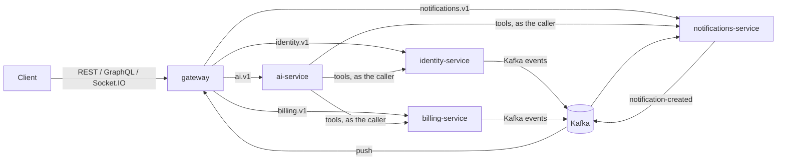
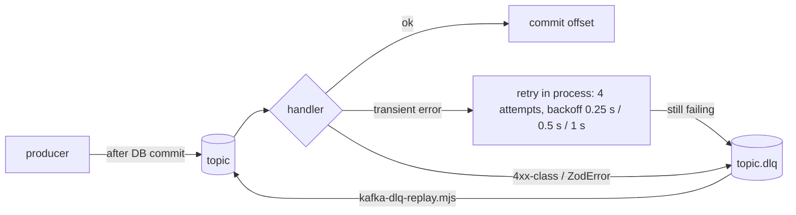

# API reference

This page lists every interface the boilerplate exposes: REST, GraphQL, Socket.IO, gRPC and Kafka. It was written from
the controllers, resolvers, gateways and `.proto` files. If this page and the code disagree, the code is right. The
generated OpenAPI document (`/openapi.json`) is the exact REST contract.

## Surfaces and ports

The public surface is the same in both topologies. The monolith and the gateway mount the same presentation classes.
In the monolith they reach the domain through the CQRS buses (`XApiModule.forLocal()`). In the gateway they reach it
through gRPC clients (`XApiModule.forRemote()`). See [ARCHITECTURE.md](ARCHITECTURE.md).

| Process                 | Listens on                                       | Serves                                                                                          |
| ----------------------- | ------------------------------------------------ | ----------------------------------------------------------------------------------------------- |
| `monolith`              | HTTP `PORT` (default `3000`)                     | REST `/v1/*`, GraphQL + graphql-ws `/graphql`, Socket.IO `/notifications`, `/docs`, `/health/*` |
| `gateway`               | HTTP `PORT` (default `3000`)                     | Same public surface as the monolith. Domain calls go to the services over gRPC                  |
| `identity-service`      | gRPC `GRPC_URL` (default `0.0.0.0:50051`) + HTTP | `identity.v1.AuthService`, `identity.v1.UsersService`. HTTP serves only `/health/*`             |
| `notifications-service` | gRPC `GRPC_URL` + HTTP                           | `notifications.v1.NotificationsService`, Kafka consumers. HTTP serves only `/health/*`          |
| `billing-service`       | gRPC `GRPC_URL` + HTTP                           | `billing.v1.BillingService`. HTTP serves only `/health/*`                                       |
| `ai-service`            | gRPC `GRPC_URL` + HTTP                           | `ai.v1.AiService` (chat, plain and server-streamed). HTTP serves only `/health/*`               |

Docker Compose host ports (all bound to `127.0.0.1`): API `3000` (`API_HOST_PORT`, used by the monolith or the gateway
depending on the profile), identity gRPC `50051`, notifications gRPC `50052`, billing gRPC `50053`, ai gRPC `50054`. Each service listens
on `50051` inside its container. In local development the gateway finds the services through `IDENTITY_GRPC_URL`
(`localhost:50051`), `NOTIFICATIONS_GRPC_URL` (`localhost:50052`), `BILLING_GRPC_URL` (`localhost:50053`) and
`AI_GRPC_URL` (`localhost:50054`). See
[DOCKER.md](DOCKER.md) and [CONFIGURATION.md](CONFIGURATION.md).

Conventions that apply to every HTTP response:

- **Versioning**: URI versioning with default version `1`, so domain routes live under `/v1/...`. `/health/*` and
  `/metrics` are version-neutral, so they have no prefix.
- **Request ids**: every response carries `x-request-id` (this hop) and `x-correlation-id` (the whole flow). A valid
  incoming `x-request-id` is adopted. Otherwise the server creates a UUIDv7. The same id appears in logs, in traces and
  in problem documents (`requestId`).
- **Rate limiting** (Redis-backed, shared by all replicas). Budgets:
  - `ip`: `THROTTLE_IP_LIMIT`/`_TTL_MS`, default 600/60 s per client IP, counted before authentication.
  - `user`: `THROTTLE_LIMIT`/`_TTL_MS`, default 300/60 s per user (per IP when anonymous), across all routes.
  - `tenant`: `THROTTLE_TENANT_LIMIT`/`_TTL_MS`, default 3000/60 s for all members of the active tenant together.
    One noisy tenant cannot starve the others.
  - Named route policies: `@RateLimit('<domain>.<name>')`, with limits from the domain's env.
  - Mark-read: `notifications.mark-read`, `NOTIFICATIONS_MARK_READ_LIMIT` per user per window, one budget for the
    Socket.IO message, REST `POST /v1/notifications/:id/read` and GraphQL `markNotificationRead`.
  - Register and login: `identity.credentials`, `IDENTITY_CREDENTIALS_LIMIT` per sha256(email)+IP, shared by REST
    and GraphQL. There is also a per-account lockout after `IDENTITY_LOCKOUT_THRESHOLD` attempts without a success,
    for `IDENTITY_LOCKOUT_MS`, answered exactly like any other 429.
  - AI chat: `ai.chat`, `AI_CHAT_LIMIT` turns per user and `AI_CHAT_TENANT_LIMIT` per tenant per window, charged by
    the send and stream routes and the `sendAiMessage` / `streamAiMessage` mutations before the model call
    ([AI.md](AI.md#limits)).
  - GraphQL: once per operation, weighted by complexity (`THROTTLE_GRAPHQL_COST_LIMIT`), HTTP 429 `RATE_LIMITED`;
    graphql-ws subscriptions run the same complexity check and cost budget.
  - WebSockets: `THROTTLE_WS_HANDSHAKE_LIMIT` handshakes per IP and `THROTTLE_WS_SOCKETS_PER_USER` concurrent sockets
    per user (Socket.IO `connect_error` 429 `RATE_LIMITED` / `TOO_MANY_CONNECTIONS`; graphql-ws 4403).

  Responses carry `RateLimit-Policy` and `RateLimit` (draft-ietf-httpapi-ratelimit-headers-11), also on 429 next to
  `Retry-After`, and they are exposed through CORS. Socket.IO messages are limited per message; errors come back as
  `{ ok: false, error }` acks or `exception` events. gRPC and Kafka are not throttled. When Redis is down, budgets
  fail open and credential endpoints answer 503.

- **Timeouts**: an HTTP or GraphQL handler that runs longer than 30 s fails with 504 `TIMEOUT`. The streaming upload
  and the AI chat routes (bounded by `AI_REQUEST_TIMEOUT_MS` instead) opt out with `@Timeout(0)`.
- **Metrics port**: `/metrics` is served on its own listener, `METRICS_PORT` (9464; host dev 9464-9467), never on the
  API port (which answers 404 for it). Keep that port cluster-internal; `METRICS_BEARER_TOKEN` adds defence in depth.
- **Maintenance**: with `MAINTENANCE_MODE=true` every request except `/health*` and `/metrics` gets 503 problem+json
  with `Retry-After`.

## API documentation pages

The monolith and the gateway serve these pages (`setupApiDocs`). They are on by default and off when
`NODE_ENV=production`, unless the variable in the table turns them on.

| Path                | What                                                                                      | Toggle                                       |
| ------------------- | ----------------------------------------------------------------------------------------- | -------------------------------------------- |
| `GET /docs`         | Scalar API reference, rendered from `/openapi.json`. It has its own route-level CSP       | `DOCS_ENABLED`                               |
| `GET /openapi.json` | OpenAPI document, built on the first request and then cached                              | `DOCS_ENABLED`                               |
| `GET /openapi.yaml` | The same document in YAML                                                                 | `DOCS_ENABLED`                               |
| `GET /graphql`      | Apollo Sandbox (embedded landing page). When it is off, a GET without a query returns 400 | `GRAPHQL_SANDBOX`                            |
| Introspection       | Schema introspection on `/graphql`                                                        | `GRAPHQL_INTROSPECTION`                      |
| gRPC reflection     | `grpc.reflection` on each service, for grpcurl, Postman and Kreya                         | `GRPC_REFLECTION` (`true` in docker-compose) |

About the OpenAPI document:

- It declares a bearer (JWT) security scheme.
- Tags come from the controllers.
- Operation ids look like `<Controller>_<method>` (`Auth_register`, `Users_list`, `Billing_createCheckoutSession`). They
  are stable, so generated clients keep the same method names across releases.
- `/health` and `/metrics` are left out of the document.
- zod-validated routes are documented from their schemas (`standardSchema`). Swagger expands query schemas into
  individual parameters.

```bash
curl -s http://localhost:3000/openapi.json | jq '.paths | keys'
```

Set `GRAPHQL_SCHEMA_FILE` to also write the code-first SDL to a file. By default the schema is kept in memory only.

## Authentication and authorization

Every route is authenticated unless it is marked `@Public()`. Clients send the access token as
`Authorization: Bearer <accessToken>`. Three global guards run in order: `JwtAuthGuard`, then `RolesGuard`, then
`PermissionsGuard`. The user id always comes from the token, never from the request body.

| Token   | Lifetime                               | Notes                                                                                                                                                                                                                                                                                               |
| ------- | -------------------------------------- | --------------------------------------------------------------------------------------------------------------------------------------------------------------------------------------------------------------------------------------------------------------------------------------------------- |
| Access  | `JWT_ACCESS_TTL_SEC` (default 900 s)   | Signed with `JWT_ACCESS_SECRET` and checked for issuer, audience and `typ`. Carries `tid` (the active tenant), your `roles` there and `email`; `staff` only on staff switch-in tokens. On logout it goes on a Redis denylist (`AUTH_DENYLIST_ENABLED`, default on), so it stops working immediately |
| Refresh | `JWT_REFRESH_TTL_SEC` (default 7 days) | Single use: every refresh returns a new pair and revokes the token you sent. Presenting a token that was already rotated revokes every session of that user (`REFRESH_TOKEN_REUSED`)                                                                                                                |

Every access token belongs to one tenant (`tid`) and carries your roles there (`owner` ⊇ `admin` ⊇ `member`); the
API acts inside that tenant only. Pick the tenant at login (`tenantId`) or switch with
`POST /v1/auth/switch-tenant`. Endpoints check permissions (`@RequirePermissions` needs all of the listed
permissions, `@RequireAnyPermission` at least one); each domain declares its permissions and the roles that get
them by default. Role changes take effect on your next token refresh.

| Permission            | `member` | `admin` | `owner` |
| --------------------- | :------: | :-----: | :-----: |
| `users:read`          |          |   yes   |   yes   |
| `members:manage`      |          |   yes   |   yes   |
| `tenant:manage`       |          |         |   yes   |
| `notifications:read`  |   yes    |   yes   |   yes   |
| `notifications:write` |          |   yes   |   yes   |
| `billing:checkout`    |   yes    |   yes   |   yes   |
| `billing:read-all`    |          |   yes   |   yes   |
| `files:read`          |   yes    |   yes   |   yes   |
| `files:write`         |   yes    |   yes   |   yes   |
| `files:manage`        |          |   yes   |   yes   |

`files:manage` reaches every file of your active tenant (never another tenant's). `billing:read-all` lists every
payment of your active tenant (never another tenant's). Platform staff enter a tenant with a short-lived switch-in
token (`admin` + `staff`); see [SECURITY.md](SECURITY.md#platform-staff-switch-in).

Some rules depend on ownership rather than on a permission. They are enforced in the handler:

- You can always read your own user record.
- Files: you can only touch keys under `tenants/<activeTenantId>/users/<yourId>/`, or, with `files:manage`, any key
  under `tenants/<activeTenantId>/`. Another tenant's key and a legacy `users/…` key are 403 for everyone.
- `GET /v1/billing/payments?all=true` requires `billing:read-all` and lists every payment of the active tenant.

See [SECURITY.md](SECURITY.md) for the threat model.

## Tenants, members and invitations

Every account has a personal tenant from registration and can create more (`POST /v1/tenants`). The endpoints are listed
in [REST endpoints](#rest-endpoints) and the operations in [GraphQL](#graphql); the same operations exist over gRPC
(`identity.v1.TenantsService`) and behave identically in the monolith and in the gateway topology. The rules:

- **Roles.** `member`, `admin` and `owner` (`owner` includes `admin`, `admin` includes `member`). `PATCH` replaces the whole
  role set, which must be non-empty and unique; an empty list or an unknown role is 400/422 `INVALID_ROLES`.
- **Owner rank.** Only an owner can grant or revoke `owner`, invite an owner or remove an owner (403
  `OWNER_RANK_REQUIRED`). Admins manage everyone else (`members:manage`); a member who edits roles gets 403 `FORBIDDEN`.
- **Last owner.** A tenant always keeps at least one owner. Demoting, removing or leaving as the last owner is 422
  `LAST_OWNER`, also when two owners demote each other at once (exactly one request succeeds). Promote another owner
  first.
- **Invitations.** `POST /v1/tenant/invitations` mails a single-use code that is valid for 7 days; the response never
  contains it. The invitee logs in (or registers) with the invited email and sends the code to
  `POST /v1/invitations/accept`. With `MAIL_APP_URL` set, the mail links to `<MAIL_APP_URL>/invitations/accept?token=<code>`; the
  web app reads the code and calls the endpoint. Unknown, expired and
  already-accepted codes are all 404 `INVITATION_INVALID`, so codes cannot be probed. Accepting does not switch your
  active tenant: call `POST /v1/auth/switch-tenant`. See [SECURITY.md](SECURITY.md#invitations).
- **Active tenant.** Role changes and removals take effect on the member's next token refresh; a removed member's
  refresh fails with 401 `MEMBERSHIP_REVOKED`.
- **Billing.** `GET /v1/billing/payments?all=true` (GraphQL `payments(all: true)`) lists every payment of the active
  tenant and needs `billing:read-all`; without `all` you get your own payments in the active tenant. A request that names
  another tenant than the caller's is 403 `TENANT_MISMATCH`.

## REST endpoints

All domain routes are prefixed with `/v1`. The "Validation" column says how the input is checked:

- **class-validator**: the global `ValidationPipe` with `whitelist` and `forbidNonWhitelisted`, so unknown fields are
  rejected. Used by the identity DTOs. For example, register expects `displayName`; sending `name` instead returns 400
  `VALIDATION_FAILED` with `errors[]` containing
  `{ "path": "name", "message": "property name should not exist", "code": "whitelistValidation" }`.
- **zod**: Nest's native Standard Schema pipe (`@Body({ schema })`, `@Query({ schema })`). Bodies use `strictObject`, so
  unknown keys are rejected. zod response schemas also strip any field they do not list.
- **guard**: `LoginRequestGuard` validates the body before passport-local runs. Guards run before pipes, so the pipe
  would be too late here.

A bad request returns 400 `VALIDATION_FAILED` with `errors[]`, whichever validator caught it.

| Method   | Path                                       | Auth / permission                                       | Validation      | Success | Description                                                                                                                                                                                                                                                                                                               |
| -------- | ------------------------------------------ | ------------------------------------------------------- | --------------- | ------- | ------------------------------------------------------------------------------------------------------------------------------------------------------------------------------------------------------------------------------------------------------------------------------------------------------------------------- |
| `POST`   | `/v1/auth/register`                        | Public, auth throttle                                   | class-validator | 201     | Create an account and open a session. Returns `AuthTokens`. 409 `EMAIL_TAKEN`                                                                                                                                                                                                                                             |
| `POST`   | `/v1/auth/login`                           | Public, auth throttle                                   | guard           | 200     | Email and password login (passport-local), optional `tenantId` (UUID; default: the most recently active workspace). Returns `AuthTokens` (with `tenantId`, `tenantRoles`). 401 `INVALID_CREDENTIALS`. 403 `TENANT_ACCESS_DENIED` for a tenant you are not a member of.                                                    |
| `POST`   | `/v1/auth/refresh`                         | Public                                                  | class-validator | 200     | Rotate the refresh token (`{ refreshToken }`). 401 `INVALID_REFRESH_TOKEN`, `SESSION_EXPIRED` or `REFRESH_TOKEN_REUSED`                                                                                                                                                                                                   |
| `POST`   | `/v1/auth/switch-tenant`                   | Bearer                                                  | class-validator | 200     | Switch the active tenant (`{ tenantId, refreshToken }`): rotates the refresh token into a session there and revokes the current access token. Returns `AuthTokens`. 403 `TENANT_ACCESS_DENIED`, `STAFF_TOKEN_NOT_ALLOWED`; 401 like refresh                                                                               |
| `POST`   | `/v1/staff/tenants/{tenantId}/switch-in`   | Bearer (platform staff)                                 | class-validator | 201     | Enter a tenant for support (`{ reason }`, 1..1000 chars). Returns `{ accessToken, expiresIn, tokenType, tenantId, auditEventId }` (admin + staff, no refresh token). 403 `STAFF_ONLY`, `STAFF_TOKEN_NOT_ALLOWED` (switch-in token); 404 unknown tenant                                                                    |
| `POST`   | `/v1/staff/switch-out`                     | Bearer, `@StaffOnly()`                                  | none            | 204     | Leave the tenant: revokes the switch-in token and records `staff.switch_out`. 403 `STAFF_ONLY` for a normal token                                                                                                                                                                                                         |
| `GET`    | `/v1/tenants`                              | Bearer                                                  | none            | 200     | My tenants and my roles in each, most recently active first (`MyTenant[]`: `id`, `slug`, `name`, `personal`, `roles`, `lastActiveAt`)                                                                                                                                                                                     |
| `POST`   | `/v1/tenants`                              | Bearer                                                  | class-validator | 201     | Create a tenant with me as its owner (`{ name }`, 1..100 chars). Returns `MyTenant`. 400 `VALIDATION_FAILED`. Switch into it with `POST /v1/auth/switch-tenant`                                                                                                                                                           |
| `PATCH`  | `/v1/tenant`                               | `tenant:manage`                                         | class-validator | 200     | Rename the active tenant (`{ name }`). Returns `Tenant`                                                                                                                                                                                                                                                                   |
| `GET`    | `/v1/tenant/members`                       | Bearer                                                  | class-validator | 200     | Members of the active tenant (`{ items: Member[], nextCursor }`; `Member`: `userId`, `email`, `displayName`, `roles`, `joinedAt`). Query: `limit` (1-100, default 20), `cursor`                                                                                                                                           |
| `PATCH`  | `/v1/tenant/members/:userId`               | `members:manage`                                        | class-validator | 200     | Replace a member's roles (`{ roles }`: non-empty, unique `member`, `admin`, `owner`). Returns `Member`. 403 `OWNER_RANK_REQUIRED` (granting or revoking `owner` needs the owner role); 422 `LAST_OWNER`, `INVALID_ROLES`; 404 for a user who is not a member                                                              |
| `DELETE` | `/v1/tenant/members/:userId`               | `members:manage`                                        | `ParseUUIDPipe` | 204     | Remove a member. 403 `OWNER_RANK_REQUIRED` (removing an owner needs the owner role); 404 for a user who is not a member; 422 `LAST_OWNER`                                                                                                                                                                                 |
| `POST`   | `/v1/tenant/leave`                         | Bearer                                                  | none            | 204     | Leave the active tenant. 422 `LAST_OWNER` for the only owner; 403 `TENANT_ACCESS_DENIED` with a staff switch-in token                                                                                                                                                                                                     |
| `POST`   | `/v1/tenant/invitations`                   | `members:manage`                                        | class-validator | 201     | Invite an email (`{ email, roles }`). Mails a single-use code valid for 7 days. Returns `{ id, tenantId, email, roles, expiresAt }` (never the code). 403 `OWNER_RANK_REQUIRED` (inviting an owner needs the owner role)                                                                                                  |
| `POST`   | `/v1/invitations/accept`                   | Bearer                                                  | class-validator | 200     | Join a tenant with the code from the mail (`{ token }`, 43 chars). The account email must equal the invitation email (case and surrounding spaces ignored). Returns `MyTenant`. 403 `INVITATION_EMAIL_MISMATCH`, `TENANT_ACCESS_DENIED` (staff token); 404 `INVITATION_INVALID`; 409 `MEMBERSHIP_EXISTS`                  |
| `POST`   | `/v1/auth/logout`                          | Bearer                                                  | class-validator | 204     | Denylists the access token. Revokes the session of `refreshToken`, or every session when it is omitted. Discard both tokens: refreshing with the logged-out token is reuse (401 `REFRESH_TOKEN_REUSED`, all sessions revoked)                                                                                             |
| `GET`    | `/v1/auth/me`                              | Bearer                                                  | none            | 200     | The authenticated user                                                                                                                                                                                                                                                                                                    |
| `GET`    | `/v1/users`                                | `users:read`                                            | class-validator | 200     | Members of your active tenant (keyset pagination, newest first). Needs `users:read` (admin, owner). Query: `limit` (1-100, default 20), `cursor`, `search` (3-100 chars)                                                                                                                                                  |
| `GET`    | `/v1/users/:id`                            | Bearer (yourself) or `users:read`                       | `ParseUUIDPipe` | 200     | Yourself, or a member of your active tenant with `users:read`; anyone else is 404. `:id` must be a UUIDv7                                                                                                                                                                                                                 |
| `GET`    | `/v1/notifications`                        | `notifications:read`                                    | zod             | 200     | My inbox, newest first. Query: `limit` (1-100, default 20), `pageState`                                                                                                                                                                                                                                                   |
| `POST`   | `/v1/notifications/:id/read`               | `notifications:read`                                    | zod             | 204     | Mark one of my notifications read. Idempotent. 404 `NOTIFICATION_NOT_FOUND` outside my inbox                                                                                                                                                                                                                              |
| `POST`   | `/v1/billing/checkout-sessions`            | `billing:checkout`                                      | zod             | 201     | Create a Stripe Checkout Session and a `pending` payment. Body: `priceId`, `quantity` (1-100). Accepts `Idempotency-Key`                                                                                                                                                                                                  |
| `POST`   | `/v1/billing/webhooks/stripe`              | Public, not throttled, verified with `Stripe-Signature` | raw body        | 200     | Stripe webhook. Each event id is applied once; duplicates return `duplicate: true`. 422 on a bad signature                                                                                                                                                                                                                |
| `GET`    | `/v1/billing/payments`                     | Bearer. `all=true` needs `billing:read-all`             | zod             | 200     | My payments in the active tenant (or, with `all=true` and `billing:read-all`, every payment of the active tenant), keyset-paginated. Query: `all`, `limit` (1-100, default 20), `cursor`                                                                                                                                  |
| `POST`   | `/v1/files`                                | `files:write`                                           | multipart       | 201     | Stream one multipart part named `file` to object storage (up to `STORAGE_MAX_UPLOAD_BYTES`, default 25 MiB)                                                                                                                                                                                                               |
| `POST`   | `/v1/files/presigned-uploads`              | `files:write`                                           | zod             | 201     | Presigned PUT URL. Body: `filename`, `contentType`, `contentLength`. Send the returned `headers` exactly as given                                                                                                                                                                                                         |
| `GET`    | `/v1/files/download-url?key=`              | `files:read` or `files:manage`                          | zod             | 200     | Presigned GET URL that downloads as an attachment. Your own keys, or any key of your active tenant with `files:manage`                                                                                                                                                                                                    |
| `DELETE` | `/v1/files?key=`                           | `files:write` or `files:manage`                         | zod             | 204     | Delete a file. Idempotent. Your own keys, or any key of your active tenant with `files:manage`                                                                                                                                                                                                                            |
| `POST`   | `/v1/ai/conversations`                     | `ai:chat`                                               | zod             | 201     | Start a conversation (`{ title?, model? }`; `model` defaults to `AI_DEFAULT_MODEL`). Returns `AiConversation`. 422 `AI_MODEL_NOT_ALLOWED`; 503 `AI_DISABLED` while AI is off                                                                                                                                              |
| `GET`    | `/v1/ai/conversations`                     | `ai:chat`                                               | zod             | 200     | My conversations in the active tenant, newest first (`{ items, nextCursor }`). Query: `limit` (1-100, default 20), `cursor`                                                                                                                                                                                               |
| `GET`    | `/v1/ai/conversations/:id`                 | `ai:chat`                                               | zod             | 200     | One of my conversations. Anyone else's is 404 `CONVERSATION_NOT_FOUND`                                                                                                                                                                                                                                                    |
| `DELETE` | `/v1/ai/conversations/:id`                 | `ai:chat`                                               | zod             | 204     | Delete one of my conversations and its messages (the usage rows stay). 404 `CONVERSATION_NOT_FOUND`                                                                                                                                                                                                                       |
| `GET`    | `/v1/ai/conversations/:id/messages`        | `ai:chat`                                               | zod             | 200     | The messages of one of my conversations, newest first (`AiMessage`: `role`, `content` (text or AI SDK parts), `status` `complete` or `incomplete`, `model`, tokens). Query: `limit`, `cursor`                                                                                                                             |
| `POST`   | `/v1/ai/conversations/:id/messages`        | `ai:chat`, `ai.chat` rate limit                         | zod             | 201     | One chat turn (`{ content, model? }`): sends the history window and the message to the model, stores both. Returns `{ message, replayed }`. Accepts `Idempotency-Key`. 404, 409 `IDEMPOTENCY_KEY_REUSED`, 422 `AI_MODEL_NOT_ALLOWED` / `AI_INPUT_TOO_LARGE`, 502 `AI_UPSTREAM_ERROR`, 503 `AI_DISABLED`, 504 `AI_TIMEOUT` |
| `POST`   | `/v1/ai/conversations/:id/messages/stream` | `ai:chat`, `ai.chat` rate limit                         | zod             | 200     | The same turn streamed as Server-Sent Events (see [AI chat streaming](#ai-chat-streaming-sse)). Accepts `Idempotency-Key`                                                                                                                                                                                                 |
| `GET`    | `/health/live`                             | Public                                                  | none            | 200     | Liveness. Always `ok` while the process is up                                                                                                                                                                                                                                                                             |
| `GET`    | `/health/ready`                            | Public                                                  | none            | 200/503 | Readiness of the app's own stores: Postgres, Cassandra, Redis (+ Kafka on notifications-service; the gateway checks only Redis). Failure details are hidden in production                                                                                                                                                 |
| `GET`    | `/metrics`                                 | Public. Bearer `METRICS_BEARER_TOKEN` when it is set    | none            | 200     | Prometheus metrics. Returns 404 when `METRICS_ENABLED=false` or the token is wrong or missing                                                                                                                                                                                                                             |

More details for each endpoint group:

- **Uploads**: the allowed content types are PNG, JPEG, GIF, WebP and AVIF images, PDF, JSON, ZIP, plain text, CSV, MP3
  and MP4. Any other type gets 415 `UNSUPPORTED_FILE_TYPE`. A file over the limit gets 413 `FILE_TOO_LARGE`, and
  `errors[0]` states the limit. Each instance runs at most `STORAGE_MAX_CONCURRENT_UPLOADS` (default 4) streamed uploads
  at once. Beyond that, the server answers 503 `UPLOAD_CAPACITY_EXCEEDED` with `Retry-After`. Use presigned uploads for
  large files.
- **Stripe webhook**: the signature is checked over the exact raw bytes of the request, so both apps are created with
  `rawBody: true`. Redirect URLs are never accepted from clients. They come from `STRIPE_SUCCESS_URL` and
  `STRIPE_CANCEL_URL`. Subscribe the endpoint to `checkout.session.completed`,
  `checkout.session.async_payment_succeeded`, `checkout.session.async_payment_failed`, `checkout.session.expired` and,
  for the ledger (`LEDGER_ENABLED=true`), `charge.succeeded`, `charge.refunded`, `refund.created`, `refund.updated`,
  `refund.failed`, `charge.dispute.funds_withdrawn`, `charge.dispute.funds_reinstated`, `payout.paid` and
  `payout.failed`. Every other signed event is acknowledged and ignored. A money event commits its
  `billing.ledger-posting.v1` row with its receipt; the webhook answers the same with the ledger on or off.

- **AI chat**: off by default (`AI_ENABLED=false`, every route answers 503 `AI_DISABLED`). Tenant and user come from
  the token; another user's conversation is always 404. Setup, models, limits, privacy and the model's read-only tools:
  [AI.md](AI.md).

### AI chat streaming (SSE)

`POST /v1/ai/conversations/:id/messages/stream` takes the same body and `Idempotency-Key` as the plain send and answers
`200` with `content-type: text/event-stream; charset=utf-8` (plus `Cache-Control: no-cache, no-transform` and
`X-Accel-Buffering: no`, so proxies do not buffer it). Events, each `event: <name>` + one `data:` line of JSON:

| Event   | Data                                                                                                                                      |
| ------- | ----------------------------------------------------------------------------------------------------------------------------------------- |
| `delta` | `{ text }`: the next chunk of the reply, in order                                                                                         |
| `done`  | `{ message, replayed, usage }`: the stored reply (`AiMessage`), `usage` `{ inputTokens, outputTokens, costUsd }` (`null` on a key replay) |
| `error` | a problem document (for example 502 `AI_UPSTREAM_ERROR`, 504 `AI_TIMEOUT`) when the call fails after the headers                          |

The stream ends after exactly one `done` or one `error`. A refusal before the turn starts (400, 404, 409, 422, 429, 503)
is a plain problem+json response, not a stream. Closing the connection aborts the model call; the reply so far is
stored as `incomplete`. A key replay streams the stored reply as a single `done`.

```bash
curl -sN http://localhost:3000/v1/ai/conversations/$CONVERSATION/messages/stream \
  -H "authorization: Bearer $TOKEN" -H 'content-type: application/json' -d '{"content":"Hello"}'
# event: delta
# data: {"text":"Hi"}
# ...
# event: done
# data: {"message":{"id":"…","role":"assistant","status":"complete",…},"replayed":false,"usage":{…}}
```

### Quick start with curl

```bash
API=http://localhost:3000

# Register (or log in) and keep the access token
TOKEN=$(curl -s "$API/v1/auth/register" -H 'content-type: application/json' \
  -d '{"email":"ada@example.com","password":"correct horse battery staple","displayName":"Ada Lovelace"}' \
  | jq -r .accessToken)

curl -s "$API/v1/auth/me" -H "authorization: Bearer $TOKEN"
curl -s "$API/v1/notifications?limit=10" -H "authorization: Bearer $TOKEN"

# Start a checkout. Sending the same Idempotency-Key again returns the same session
curl -s "$API/v1/billing/checkout-sessions" -H "authorization: Bearer $TOKEN" \
  -H 'content-type: application/json' -H 'idempotency-key: order-42' \
  -d '{"priceId":"price_123","quantity":1}'

# Upload a file through the API
curl -s "$API/v1/files" -H "authorization: Bearer $TOKEN" -F 'file=@./report.pdf;type=application/pdf'
```

The upload answers 201 `{ key: "tenants/<tenantId>/users/<userId>/<uuidv7>/<filename>", filename, contentType, size,
etag }`, keyed by the active tenant of your token.
`GET /v1/files/download-url?key=` returns `{ key, filename, url, expiresAt, size, contentType }`, where `url` is a
presigned GET built from `S3_PUBLIC_ENDPOINT` that downloads as an attachment. `POST /v1/files/presigned-uploads`
returns `{ key, filename, url, method: "PUT", headers: { "content-type" }, expiresAt }`; content type and length are
signed. A key outside your own `tenants/<tenantId>/users/<id>/` prefix gets 403 `FILE_ACCESS_DENIED` unless you hold
`files:manage`, which reaches any key of your active tenant and never another tenant's. Keys from before B4
(`users/<id>/…`) are 403 for everyone; see [the files README](../domains/files/README.md#data-model) for moving them.

**Testing the Stripe webhook locally.** Sign the exact payload with the same `STRIPE_WEBHOOK_SECRET` the app (or
billing-service) uses, then send the bytes unchanged (`--data-binary`, not `-d`):

```js
// sign.mjs: node sign.mjs > header.txt (payload.json holds the event)
import { readFileSync } from 'node:fs';
import Stripe from 'stripe';
const payload = readFileSync('payload.json', 'utf8');
console.log(
  new Stripe('sk_test_placeholder').webhooks.generateTestHeaderString({
    payload,
    secret: process.env.STRIPE_WEBHOOK_SECRET,
  }),
);
```

```bash
curl -s "$API/v1/billing/webhooks/stripe" -H 'content-type: application/json' \
  -H "stripe-signature: $(cat header.txt)" --data-binary @payload.json
# 200 {"received":true,"eventId":"evt_…","eventType":"checkout.session.completed","duplicate":false}
# the same event again → "duplicate":true; a bad signature → 422 INVALID_WEBHOOK_SIGNATURE
```

A `checkout.session.completed` event with `payment_status: "paid"` marks the matching payment (by
`client_reference_id` or `metadata.paymentId`, then the session id) `succeeded`, stores `amount_total`, `currency` and
`payment_intent`, and publishes `billing.payment-succeeded.v1`: the user then gets a `payment_receipt` notification and
a "Your receipt ($19.99)" mail.

The `AuthTokens` response looks like this:

```json
{
  "accessToken": "eyJ...",
  "refreshToken": "eyJ...",
  "expiresIn": 900,
  "tokenType": "Bearer",
  "user": {
    "id": "01994f6c-1c3a-7b4e-9f00-5d1e2a3b4c5d",
    "email": "ada@example.com",
    "displayName": "Ada Lovelace",
    "createdAt": "2026-09-30T10:00:00.000Z",
    "updatedAt": "2026-09-30T10:00:00.000Z"
  }
}
```

## Error format

All transports share one error vocabulary. Domain code throws `DomainException` subclasses from `@platform/common`, each with
a stable `code` and an HTTP status. Each transport turns that exception into its own error format:

| Transport | Error format                                                                                                                        |
| --------- | ----------------------------------------------------------------------------------------------------------------------------------- |
| REST      | RFC 9457 body with `content-type: application/problem+json; charset=utf-8` (`AllExceptionsFilter`)                                  |
| GraphQL   | `errors[].extensions` = `{ code, status, type, errors?, requestId? }` (`formatGraphqlError`)                                        |
| Socket.IO | The ack callback receives `{ ok: false, error: <problem> }`. Without an ack, the server emits an `exception` event with the problem |
| gRPC      | A gRPC status, plus the `x-error-code` and `x-error-details-bin` trailers (see [gRPC](#grpc))                                       |
| Kafka     | No reply. The record goes to `<topic>.dlq` (see [Kafka](#kafka))                                                                    |

### Problem document

```json
{
  "type": "https://errors.nestjs-boilerplate.dev/validation-failed",
  "title": "Validation Failed",
  "status": 400,
  "detail": "Request validation failed",
  "instance": "/v1/auth/register",
  "code": "VALIDATION_FAILED",
  "requestId": "01994f6c-1c3a-7b4e-9f00-5d1e2a3b4c5d",
  "errors": [{ "path": "email", "message": "email must be an email", "code": "isEmail" }]
}
```

- `type` is built as `https://errors.nestjs-boilerplate.dev/` + the code in kebab-case. `title` is derived from the
  code.
- Clients should branch on `code`. Codes are part of the public API and are never renamed.
- `errors[]` holds `{ path, message, code? }` issues. The shape is the same for class-validator, zod and the gRPC zod
  pipe. Paths are dotted (`items.0.sku`).
- The body never has a `statusCode` member. Fastify would otherwise rewrite the content type to `application/json`.
- 5xx responses have no `detail` in production. Outside production (`exposeInternal`), the message is shown. 429
  responses always use the generic "Too many requests" detail.

### Generic codes

| Code                      | Status | When                                                                                              |
| ------------------------- | ------ | ------------------------------------------------------------------------------------------------- |
| `BAD_REQUEST`             | 400    | Malformed request (other 4xx without a specific code)                                             |
| `VALIDATION_FAILED`       | 400    | Body, query, param or header validation failed (`errors[]` set)                                   |
| `VALIDATION_FAILED`       | 422    | Domain-level validation (`DomainValidationException` without a specific code)                     |
| `UNAUTHENTICATED`         | 401    | Missing or invalid credentials                                                                    |
| `FORBIDDEN`               | 403    | Authenticated but missing a permission (`details.requiredPermissions`)                            |
| `NOT_FOUND`               | 404    | Unknown route or entity                                                                           |
| `METHOD_NOT_ALLOWED`      | 405    |                                                                                                   |
| `CONFLICT`                | 409    | State conflict                                                                                    |
| `PAYLOAD_TOO_LARGE`       | 413    | Body over `BODY_LIMIT_BYTES` (default 1 MiB)                                                      |
| `UNSUPPORTED_MEDIA_TYPE`  | 415    |                                                                                                   |
| `BUSINESS_RULE_VIOLATION` | 422    | A well-formed request that breaks a business rule                                                 |
| `RATE_LIMITED`            | 429    | Throttled                                                                                         |
| `TOO_MANY_CONNECTIONS`    | 429    | More concurrent WebSocket connections than `THROTTLE_WS_SOCKETS_PER_USER` for this user           |
| `EXTERNAL_SERVICE_ERROR`  | 502    | An upstream (Stripe, SMTP, another service) failed                                                |
| `SERVICE_UNAVAILABLE`     | 503    | Maintenance mode, open circuit breaker, upstream unavailable                                      |
| `TIMEOUT`                 | 504    | Handler timeout (30 s), gRPC deadline exceeded, or an HTTP 408 from Fastify (mapped to `TIMEOUT`) |
| `INTERNAL`                | 500    | Anything unexpected                                                                               |

**Database errors** (B3 final review F5) map to the same codes in every transport, with a fixed message (the internal
one, which names tables, system methods or env keys, is only logged): a runtime query as the platform tenant
(`RLS_PLATFORM_TENANT`) → 403 `FORBIDDEN`; no system pool configured → 503 `SYSTEM_DATABASE_UNAVAILABLE`. Everything
else is a server bug and stays a logged 500 `INTERNAL`: no principal reached the database (`RLS_NO_PRINCIPAL`, a guard let
the call through), a stale RLS context, a missing transaction, a system method outside `SystemContext`, and a write that
expected one row and matched none (`RowCountMismatchError`). The expected zero-row cases, a membership removed before the
touch and an RLS-hidden tenant or member write, are mapped by their handlers to 403 `TENANT_ACCESS_DENIED` or 404.

4xx domain errors carry their public context in `details` (plain JSON only), for example
`details.requiredPermissions` on 403 and `{ entity, id }` on 404. GraphQL puts the same object in
`extensions.details`.

### Domain codes

| Code                                                                                                                                      | Status | Source                                                                                                                                                                                                                                                                                                                              |
| ----------------------------------------------------------------------------------------------------------------------------------------- | ------ | ----------------------------------------------------------------------------------------------------------------------------------------------------------------------------------------------------------------------------------------------------------------------------------------------------------------------------------- |
| `MISSING_CREDENTIALS`, `MISSING_TOKEN`, `INVALID_TOKEN`, `TOKEN_EXPIRED`, `TOKEN_REVOKED`                                                 | 401    | `@platform/auth` (`AuthErrorCode`)                                                                                                                                                                                                                                                                                                  |
| `INVALID_CREDENTIALS`, `INVALID_REFRESH_TOKEN`, `SESSION_EXPIRED`, `REFRESH_TOKEN_REUSED`                                                 | 401    | identity                                                                                                                                                                                                                                                                                                                            |
| `TENANT_ACCESS_DENIED`, `OWNER_RANK_REQUIRED`, `INVITATION_EMAIL_MISMATCH`                                                                | 403    | identity (login or switch to a tenant you are not in; invitation acceptance or leaving a tenant with a staff switch-in token; unknown and nil ids included. `OWNER_RANK_REQUIRED`: granting, revoking, inviting or removing an owner without the owner role. `INVITATION_EMAIL_MISMATCH`: the invitation was sent to another email) |
| `MEMBERSHIP_REVOKED`                                                                                                                      | 401    | identity (refresh of a session whose membership was removed)                                                                                                                                                                                                                                                                        |
| `STAFF_TOKEN_NOT_ALLOWED`                                                                                                                 | 403    | identity (switch-tenant or switch-in with a staff switch-in token)                                                                                                                                                                                                                                                                  |
| `STAFF_ONLY`                                                                                                                              | 403    | auth / identity (a `@StaffOnly()` route without a switch-in token; switch-in without the staff flag)                                                                                                                                                                                                                                |
| `EMAIL_TAKEN`, `MEMBERSHIP_EXISTS`, `TENANT_SLUG_TAKEN`                                                                                   | 409    | identity (`MEMBERSHIP_EXISTS`: the invitee is already a member, the invitation stays open; `TENANT_SLUG_TAKEN`: a workspace with that slug exists)                                                                                                                                                                                  |
| `INVITATION_INVALID`                                                                                                                      | 404    | identity (unknown, expired or already accepted invitation code: all look the same)                                                                                                                                                                                                                                                  |
| `GLOBAL_ROLES_REMOVED`                                                                                                                    | 422    | identity (the retired gRPC `UpdateUserRoles`)                                                                                                                                                                                                                                                                                       |
| `INVALID_ROLES`, `INVALID_USER`                                                                                                           | 422    | identity                                                                                                                                                                                                                                                                                                                            |
| `LAST_OWNER`                                                                                                                              | 422    | identity (the demotion, removal or departure would leave the tenant without an owner)                                                                                                                                                                                                                                               |
| `INVALID_PRINCIPAL`, `PRINCIPAL_MISSING`                                                                                                  | 401    | `@platform/common` (`TenancyErrorCode`): a malformed principal, for example hostile gRPC metadata or another user's principal; no principal in a context that needs one                                                                                                                                                             |
| `NOTIFICATION_NOT_FOUND`                                                                                                                  | 404    | notifications                                                                                                                                                                                                                                                                                                                       |
| `PAYMENT_NOT_FOUND`                                                                                                                       | 404    | billing                                                                                                                                                                                                                                                                                                                             |
| `CONVERSATION_NOT_FOUND`                                                                                                                  | 404    | ai (no conversation with this id among the caller's; another user's is never visible)                                                                                                                                                                                                                                               |
| `TENANT_MISMATCH`                                                                                                                         | 403    | billing, ai (the request names a tenant, or for ai a user, other than the caller's principal)                                                                                                                                                                                                                                       |
| `IDEMPOTENCY_KEY_REUSED`, `PAYMENT_CONCURRENTLY_MODIFIED`, `CHECKOUT_SESSION_MISMATCH`, `CHECKOUT_IN_PROGRESS`, `CHECKOUT_SESSION_CLOSED` | 409    | billing (ai: `IDEMPOTENCY_KEY_REUSED` on a chat turn)                                                                                                                                                                                                                                                                               |
| `INVALID_PAYMENT`, `PAYMENT_REQUEST_INVALID`                                                                                              | 422    | billing (`PAYMENT_REQUEST_INVALID`: Stripe rejected the request, for example an unknown price)                                                                                                                                                                                                                                      |
| `PAYMENT_DECLINED`                                                                                                                        | 422    | billing (a business rule: Stripe declined the card, `details.declineCode`)                                                                                                                                                                                                                                                          |
| `CHECKOUT_URL_MISSING`, `PAYMENT_PROVIDER_ERROR`                                                                                          | 502    | billing (`PAYMENT_PROVIDER_ERROR`: any other Stripe failure)                                                                                                                                                                                                                                                                        |
| `PAYMENT_PROVIDER_RATE_LIMITED`                                                                                                           | 503    | billing (Stripe rate limit; retry later)                                                                                                                                                                                                                                                                                            |
| `LEDGER_ENTRY_INVALID`                                                                                                                    | 422    | billing (a ledger draft that breaks the double-entry rules: a programming error, never retried)                                                                                                                                                                                                                                     |
| `LEDGER_VERIFICATION_FAILED`                                                                                                              | 502    | billing (a ledger row failed proof verification: tamper evidence, alert and do not retry)                                                                                                                                                                                                                                           |
| `LEDGER_TENANT_MISMATCH`                                                                                                                  | 403    | billing (a ledger post or read for a tenant other than the principal's, or with neither a principal nor `SystemContext`; the posting message is dead-lettered)                                                                                                                                                                      |
| `LEDGER_DISABLED`                                                                                                                         | 503    | billing (the ledger is not enabled in this process: `LEDGER_ENABLED=false`)                                                                                                                                                                                                                                                         |
| `INVALID_WEBHOOK_SIGNATURE`, `INVALID_WEBHOOK_PAYLOAD`                                                                                    | 422    | billing's Stripe adapter (`BillingErrorCode`: a missing, forged or stale `Stripe-Signature`; a signed body that is not a JSON event)                                                                                                                                                                                                |
| `FILE_ACCESS_DENIED`                                                                                                                      | 403    | files                                                                                                                                                                                                                                                                                                                               |
| `FILE_NOT_FOUND`                                                                                                                          | 404    | files                                                                                                                                                                                                                                                                                                                               |
| `FILE_TOO_LARGE`                                                                                                                          | 413    | files                                                                                                                                                                                                                                                                                                                               |
| `UNSUPPORTED_FILE_TYPE`                                                                                                                   | 415    | files                                                                                                                                                                                                                                                                                                                               |
| `UPLOAD_CAPACITY_EXCEEDED`                                                                                                                | 503    | files (with `Retry-After`)                                                                                                                                                                                                                                                                                                          |
| `INVALID_STORAGE_KEY`                                                                                                                     | 422    | `@platform/storage` (a key that is empty, too long, absolute, or contains `..` or control characters)                                                                                                                                                                                                                               |
| `STORAGE_ERROR`                                                                                                                           | 502    | `@platform/storage` (the object store failed or is unreachable; the message is generic)                                                                                                                                                                                                                                             |
| `INVALID_CURSOR`                                                                                                                          | 422    | keyset pagination (`@platform/common`, `@platform/database`)                                                                                                                                                                                                                                                                        |
| `INVALID_PAGE_STATE`                                                                                                                      | 422    | Cassandra paging (`@platform/cassandra`)                                                                                                                                                                                                                                                                                            |
| `QUERY_TOO_COMPLEX`                                                                                                                       | 400    | GraphQL only: query cost above `GRAPHQL_MAX_COMPLEXITY` (default 250)                                                                                                                                                                                                                                                               |
| `AI_DISABLED`                                                                                                                             | 503    | `@platform/ai` (`AiErrorCode`): `AI_ENABLED=false`, nothing calls OpenRouter                                                                                                                                                                                                                                                        |
| `AI_MODEL_NOT_ALLOWED`, `AI_INPUT_TOO_LARGE`                                                                                              | 422    | `@platform/ai`: a model outside `AI_ALLOWED_MODELS` (`details.model`); more text than `AI_MAX_INPUT_CHARS` (`details.maxInputChars`)                                                                                                                                                                                                |
| `AI_UPSTREAM_ERROR`                                                                                                                       | 502    | `@platform/ai`: OpenRouter or the model failed after the retries (the upstream message is never returned)                                                                                                                                                                                                                           |
| `AI_TIMEOUT`                                                                                                                              | 504    | `@platform/ai`: the call ran longer than `AI_REQUEST_TIMEOUT_MS` and was aborted (`details.timeoutMs`)                                                                                                                                                                                                                              |

## Pagination

No list endpoint uses `OFFSET`. Each list is either keyset-paginated (Postgres) or uses the driver's native paging
(Cassandra). Fetching page 1000 costs the same as fetching page 1. Every page token is opaque: send back exactly what
the previous page returned.

| List                                             | Store     | Request              | Response                   | Default / max size |
| ------------------------------------------------ | --------- | -------------------- | -------------------------- | ------------------ |
| `GET /v1/users`, GraphQL `users`                 | Postgres  | `limit`, `cursor`    | `{ items, nextCursor }`    | 20 / 100           |
| `GET /v1/billing/payments`, GraphQL `payments`   | Postgres  | `limit`, `cursor`    | `{ items, nextCursor }`    | 20 / 100           |
| `GET /v1/notifications`, GraphQL `notifications` | Cassandra | `limit`, `pageState` | `{ items, nextPageState }` | 20 / 100           |

**Keyset cursors (Postgres).** Ids are UUIDv7, which sort by creation time. So `ORDER BY id DESC` returns the newest
first, and `WHERE id < :cursor` resumes right after the last row of the previous page. The server fetches `limit + 1`
rows to find out whether there is a next page. `nextCursor` is `null` on the last page, so you never get a cursor that
leads to an empty page. A cursor is base64url-encoded JSON, at most 512 characters. Errors:

- Too long or the wrong type: 400 `VALIDATION_FAILED` from the request schema.
- Well-formed but does not decode to a cursor this API issued: 422 `INVALID_CURSOR`.

**Cassandra paging state (notifications).** `nextPageState` is the driver's paging state as hex, at most 2048
characters. It only works with the exact same query (same user). Errors:

- Not hex, or too long: 400 `VALIDATION_FAILED` at the edge.
- Hex that the driver rejects: 422 `INVALID_PAGE_STATE`.

When the inbox ends exactly on a page boundary, the driver still returns a state, and the next page is empty with
`nextPageState: null`. Treat that empty page as the end of the list.

```bash
# Walk every page of my payments
CURSOR=""
while :; do
  PAGE=$(curl -s "$API/v1/billing/payments?limit=50${CURSOR:+&cursor=$CURSOR}" -H "authorization: Bearer $TOKEN")
  echo "$PAGE" | jq -c '.items[]'
  CURSOR=$(echo "$PAGE" | jq -r '.nextCursor // empty'); [ -z "$CURSOR" ] && break
done
```

## Idempotency keys

| Operation                                                                                   | Mechanism                                                                                                                                                                                                                                                                                                                                                                                                                                                                                                                                                                                                                                                                                                                                                                                                                                                                                                                                                                                                                 |
| ------------------------------------------------------------------------------------------- | ------------------------------------------------------------------------------------------------------------------------------------------------------------------------------------------------------------------------------------------------------------------------------------------------------------------------------------------------------------------------------------------------------------------------------------------------------------------------------------------------------------------------------------------------------------------------------------------------------------------------------------------------------------------------------------------------------------------------------------------------------------------------------------------------------------------------------------------------------------------------------------------------------------------------------------------------------------------------------------------------------------------------- |
| `POST /v1/billing/checkout-sessions`                                                        | Optional `Idempotency-Key` header: 8-255 characters of `[A-Za-z0-9._:-]`. An invalid key gets 400 `VALIDATION_FAILED` with `errors[0].path = "headers.idempotency-key"`. The key is unique per tenant and user (`(tenant_id, user_id, idempotency_key)`), so one user can reuse a key in two workspaces. Sending it again with the same body (`priceId`, `quantity`, email and redirect URLs) returns the same payment and the same Checkout Session (retrieved from Stripe, so this holds after Stripe's 24-hour key window too); once that session is paid or expired the replay gets 409 `CHECKOUT_SESSION_CLOSED`. A replay while the first request is still at Stripe gets 409 `CHECKOUT_IN_PROGRESS` (`details.retryAfterSec`). The key lives as long as the payment; it has no expiry window. Without the header every request makes a new payment and session; such requests are counted in `billing_checkout_without_idempotency_key_total`. Sending it with a different body gets 409 `IDEMPOTENCY_KEY_REUSED`. |
| GraphQL `createCheckoutSession`                                                             | The same rules, through the `idempotencyKey` input field                                                                                                                                                                                                                                                                                                                                                                                                                                                                                                                                                                                                                                                                                                                                                                                                                                                                                                                                                                  |
| `POST /v1/ai/conversations/:id/messages`                                                    | Optional `Idempotency-Key` header, same syntax as checkout (400 `VALIDATION_FAILED` otherwise). The key is stored on the assistant reply, unique per conversation (`(tenant_id, conversation_id, idempotency_key)`). Sending it again with the same `content` and `model` returns the stored reply with `replayed: true` and calls no model; a reply cut short (`incomplete`) is returned the same way. A different body gets 409 `IDEMPOTENCY_KEY_REUSED`. Concurrent duplicates: the first stored reply wins and the other request returns it                                                                                                                                                                                                                                                                                                                                                                                                                                                                           |
| `POST /v1/ai/conversations/:id/messages/stream`, GraphQL `sendAiMessage`, `streamAiMessage` | The same key, shared with the plain send (`idempotencyKey` input field in GraphQL); a streamed replay is a single `done`                                                                                                                                                                                                                                                                                                                                                                                                                                                                                                                                                                                                                                                                                                                                                                                                                                                                                                  |
| Stripe idempotency                                                                          | The key sent to Stripe is derived from our payment id (`checkout-<paymentId>`), never from the client's key. Stripe keys are account-wide, so two users sending the same key must not collide                                                                                                                                                                                                                                                                                                                                                                                                                                                                                                                                                                                                                                                                                                                                                                                                                             |
| `POST /v1/billing/webhooks/stripe`                                                          | Each Stripe event id is recorded in `stripe_events` and applied once (a money event's `billing.ledger-posting.v1` row commits with that receipt). A redelivered event returns 200 with `duplicate: true`. The ledger is kept for 30 days (Stripe retries for up to 3 days)                                                                                                                                                                                                                                                                                                                                                                                                                                                                                                                                                                                                                                                                                                                                                |
| Mark read (REST, GraphQL, Socket.IO, gRPC)                                                  | Idempotent by nature: marking a notification read twice is a no-op                                                                                                                                                                                                                                                                                                                                                                                                                                                                                                                                                                                                                                                                                                                                                                                                                                                                                                                                                        |
| `DELETE /v1/files`                                                                          | Idempotent: deleting a key that does not exist returns 204                                                                                                                                                                                                                                                                                                                                                                                                                                                                                                                                                                                                                                                                                                                                                                                                                                                                                                                                                                |
| Kafka consumers                                                                             | Delivery is at least once. Notifications created from events get a deterministic UUIDv7 id, derived from the source fact, so reprocessing an event upserts the same Cassandra row. The push consumer deduplicates on the envelope id (`SET NX`, 10 minutes)                                                                                                                                                                                                                                                                                                                                                                                                                                                                                                                                                                                                                                                                                                                                                               |

Other `POST` endpoints (register, login, refresh, upload, presigned upload) are not idempotent. Replaying `refresh` with
a token that was already rotated is treated as token theft. For the same reason, gRPC clients retry only read methods
(see [gRPC](#grpc)).

## GraphQL

Apollo Server on Fastify at `/graphql` (`GRAPHQL_PATH`). The schema is code-first. Queries and mutations go over
HTTP POST, and subscriptions go over **graphql-ws** on the same path. Authentication and RBAC are the same as REST: send
`Authorization: Bearer <accessToken>`. Inputs are validated by class-validator, through the same global pipe as REST.

| Kind         | Field                                                       | Auth / permission                            | Returns                     | Notes                                                                                                                                                                          |
| ------------ | ----------------------------------------------------------- | -------------------------------------------- | --------------------------- | ------------------------------------------------------------------------------------------------------------------------------------------------------------------------------ |
| Query        | `me`                                                        | Bearer                                       | `User!`                     |                                                                                                                                                                                |
| Query        | `user(id: UUID!)`                                           | Bearer (yourself) or `users:read`            | `User!`                     | Yourself, or a member of your active tenant; anyone else is not found                                                                                                          |
| Query        | `users(limit, cursor, search)`                              | `users:read`                                 | `UserConnection!`           | Members of your active tenant. Complexity 10                                                                                                                                   |
| Query        | `notifications(limit, pageState)`                           | `notifications:read`                         | `NotificationConnection!`   | Complexity 5                                                                                                                                                                   |
| Query        | `payments(all, limit, cursor)`                              | Bearer. `all: true` needs `billing:read-all` | `PaymentConnection!`        | Your payments in the active tenant; `all: true` lists every payment of the active tenant. Complexity 10. `Payment.user` is batched through a DataLoader (complexity 5, no N+1) |
| Query        | `myTenants`                                                 | Bearer                                       | `[MyTenant!]!`              | Your tenants and roles, most recently active first                                                                                                                             |
| Query        | `tenantMembers(limit, cursor)`                              | Bearer                                       | `MemberConnection!`         | Members of the active tenant. Complexity 10                                                                                                                                    |
| Mutation     | `register(input: RegisterInput!)`                           | Public, auth throttle                        | `AuthPayload!`              |                                                                                                                                                                                |
| Mutation     | `login(input: LoginInput!)`                                 | Public, auth throttle                        | `AuthPayload!`              | `LoginInput.tenantId: ID` (optional)                                                                                                                                           |
| Mutation     | `refreshTokens(input: RefreshTokensInput!)`                 | Public                                       | `AuthPayload!`              | Single-use rotation, the same as REST                                                                                                                                          |
| Mutation     | `switchTenant(input: SwitchTenantInput!)`                   | Bearer                                       | `AuthPayload!`              |                                                                                                                                                                                |
| Mutation     | `createTenant(input: TenantNameInput!)`                     | Bearer                                       | `MyTenant!`                 | You become its owner                                                                                                                                                           |
| Mutation     | `renameTenant(input: TenantNameInput!)`                     | `tenant:manage`                              | `Tenant!`                   |                                                                                                                                                                                |
| Mutation     | `inviteMember(input: InviteMemberInput!)`                   | `members:manage`                             | `Invitation!`               | Mails a single-use code. `OWNER_RANK_REQUIRED` to invite an owner                                                                                                              |
| Mutation     | `acceptInvitation(input: AcceptInvitationInput!)`           | Bearer                                       | `MyTenant!`                 | `INVITATION_EMAIL_MISMATCH`, `INVITATION_INVALID`, `MEMBERSHIP_EXISTS`                                                                                                         |
| Mutation     | `updateMemberRoles(input: UpdateMemberRolesInput!)`         | `members:manage`                             | `Member!`                   | `OWNER_RANK_REQUIRED`, `LAST_OWNER`, `INVALID_ROLES`                                                                                                                           |
| Mutation     | `removeMember(userId: UUID!)`                               | `members:manage`                             | `Boolean!`                  | `OWNER_RANK_REQUIRED`, `LAST_OWNER`                                                                                                                                            |
| Mutation     | `leaveTenant`                                               | Bearer                                       | `Boolean!`                  | `LAST_OWNER` for the only owner                                                                                                                                                |
| Mutation     | `markNotificationRead(input: MarkNotificationReadInput!)`   | `notifications:read`                         | `Boolean!`                  | Idempotent. `NOTIFICATION_NOT_FOUND` outside my inbox                                                                                                                          |
| Mutation     | `createCheckoutSession(input: CreateCheckoutSessionInput!)` | `billing:checkout`                           | `CheckoutSession!`          | `idempotencyKey` in the input                                                                                                                                                  |
| Mutation     | `createUploadUrl(input: CreateUploadUrlInput!)`             | `files:write`                                | `PresignedUpload!`          | Presigned PUT (the same as `POST /v1/files/presigned-uploads`)                                                                                                                 |
| Query        | `aiConversations(limit, cursor)`                            | `ai:chat`                                    | `AiConversationConnection!` | My AI conversations, newest first. Complexity 5                                                                                                                                |
| Query        | `aiConversation(id: UUID!)`                                 | `ai:chat`                                    | `AiConversation!`           | `CONVERSATION_NOT_FOUND` for anyone else's                                                                                                                                     |
| Query        | `aiMessages(conversationId, limit, cursor)`                 | `ai:chat`                                    | `AiMessageConnection!`      | Newest first (`text`, `parts`, `status`). Complexity 5                                                                                                                         |
| Mutation     | `createAiConversation(input: CreateAiConversationInput!)`   | `ai:chat`                                    | `AiConversation!`           | `AI_MODEL_NOT_ALLOWED`, `AI_DISABLED`                                                                                                                                          |
| Mutation     | `deleteAiConversation(id: UUID!)`                           | `ai:chat`                                    | `Boolean!`                  | Its messages go with it; usage records stay                                                                                                                                    |
| Mutation     | `sendAiMessage(input: SendAiMessageInput!)`                 | `ai:chat`, `ai.chat` rate limit              | `AiSendMessageResult!`      | One chat turn, the REST send's mirror; `idempotencyKey` in the input                                                                                                           |
| Mutation     | `streamAiMessage(input: SendAiMessageInput!)`               | `ai:chat`, `ai.chat` rate limit              | `AiSendMessageResult!`      | The streamed turn: publishes to `aiMessageStream`, resolves with the stored reply. Closing the HTTP request aborts the model call                                              |
| Subscription | `notificationCreated`                                       | `notifications:read`                         | `Notification!`             | Only the subscriber's own notifications in the token's tenant                                                                                                                  |
| Subscription | `aiMessageStream(conversationId: UUID!)`                    | `ai:chat`                                    | `AiMessageStreamEvent!`     | The chunks of my `streamAiMessage` turns in this conversation: `DELTA`, then `DONE` or `ERROR`                                                                                 |

The GraphQL surface is smaller than REST. Logout, the streaming upload, file download and delete, and the Stripe
webhook are **REST only**.

Custom scalars are `UUID` and `JSONObject` (from graphql-scalars) and `DateTime` (ISO 8601). Enum values are in
SCREAMING_CASE in GraphQL (`ADMIN`, `PAYMENT_RECEIPT`, `SUCCEEDED`). REST, gRPC and Kafka carry the lower-case wire
values (`admin`, `payment_receipt`, `succeeded`).

### Example documents

```graphql
mutation Login($input: LoginInput!) {
  login(input: $input) {
    accessToken
    refreshToken
    expiresIn
    user {
      id
      email
    }
  }
}
# variables: { "input": { "email": "ada@example.com", "password": "correct horse battery staple" } }

query Inbox($pageState: String) {
  notifications(limit: 20, pageState: $pageState) {
    items {
      id
      type
      title
      body
      read
      data
      createdAt
    }
    nextPageState
  }
}

query Payments($cursor: String) {
  payments(limit: 20, cursor: $cursor) {
    items {
      id
      status
      amountTotal
      currency
      user {
        displayName
      }
    }
    nextCursor
  }
}

mutation Checkout {
  createCheckoutSession(input: { priceId: "price_123", quantity: 1, idempotencyKey: "order-42" }) {
    id
    url
    paymentId
  }
}

mutation MarkRead($id: UUID!) {
  markNotificationRead(input: { id: $id })
}

subscription OnNotification {
  notificationCreated {
    id
    type
    title
    createdAt
  }
}
```

Requests over HTTP need `content-type: application/json` (Apollo CSRF prevention). A GET or a "simple" request without
that header, or without `apollo-require-preflight`, is rejected.

```bash
curl -s "$API/graphql" -H 'content-type: application/json' -H "authorization: Bearer $TOKEN" \
  -d '{"query":"{ me { id email } }"}'
```

### Subscriptions (graphql-ws)

- **Authentication** happens once, at `connection_init`. Put the token in `connectionParams` as
  `{ authorization: 'Bearer <jwt>' }` or `{ token: '<jwt>' }`. The keys `Authorization` and `authToken` also work. The
  server checks the signature, issuer, audience, `typ` and the denylist.
- The client must send `connection_init` within **10 s**, or the socket is closed.
- A missing, invalid or revoked token closes the socket with **4403** Forbidden.
- When the access token expires mid-session, the socket is closed with **4401**. Reconnect with a fresh token.
- Events fan out through Redis PubSub, so a subscriber connected to any replica gets its own events. Each
  (tenant, user) pair has its own trigger (`notificationCreated:<tenantId>:<userId>`), both taken from the token at
  `connection_init`: a subscription only hears notifications of the tenant its token is for. After a tenant switch,
  open a new connection with the new token. The filter re-checks tenant and user on every event.
- `aiMessageStream(conversationId)` works the same way, per (tenant, user, conversation)
  (`aiMessageStream:<tenantId>:<userId>:<conversationId>`): subscribe first, then call `streamAiMessage`; the events
  are `DELTA` (`delta`), then one `DONE` (`message`, `replayed`) or `ERROR` (`errorCode`). Another user, or the same
  user in another tenant, receives nothing.
- A `streamAiMessage` mutation sent over graphql-ws is bounded only by `AI_REQUEST_TIMEOUT_MS`: closing the socket does
  not abort the model call (over HTTP POST, closing the request does). See [AI.md](AI.md#limits).

```ts
import { createClient } from 'graphql-ws';

const client = createClient({
  url: 'ws://localhost:3000/graphql',
  connectionParams: async () => ({ authorization: `Bearer ${await getAccessToken()}` }),
});

const unsubscribe = client.subscribe(
  { query: 'subscription { notificationCreated { id type title createdAt } }' },
  {
    next: ({ data }) => console.log(data?.notificationCreated),
    error: (err) => console.error(err), // CloseEvent 4401: refresh the token and resubscribe
    complete: () => undefined,
  },
);
```

### GraphQL errors

Errors thrown by resolvers use the REST vocabulary in `extensions`:

```json
{
  "errors": [
    {
      "message": "Insufficient permissions",
      "path": ["users"],
      "extensions": {
        "code": "FORBIDDEN",
        "status": 403,
        "type": "https://errors.nestjs-boilerplate.dev/forbidden",
        "requestId": "01994f6c-..."
      }
    }
  ],
  "data": null
}
```

Errors in the document itself (syntax, validation, `BAD_USER_INPUT`, `QUERY_TOO_COMPLEX`) keep Apollo's code and
message. Stack traces appear only outside production. A query whose cost is above `GRAPHQL_MAX_COMPLEXITY` (default 250) is rejected with HTTP 400 `QUERY_TOO_COMPLEX`.

## WebSocket: /notifications

The `/notifications` Socket.IO namespace is served by `NotificationsGateway` on the HTTP port, at the default Socket.IO
path `/socket.io`. The server only accepts the **`websocket` transport**: no long-polling. Set
`transports: ['websocket']` on the client, because the default client starts with polling and fails to connect.
`RedisIoAdapter` relays room emits across replicas.

**Handshake.** A namespace middleware checks the access token (signature and denylist) before the connection is
accepted, so no message can arrive before authentication. Pass the token in `auth: { token }`, as a raw JWT or as
`Bearer <jwt>`. Server-to-server clients can send an `Authorization: Bearer` header instead. Tokens in the query string
are deliberately rejected, because they end up in access logs. A refused client gets `connect_error`, and `err.data` is
the problem document (`code` = `MISSING_TOKEN`, `INVALID_TOKEN`, `TOKEN_EXPIRED` or `TOKEN_REVOKED`). Once connected,
the socket joins exactly one room, `t:<tenantId>:u:<userId>`, both taken from its token. A push for a notification
reaches only the sockets of that user signed in to that notification's tenant: a socket connected with tenant A's
token never receives tenant B's notifications, the user's own included. A socket never changes room; to follow
another tenant, connect again with that tenant's token.

**Session lifetime.** Tokens are short-lived but sockets are not:

- When the token expires, the server emits `exception` (`TOKEN_EXPIRED`) and disconnects the socket.
- Every `WS_REVOCATION_SWEEP_INTERVAL_MS` (default 30 s), each replica disconnects its sockets whose token was revoked
  (`exception`, `TOKEN_REVOKED`). Logout and `POST /v1/auth/switch-tenant` both revoke the access token they were
  called with, so after a tenant switch the old token's sockets close within one interval. Sockets opened with another
  token of the same user stay connected.

The client must reconnect with a fresh token. Socket.IO does not reconnect on its own after a server-side disconnect.

| Event                    | Direction       | Payload                                 | Reply                                                                                                          |
| ------------------------ | --------------- | --------------------------------------- | -------------------------------------------------------------------------------------------------------------- |
| `notification.created`   | server → client | `Notification` (the same shape as REST) | none                                                                                                           |
| `notifications.markRead` | client → server | `{ id: "<uuid>" }` (zod-validated)      | ack `{ ok: true }`, or `{ ok: false, error: <problem> }`. Needs `notifications:read`. Throttled to 30 per 10 s |
| `ping`                   | client → server | none                                    | a `pong` event with `{ ts: "<ISO date>" }`                                                                     |
| `exception`              | server → client | Problem document                        | Sent when a message fails without an ack, and on token expiry or revocation                                    |

Each message passes through the global guards (`JwtAuthGuard`, which also checks the token has not expired, then RBAC),
then `WsSessionGuard` (the denylist), then `WsThrottlerGuard` (Redis-backed). Messages are limited to 1 MB
(`maxHttpBufferSize`).

```ts
import { io } from 'socket.io-client';

const socket = io('http://localhost:3000/notifications', {
  transports: ['websocket'], // the server has no polling transport
  auth: { token: accessToken }, // or `Bearer ${accessToken}`
});

socket.on('connect_error', (err) => {
  // err.data is the problem document: { code: 'TOKEN_EXPIRED', status: 401, ... }
  console.error((err as Error & { data?: { code: string } }).data?.code ?? err.message);
});
socket.on('notification.created', (n) => console.log('new', n.id, n.title));
socket.on('exception', (problem) => {
  if (problem.code === 'TOKEN_EXPIRED' || problem.code === 'TOKEN_REVOKED') {
    // refresh the access token, then: socket.auth = { token: fresh }; socket.connect();
  }
});

const ack = await socket.emitWithAck('notifications.markRead', { id: notificationId });
if (!ack.ok) console.error(ack.error.code); // e.g. NOTIFICATION_NOT_FOUND, VALIDATION_FAILED, RATE_LIMITED
```

## gRPC

gRPC is the internal API between the gateway and the services. It is not a public API. The contracts live in
`domains/<context>/contracts/src/proto/<context>/v1/*.proto`. TypeScript types and controller decorators are generated with ts-proto
(`bun run proto:gen`). `google.protobuf.Timestamp` maps to `Date`, which is why `protobufjs` is pinned to 7.x.



| Package / service                       | RPC                     | Request → response                                                                                  | Retried on `UNAVAILABLE` |
| --------------------------------------- | ----------------------- | --------------------------------------------------------------------------------------------------- | :----------------------: |
| `identity.v1.AuthService`               | `Register`              | `RegisterRequest` → `AuthTokens`                                                                    |                          |
|                                         | `Login`                 | `LoginRequest` → `AuthTokens`                                                                       |                          |
|                                         | `RefreshTokens`         | `RefreshTokensRequest` → `AuthTokens`                                                               |                          |
|                                         | `Logout`                | `LogoutRequest` → `google.protobuf.Empty`                                                           |                          |
|                                         | `SwitchTenant`          | `SwitchTenantRequest` → `AuthTokens`                                                                |                          |
|                                         | `StaffSwitchIn`         | `StaffSwitchInRequest` → `StaffAccessToken`                                                         |                          |
|                                         | `StaffSwitchOut`        | `StaffSwitchOutRequest` → `google.protobuf.Empty`                                                   |                          |
| `identity.v1.UsersService`              | `GetUser`               | `GetUserRequest` → `User`                                                                           |           yes            |
|                                         | `GetUsersByIds`         | `GetUsersByIdsRequest` → `UserList` (DataLoader backend, at most 500 ids)                           |           yes            |
|                                         | `ListUsers`             | `ListUsersRequest` → `UserPage`                                                                     |           yes            |
|                                         | `UpdateUserRoles`       | `UpdateUserRolesRequest` → `User` (retired: always `FAILED_PRECONDITION`)                           |                          |
| `identity.v1.TenantsService`            | `ListMyTenants`         | `ListMyTenantsRequest` → `MyTenantList`                                                             |           yes            |
|                                         | `CreateTenant`          | `CreateTenantRequest` → `MyTenant`                                                                  |                          |
|                                         | `RenameTenant`          | `RenameTenantRequest` → `Tenant`                                                                    |                          |
|                                         | `ListMembers`           | `ListMembersRequest` → `MemberPage`                                                                 |           yes            |
|                                         | `UpdateMemberRoles`     | `UpdateMemberRolesRequest` → `Member`                                                               |                          |
|                                         | `RemoveMember`          | `RemoveMemberRequest` → `google.protobuf.Empty`                                                     |                          |
|                                         | `LeaveTenant`           | `LeaveTenantRequest` → `google.protobuf.Empty`                                                      |                          |
|                                         | `CreateInvitation`      | `CreateInvitationRequest` → `Invitation`                                                            |                          |
|                                         | `AcceptInvitation`      | `AcceptInvitationRequest` → `MyTenant`                                                              |                          |
| `notifications.v1.NotificationsService` | `ListNotifications`     | `ListNotificationsRequest` → `NotificationPage`                                                     |           yes            |
|                                         | `MarkNotificationRead`  | `MarkNotificationReadRequest` → `google.protobuf.Empty`                                             |                          |
| `billing.v1.BillingService`             | `CreateCheckoutSession` | `CreateCheckoutSessionRequest` → `CheckoutSession`                                                  |                          |
|                                         | `HandleStripeWebhook`   | `HandleStripeWebhookRequest` → `HandleStripeWebhookResponse`                                        |                          |
|                                         | `ListPayments`          | `ListPaymentsRequest` → `PaymentList`                                                               |           yes            |
| `ai.v1.AiService`                       | `CreateConversation`    | `CreateConversationRequest` → `Conversation`                                                        |                          |
|                                         | `ListConversations`     | `ListConversationsRequest` → `ConversationPage`                                                     |           yes            |
|                                         | `GetConversation`       | `GetConversationRequest` → `Conversation`                                                           |           yes            |
|                                         | `DeleteConversation`    | `DeleteConversationRequest` → `google.protobuf.Empty`                                               |                          |
|                                         | `ListMessages`          | `ListMessagesRequest` → `MessagePage`                                                               |           yes            |
|                                         | `SendMessage`           | `SendMessageRequest` → `SendMessageResult` (deadline `AI_GRPC_CHAT_DEADLINE_MS`)                    |                          |
|                                         | `StreamMessage`         | `StreamMessageRequest` → stream of `StreamMessageEvent` (`started`, then `delta`…, then one `done`) |                          |

Each server also exposes `grpc.health.v1.Health` (`Check` and `Watch`, overall and per service). It reports `SERVING`
once every service is registered and switches to `NOT_SERVING` when shutdown starts.

`StreamMessage` (served by ai-service) is the only server-streaming RPC. A refusal (404, 409, 422, 503) is the call's
status, before any event; `started` follows once the turn began. Cancelling the call (the SSE client left) aborts the
model call in ai-service, which stores the reply so far as `incomplete`. The `ai` circuit breaker does not count
ai-service's own answers (`AI_DISABLED`, `AI_TIMEOUT`, `AI_UPSTREAM_ERROR`, …) as failures of ai-service. For the
model's tools ai-service is itself a client of identity-, notifications- and billing-service and forwards the caller's
principal to them. Reflection is controlled by
`GRPC_REFLECTION` (see [API documentation pages](#api-documentation-pages)).

**Trust model.** The gateway authenticates and enforces RBAC at the edge, then forwards the caller's principal on every
call as `x-user-id`, `x-tenant-id`, `x-user-roles` and `x-staff`. A service rebuilds the principal from that metadata
(malformed values fail with 401 `INVALID_PRINCIPAL`; no `x-user-id` means no principal) and recomputes permissions from the
roles. Services trust this metadata and the `user_id` / `tenant_id` fields of a request (billing, notifications and ai
cross-check the tenant against the principal: 403 `TENANT_MISMATCH`; ai also checks the user; notifications also requires the request's user to
be the principal's), so they must not be reachable from outside the cluster. In production they need
TLS: `GRPC_TLS_CA_PATH`, `GRPC_TLS_CERT_PATH`, `GRPC_TLS_KEY_PATH`, and mutual TLS by default
(`GRPC_TLS_REQUIRE_CLIENT_CERT`). With `NODE_ENV=production`, plaintext is refused unless `GRPC_ALLOW_INSECURE=true`.
docker-compose sets that flag, plus `GRPC_REFLECTION=true`, for local use only. Other metadata carried on each call:

- `x-request-id` and `x-correlation-id`: the services adopt them, so logs line up across hops.
- `x-user-id`, `x-tenant-id`, `x-user-roles`, `x-staff`: the caller's principal (see [SECURITY.md](SECURITY.md#principal-propagation)).
- Error trailers: `x-error-code` (the stable domain code) and `x-error-details-bin` (JSON of the client-safe details).

Requests are validated with zod (`ZodRpcValidationPipe`). See [SECURITY.md](SECURITY.md).

**Client policy (gateway).**

- Every call has a deadline of `GRPC_DEADLINE_MS` (default 5000 ms). Messages are capped by `GRPC_MAX_MESSAGE_BYTES`
  (default 4 MiB).
- Only the read methods marked "yes" above are retried on `UNAVAILABLE`, with backoff. A mutation can commit just
  before its server dies, and replaying `RefreshTokens` would trip reuse detection and revoke every session of the user.
- Each client has a circuit breaker. It opens at 50 % failures once there are at least 10 calls in a 10 s window, and
  tries again (half-open) after 5 s. Caller mistakes (`NOT_FOUND`, `INVALID_ARGUMENT`, ...) do not count as failures.
  While the circuit is open, calls fail fast with 503 `SERVICE_UNAVAILABLE`.
- **What a client sees during an upstream outage** (observed with billing-service stopped): the upstream's routes
  answer 503 problem+json (`type .../service-unavailable`, `code SERVICE_UNAVAILABLE`, `detail` "The upstream service is
  temporarily unavailable", `instance`, `requestId`) in about 100-350 ms while the circuit is closed (idempotent reads
  are retried), then in about 3 ms once it is open. GraphQL fields return
  `errors[].extensions` with `code: SERVICE_UNAVAILABLE` and `status: 503`. Connection details (`ECONNREFUSED host:port`, "Breaker is open") appear only in
  the gateway logs. Routes on other upstreams keep working. Upstream 503s carry **no `Retry-After`** (only maintenance
  mode, upload capacity and 429 throttling send one). A Stripe webhook that arrives during a billing outage gets 503, so Stripe
  retries it.
- **Recovery** needs no intervention, but can take up to about `resetTimeout` + the grpc-js reconnect backoff (5 s +
  at most 10 s): a half-open probe can still fail on the channel's cached connection error while grpc-js is backing
  off. Observed: about 9 s after a 40 s outage, about 1 s after a short outage that never opened the breaker.

```bash
# Local only (docker-compose turns reflection on)
grpcurl -plaintext localhost:50051 list
grpcurl -plaintext -d '{"id":"<uuidv7>"}' localhost:50051 identity.v1.UsersService/GetUser
grpcurl -plaintext localhost:50052 grpc.health.v1.Health/Check
```

### Error-status mapping

On the server, `DomainToGrpcExceptionFilter` (scoped to each controller through `@GrpcController()`) turns a
`DomainException` into a status plus trailers. On the client, `grpcCall` turns the status and trailers back into the
same `DomainException`, so the gateway answers with the same problem document as the monolith. Details of server-side
statuses (5xx-class and `CANCELLED`) are replaced by a generic message, so internal hostnames and errors never leak.

| Thrown in the service (HTTP status)                               | gRPC status           | Rebuilt at the edge as (HTTP status)                                           |
| ----------------------------------------------------------------- | --------------------- | ------------------------------------------------------------------------------ |
| `DomainValidationException` (422), zod error, `HttpException` 400 | `INVALID_ARGUMENT`    | `DomainValidationException` (422). `errors[]` comes from the trailer           |
| `HttpException` 413                                               | `OUT_OF_RANGE`        | `DomainValidationException` (422)                                              |
| `BusinessRuleViolationException` (422)                            | `FAILED_PRECONDITION` | `BusinessRuleViolationException` (422)                                         |
| `UnauthenticatedException` (401)                                  | `UNAUTHENTICATED`     | `UnauthenticatedException` (401)                                               |
| `PermissionDeniedException` (403)                                 | `PERMISSION_DENIED`   | `PermissionDeniedException` (403)                                              |
| `EntityNotFoundException` (404)                                   | `NOT_FOUND`           | `EntityNotFoundException` (404)                                                |
| `DomainConflictException` (409)                                   | `ALREADY_EXISTS`      | `DomainConflictException` (409). `ABORTED` maps the same way                   |
| 429                                                               | `RESOURCE_EXHAUSTED`  | 429 `RATE_LIMITED`                                                             |
| `ServiceUnavailableException` (503)                               | `UNAVAILABLE`         | `ServiceUnavailableException` (503). `CANCELLED` maps the same way             |
| `OperationTimeoutException` (504), or the client deadline         | `DEADLINE_EXCEEDED`   | `OperationTimeoutException` (504 `TIMEOUT`)                                    |
| `ExternalServiceException` (502)                                  | `INTERNAL`            | `ExternalServiceException` (502)                                               |
| Unknown error                                                     | `INTERNAL`            | `ExternalServiceException` (502). From the gateway's view, the upstream failed |
| Not implemented                                                   | `UNIMPLEMENTED`       | 501 `NOT_IMPLEMENTED`                                                          |

The `x-error-code` trailer keeps the specific code when there is one (`EMAIL_TAKEN`, `NOTIFICATION_NOT_FOUND`,
`TENANT_ACCESS_DENIED`, `LAST_OWNER`). So a client of the gateway sees the same `code` as a client of the monolith. A 502 from the
service is deliberately mapped to `INTERNAL`, not `UNAVAILABLE`, because clients retry `UNAVAILABLE` automatically and a
failed side effect must not be replayed.

Request validation is the exception to "same as the monolith". The gateway validates REST and GraphQL input itself
(400) before calling a service. A service only returns `INVALID_ARGUMENT` for a request that passed the edge, and the
gateway reports that as 422.

## Kafka

Kafka carries integration events between bounded contexts. It is used in both topologies: the monolith produces and
consumes its own events. Topic names follow `<context>.<event-name>.v<major>` and are defined once, as an `EventContract`
in the producer's `@domain/<context>-contracts`. A breaking payload change ships as a new `.v2` topic, consumed alongside the old one. Additive
changes stay on the same topic, because readers ignore fields they do not know: zod strips unknown keys instead of
rejecting them.

| Topic                                   | Producer                                            | Key        | Payload (zod)                                                                                                                                                                                                  | Consumers                                                                                             |
| --------------------------------------- | --------------------------------------------------- | ---------- | -------------------------------------------------------------------------------------------------------------------------------------------------------------------------------------------------------------- | ----------------------------------------------------------------------------------------------------- |
| `identity.user-registered.v1`           | identity (`identity.outbox`, relayed)               | `userId`   | `userId`, `email`, `displayName`, `registeredAt`                                                                                                                                                               | notifications (`IdentityEventsConsumer`): welcome notification + mail                                 |
| `identity.membership-created.v1`        | identity (`identity.outbox`, relayed)               | `userId`   | `userId`, `email`, `displayName`, `createdAt`                                                                                                                                                                  | notifications (`IdentityEventsConsumer`): upsert the `(tenant, user)` mail recipient                  |
| `identity.membership-removed.v1`        | identity (`identity.outbox`, relayed)               | `userId`   | `userId`, `removedAt`                                                                                                                                                                                          | notifications (`IdentityEventsConsumer`): remove the `(tenant, user)` mail recipient                  |
| `billing.payment-succeeded.v1`          | billing (`billing.outbox`, relayed)                 | `userId`   | `paymentId`, `userId`, `stripeCheckoutSessionId`, `amountTotal` (minor units), `currency`, `paidAt`                                                                                                            | notifications (`BillingEventsConsumer`): payment receipt, mailed in the payment's tenant              |
| `billing.ledger-posting.v1`             | billing (`billing.outbox`, relayed)                 | `tenantId` | `source`, `stripeEventId`, `stripeEventType`, `objectType` (`charge`, `refund`, `dispute`, `payout`, `balance_transaction`), `objectId`, `tenantId`, `userId` (or `null`), `paymentId` (or `null`), `livemode` | billing (`LedgerPostingConsumer`, only with `LEDGER_ENABLED=true`): balanced ledger entries in immudb |
| `notifications.notification-created.v1` | notifications (`PublishNotificationCreatedHandler`) | `userId`   | `notificationId`, `userId`, `type`, `title`, `body`, `data`, `createdAt`                                                                                                                                       | edge (`NotificationPushConsumer`): Socket.IO room `t:<tid>:u:<uid>` + GraphQL `notificationCreated`   |

Each topic has a dead-letter topic, `<topic>.dlq`. The record key is `userId` (`tenantId` for `billing.ledger-posting.v1`), so all
events of one user land on the same partition and are consumed in order.

Identity and billing never publish from a request path: each event is a row of `identity.outbox` or `billing.outbox`,
written in the transaction that changes the state, and the leader relay of that outbox publishes it to Kafka afterwards,
at least once, in `created_at` order. `notifications.notification-created.v1` is the exception (the notifications
context has no Postgres store): it is published directly after the inbox row was written.

The three identity topics are tenant-scoped. Their envelope `tenantId` is the tenant the event is about, set explicitly
by the producer and never taken from the caller's principal: the new account's personal workspace for
`user-registered`, and the membership's tenant for `membership-created` (register, a login that creates the personal
workspace of an account without one, a new tenant, an accepted invitation) and `membership-removed` (a member removed,
a member who left). `actorId` is the acting user: the member themself, or the admin who removed them. Each event is
written to `identity.outbox` in its transaction and relayed after it committed; a rejected command writes and publishes
nothing, and a relay retry can deliver the same envelope (same `id`) again.

Notifications keeps its mail recipients per `(tenant, user)` from the two membership topics, so receipts and digests
follow memberships and stop when one ends. Its user-registered, membership and payment consumers take the tenant only
from the envelope and dead-letter an envelope without `tenantId` (or with the platform tenant) before any write or mail.
The inbox is keyed by `(tenant, user)` too: the welcome lands in the personal workspace's inbox, a receipt in the
payment's tenant, and `notifications.notification-created.v1` is tenant-scoped (envelope `tenantId` = the inbox
tenant). `ListNotificationsRequest` and `MarkNotificationReadRequest` carry `tenant_id`, which must be the caller's
active tenant, and every `Notification` carries its `tenant_id`. Recipient writes
are stamped with the event's time (`createdAt`, `removedAt`), so a replayed or reordered `membership-created` cannot
bring back a removed member. The daily digest sends one mail per `(tenant, user)`, keyed `digest-<tid>-<uid>-<day>`, listing only that pair's
unread notifications.

Consumer groups (`KAFKA_GROUP_ID` overrides the monolith's default and the gateway's `gateway-push`; notifications-service pins `notifications-service` in code, `NOTIFICATIONS_CONSUMER_GROUP`, so it ignores `KAFKA_GROUP_ID`):

| Process                 | Default group           | Consumes                                                                                                                          |
| ----------------------- | ----------------------- | --------------------------------------------------------------------------------------------------------------------------------- |
| `monolith`              | `monolith`              | Every topic above (`billing.ledger-posting.v1` only with `LEDGER_ENABLED=true`)                                                   |
| `billing-service`       | `billing-service`       | `billing.ledger-posting.v1` (only with `LEDGER_ENABLED=true`; pinned in code, `BILLING_CONSUMER_GROUP`)                           |
| `notifications-service` | `notifications-service` | `identity.user-registered.v1`, `identity.membership-created.v1`, `identity.membership-removed.v1`, `billing.payment-succeeded.v1` |
| `gateway`               | `gateway-push`          | `notifications.notification-created.v1`                                                                                           |

All replicas of a process share one group, so each event is handled once per process type. The Redis Socket.IO adapter
and Redis PubSub then fan a push out to whichever replica holds the user's connection.

### Envelope

Every record value is a JSON envelope. Both the producer and the consumer validate it with zod (`ParseEventEnvelopePipe`).

```json
{
  "id": "01994f6c-1c3a-7b4e-9f00-5d1e2a3b4c5d",
  "type": "billing.payment-succeeded.v1",
  "version": 1,
  "occurredAt": "2026-09-30T10:00:00.000Z",
  "source": "billing-service",
  "correlationId": "01994f6b-...",
  "payload": {
    "paymentId": "...",
    "userId": "...",
    "stripeCheckoutSessionId": "cs_...",
    "amountTotal": 1999,
    "currency": "usd",
    "paidAt": "2026-09-30T10:00:00.000Z"
  }
}
```

The envelope fields:

- `id`: a UUIDv7, and the consumers' idempotency key.
- `type`: equals the topic.
- `version`: the topic's major version.
- `source`: the producer's `SERVICE_NAME`.
- `correlationId`: optional. It comes from the originating request.
- `tenantId`: optional UUID of the tenant the event belongs to; the nil UUID marks a platform event. Tenant-scoped contracts must set it when produced; consumers accept envelopes without it.
- `actorId`: optional UUID of the user who caused the event, or `null` for system work. `tenantId` and `actorId` default to the producer's CLS principal, and consumers run as `{ userId: actorId, tenantId }` when both are usable.

Record headers: `x-event-type` and `x-correlation-id`. Dead-lettered records also get `x-original-topic`,
`x-original-partition`, `x-original-offset`, `x-error-message`, `x-error-type` and `x-failed-at`.

### Delivery, retry and dead letters



- **Transactional outbox.** The events of identity and billing are rows of `<schema>.outbox`, committed with the state
  they report and published by one leader relay per outbox (`outbox_*` metrics, alerts in
  [OBSERVABILITY.md](OBSERVABILITY.md#outbox-ledger-and-ai-alerts)). A crash or a broker outage delays an event until the relay
  can publish it; it does not lose it. Only `notifications.notification-created.v1` is published without an outbox.
- **At least once.** The relay may publish a row twice (a crash between the broker's acknowledgement and the mark), so
  consumers are idempotent: notification ids are derived deterministically, the mail has its own idempotency key, push
  dedupe uses `SET NX`, and a ledger posting's entry id derives from the Stripe transaction id. Redeliveries and replays
  are therefore safe.
- **Retry.** `KafkaRetryInterceptor` retries in process (`DEFAULT_KAFKA_RETRY_OPTIONS`: 4 attempts, exponential
  backoff from 250 ms capped at 2 s, so about 0.25 s, 0.5 s and 1 s between attempts) only for infrastructure errors and 5xx-class `DomainException`s. 4xx-class errors and `ZodError`s go
  straight to the dead-letter topic. The retry budget stays far below the consumer's 30 s `sessionTimeout`.
- **Dead letter.** `KafkaDeadLetterFilter`, applied by `@KafkaConsumerController()`, sends the failing record (same
  key, value and headers, plus the error headers) to `<topic>.dlq` and commits the offset. One poison message therefore
  never blocks its partition. If the dead-letter publish itself fails, the original error is rethrown and kafkajs
  redelivers the record later. A handler can throw `KafkaRetriableException` (from `@nestjs/microservices`) to ask for a kafkajs
  redelivery explicitly.

### Replaying a dead-letter topic

Once the cause is fixed, replay `<topic>.dlq` into `<topic>`. The script runs the compiled packages, so build first.
Broker settings come from the `kafka` config namespace (`KAFKA_BROKERS`, `KAFKA_SSL`, `KAFKA_SASL_*`).

```bash
bun run build
node --env-file=.env libs/transport/scripts/kafka-dlq-replay.mjs identity.user-registered.v1 --dry-run
node --env-file=.env libs/transport/scripts/kafka-dlq-replay.mjs identity.user-registered.v1
# options: --dry-run, --group <id> (default <topic>.dlq-replay)
```

How the replay behaves:

- The argument is the source topic. The script reads `<topic>.dlq`.
- It replays the records present when it starts, oldest first per partition.
- Each record keeps its key and value bytes, so the envelope id, and with it consumer deduplication, is unchanged. The
  dead-letter headers are stripped.
- Progress is committed to the group, so a second run only replays what was dead-lettered since the first.
- The exit code is `1` if any record was skipped.

Kafka UI (`docker compose --profile tools`, host port `8080`) is handy for inspecting topics and dead letters.

## Related documents

Project-wide guides:

- [README.md](../README.md): overview and quick start.
- [ARCHITECTURE.md](ARCHITECTURE.md): topologies, hexagonal/CQRS layout, the transactional outbox, known
  follow-ups (per-domain API subpath exports).
- [CONFIGURATION.md](CONFIGURATION.md): every environment variable mentioned here.
- [SECURITY.md](SECURITY.md): tokens, RBAC, gRPC mTLS, webhook verification.
- [AI.md](AI.md): the AI chat feature (OpenRouter setup, models, limits, privacy, tools).
- [OBSERVABILITY.md](OBSERVABILITY.md): request ids, logs, metrics, traces.
- [TESTING.md](TESTING.md): e2e specs that exercise these APIs.
- [PERFORMANCE.md](PERFORMANCE.md), [DOCKER.md](DOCKER.md), [DEVELOPMENT.md](DEVELOPMENT.md),
  [RELEASING.md](RELEASING.md).

Package docs with the API of each library:

- Domain libraries: [`@domain/identity`](../domains/identity/README.md), [`@domain/notifications`](../domains/notifications/README.md),
  [`@domain/billing`](../domains/billing/README.md), [`@domain/files`](../domains/files/README.md),
  [`@domain/ai`](../domains/ai/README.md).
- Cross-cutting libraries: [`@platform/contracts`](../libs/contracts/README.md), [`@platform/transport`](../libs/transport/README.md),
  [`@platform/graphql`](../libs/graphql/README.md), [`@platform/common`](../libs/common/README.md).
- Apps: [monolith](../apps/monolith/README.md), [gateway](../apps/gateway/README.md),
  [ai-service](../apps/ai-service/README.md).
