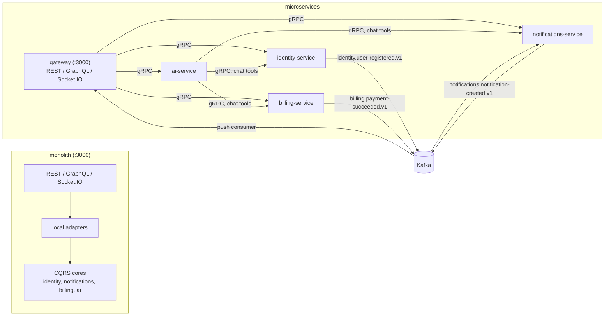
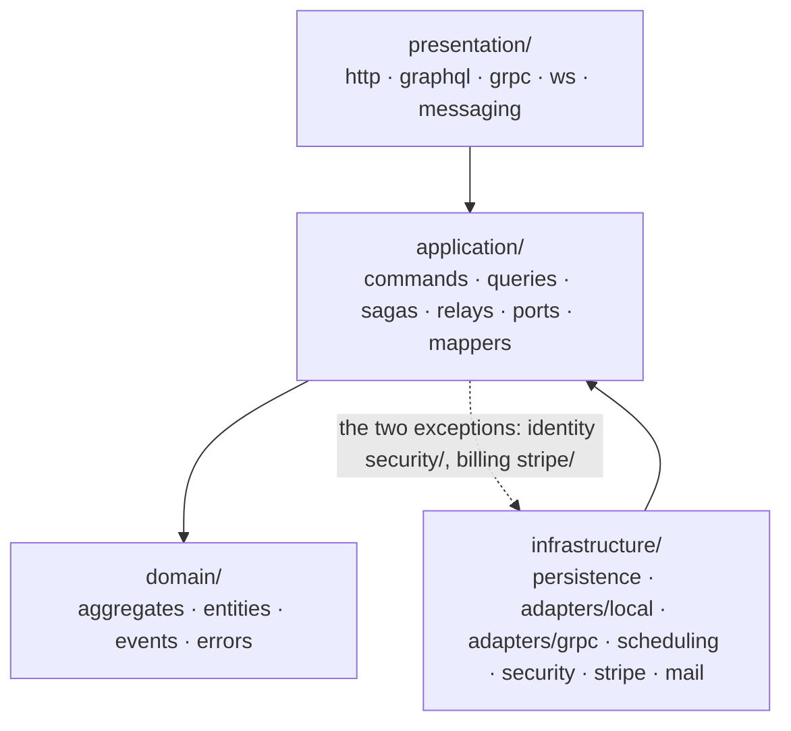
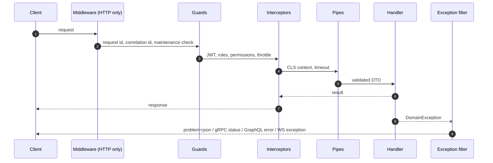
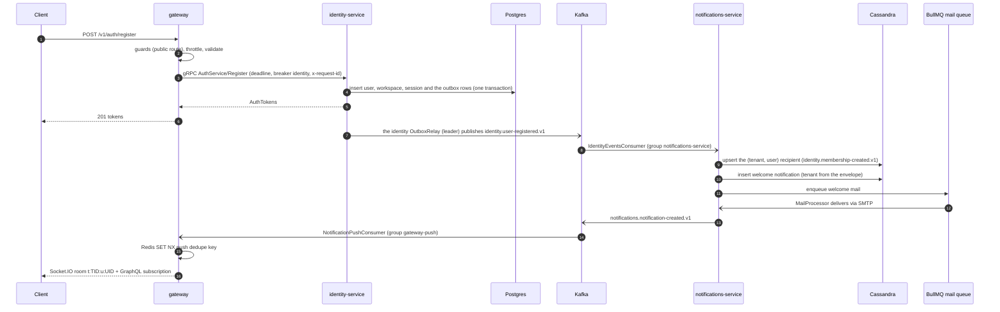
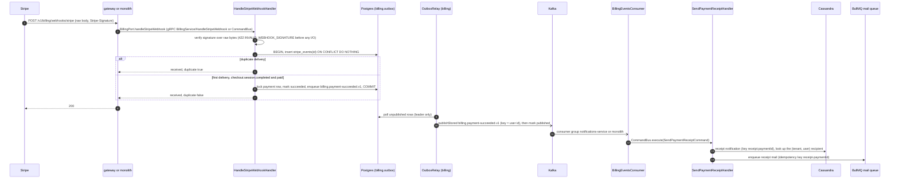
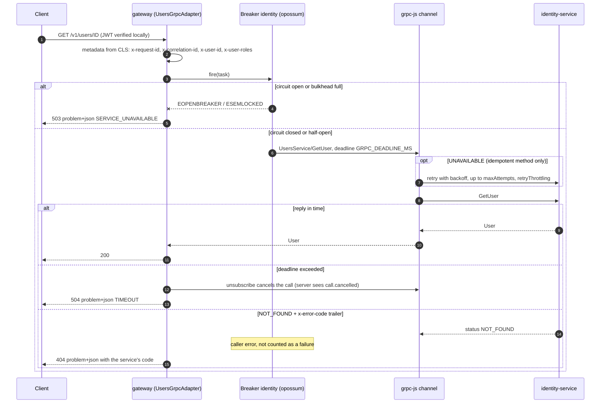
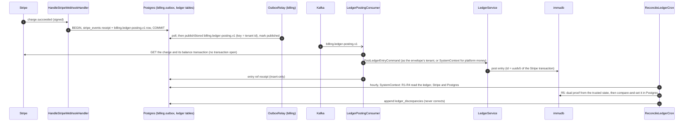

# Architecture

How the boilerplate is put together: one codebase, two deployment topologies, hexagonal + CQRS domain packages.

## 1. Topologies

The same domain packages and the same presentation classes (REST controllers, GraphQL resolvers, the Socket.IO gateway, Kafka consumers) run in two shapes. Only the module bindings change.

| Topology          | Processes                                                                                        | Port binding                                                                                  | Async integration                           | Compose profile |
| ----------------- | ------------------------------------------------------------------------------------------------ | --------------------------------------------------------------------------------------------- | ------------------------------------------- | --------------- |
| **Monolith**      | `apps/monolith`                                                                                  | `XApiModule.forLocal()`: ports call the in-process `CommandBus` / `QueryBus`                  | Kafka (the same topics as between services) | `monolith`      |
| **Microservices** | `apps/gateway` + `identity-service` + `notifications-service` + `billing-service` + `ai-service` | Gateway: `XApiModule.forRemote()`: ports call gRPC clients (deadline, retry, circuit breaker) | Kafka                                       | `microservices` |



Even inside the monolith, cross-context side effects (welcome notification, receipt, real-time push) travel through Kafka. A context never calls another context's handlers directly, so splitting a context into its own service changes wiring, not behaviour. The Postgres domains (identity, billing) hand their events to Kafka through a transactional outbox (section 6), the same in both topologies.

Host ports (from [`docker-compose.yml`](../docker-compose.yml)): the API (monolith or gateway) on `3000`, identity-service gRPC on `50051`, notifications-service on `50052`, billing-service on `50053`, ai-service on `50054` (every service listens on `50051` inside its container). Grafana is on host port `3300`. See [DOCKER.md](DOCKER.md).

**ai-service** serves `ai.v1.AiService` (conversations and the chat turn, plain or server-streamed) from the `domains/ai` context over `libs/ai` (OpenRouter), with Postgres (schema `ai`, under RLS) as its only store: no Kafka, no Redis. The gateway is its only inbound caller (`AiApiModule.forRemote()` adds the REST, SSE and GraphQL edge and charges `ai:chat` and the `ai.chat` rate limit); the monolith runs the same context in-process. It is the one service that is also a gRPC client of the others: the model's read-only tools (`get_my_profile`, `list_my_notifications`, `list_my_payments`) call identity-, notifications- and billing-service within the turn, as the caller. Its trust model is the other services': it accepts the principal in the call metadata (under `GRPC_PRINCIPAL_ASSERTION=enforce` only with the gateway's signed assertion) and does not authenticate the caller itself, but every handler re-checks the request's tenant and user against that principal (`TENANT_MISMATCH`), and each tool call carries the same principal on, with the caller's signed assertion forwarded unchanged (ai-service holds no signing key), so the owning service applies its own checks. That is why the NetworkPolicy must let **only the gateway and ai-service** reach the services' gRPC ports: the gateway reaches all four services, ai-service the other three, and nothing else ([SECURITY.md](SECURITY.md#internal-grpc-mtls-reflection)). Cutting ai-service off from them would make every chat tool call fail.

## 2. Repository layout

Three top-level folders, one dependency direction: `apps/*` (`@app/*`, the deployables: composition roots only) → `domains/*` (`@domain/*`, business code, one package per bounded context) → `libs/*` (`@platform/*`, platform adapters and the shared kernel, no business rules). A domain that other code calls or listens to also publishes a nested **contracts package**, `domains/<x>/contracts` (`@domain/<x>-contracts`): its `.proto` files, the ts-proto output, its gRPC package spec and its Kafka event contracts. Another domain depends only on that package, never on the domain itself; the apps, as composition roots, may import both. `scripts/check-boundaries.mjs` (part of `bun run check`) reads every `package.json` dependency field and every import in the sources, specs included, and fails when:

- a platform package declares or imports a domain or an app;
- a domain imports an app, or another domain other than through its contracts package;
- a contracts package depends on anything but `@platform/contracts` and third-party packages;
- production source imports a `@<scope>/<pkg>/testing` subpath or the test-only package `@platform/testing` (fakes, test token signers and Vitest helpers are for specs and `test/` code only);
- a relative import reaches outside its own package, or a package's `name` does not match its folder;
- a file under a domain's `src/application/` or `src/domain/` imports that domain's `src/infrastructure/` or `src/presentation/`, outside the exceptions of [section 3](#3-layers) (specs and `test/` code may).

| Path                                                                                                                 | Role                                                                                                                                                                                                                                                                                                              |
| -------------------------------------------------------------------------------------------------------------------- | ----------------------------------------------------------------------------------------------------------------------------------------------------------------------------------------------------------------------------------------------------------------------------------------------------------------- |
| `apps/monolith`                                                                                                      | All contexts in one process: HTTP (REST + GraphQL + Socket.IO) plus a hybrid Kafka consumer                                                                                                                                                                                                                       |
| `apps/gateway`                                                                                                       | Edge of the microservices topology: the same presentation, ports bound to gRPC clients. Owns no data                                                                                                                                                                                                              |
| `apps/identity-service`                                                                                              | gRPC `identity.v1.AuthService` + `identity.v1.UsersService`; Postgres schema `identity`, Redis; produces `identity.user-registered.v1`                                                                                                                                                                            |
| `apps/notifications-service`                                                                                         | gRPC `notifications.v1.NotificationsService`; Cassandra inbox; Kafka consumers; BullMQ `mail` worker; daily digest cron                                                                                                                                                                                           |
| `apps/ai-service`                                                                                                    | gRPC `ai.v1.AiService` (chat, conversations, streaming); Postgres schema `ai`; gRPC client of identity-, notifications- and billing-service for the model's tools; no Kafka, no Redis                                                                                                                             |
| `apps/billing-service`                                                                                               | gRPC `billing.v1.BillingService`; Stripe Checkout + webhooks; Postgres schema `billing`; produces `billing.payment-succeeded.v1`                                                                                                                                                                                  |
| `domains/identity`, `domains/notifications`, `domains/billing`, `domains/ai`                                         | Bounded contexts: hexagonal + CQRS (sections 3–6). Each owns its data (identity, billing, ai: a Postgres schema and migration set; notifications: Cassandra tables) and its config namespaces; notifications also owns its mail templates, and identity and notifications ship test doubles (`./testing`)         |
| `domains/identity/contracts`, `domains/notifications/contracts`, `domains/billing/contracts`, `domains/ai/contracts` | Each context's published language (`@domain/<x>-contracts`): `.proto` + ts-proto output, `IDENTITY_GRPC_PACKAGE` / `NOTIFICATIONS_GRPC_PACKAGE` / `BILLING_GRPC_PACKAGE`, and `AI_GRPC_PACKAGE`, and `USER_REGISTERED_EVENT` / `NOTIFICATION_CREATED_EVENT` / `PAYMENT_SUCCEEDED_EVENT`                           |
| `domains/files`                                                                                                      | Edge-only context (object storage, presigned URLs). A plain application service, no CQRS, no service of its own                                                                                                                                                                                                   |
| `libs/contracts`                                                                                                     | Generic contract plumbing: the Kafka envelope schema and headers, `deadLetterTopic()`, the `GrpcPackageSpec` and `EventContract` types, the shared buf policy and ts-proto template (`buf.yaml`, `buf.gen.yaml`)                                                                                                  |
| `libs/transport`                                                                                                     | gRPC clients/servers and Kafka producer/consumer plumbing that take contract values (`GrpcPackageSpec`, `EventContract`); status mapping, circuit breakers, dead-lettering                                                                                                                                        |
| `libs/common`                                                                                                        | `DomainException` hierarchy, problem+json, global pipes/filter/timeout interceptor, middlewares, utilities                                                                                                                                                                                                        |
| `libs/auth`                                                                                                          | Access-token verification (JWT strategy, `TokenService`), RBAC guards, access-token denylist; `@platform/auth/testing` signs test tokens. Token issuance and password hashing belong to identity                                                                                                                  |
| `libs/graphql`                                                                                                       | Apollo on Fastify, graphql-ws, DataLoader registry, error formatting, Redis PubSub                                                                                                                                                                                                                                |
| `libs/observability`                                                                                                 | pino logger (apps add their domains' redaction paths), nestjs-cls request context, Prometheus metrics, terminus health, OpenTelemetry, `@nestjs/observe`                                                                                                                                                          |
| `libs/config`                                                                                                        | The platform env namespaces, validated per namespace; domains define their own with the same helpers (see [CONFIGURATION.md](CONFIGURATION.md))                                                                                                                                                                   |
| `libs/database`                                                                                                      | Drizzle + postgres.js; the platform migration set, run before the domain sets the app passes, under one advisory lock; keyset pagination; the RLS context on `BEGIN`, `inUnitOfWork`, elevation, the `app_system` pool (`SystemDatabase`) and the boot guard                                                      |
| `libs/outbox`                                                                                                        | The transactional outbox: `OutboxWriter` (an event row in the caller's transaction), the system repository base and the leader `OutboxRelay` that publishes the rows to Kafka at least once. Names no domain; identity and billing each own their outbox table (section 6)                                        |
| `libs/ai`                                                                                                            | Language-model calls through OpenRouter on the Vercel AI SDK: a model allowlist, caps, cancellation, metrics. Off by default (`AI_ENABLED=false`). Names no domain: conversations, history and tools belong to `domains/ai`                                                                                       |
| `libs/immudb`                                                                                                        | immudb over gRPC: the client generated from the pinned `schema.proto`, a session pool with SQL transactions, versioned SQL migrations and client-side verification of Merkle proofs. Names no domain; billing's ledger (section 10.5) is its user, in the monolith and billing-service with `LEDGER_ENABLED=true` |
| `libs/mailer`                                                                                                        | BullMQ mail queue and worker; renders the template folders the app registers, with shared layout partials                                                                                                                                                                                                         |
| `libs/cassandra`, `libs/redis`, `libs/storage`, `libs/bootstrap`, `libs/testing`                                     | Platform adapters and app bootstrap helpers. Each has its own `README.md`                                                                                                                                                                                                                                         |

## 3. Layers

Each domain package (`domains/identity`, `domains/notifications`, `domains/billing`) has four folders under `src/`. Dependencies point inward, with two documented exceptions: in two domains, application code uses the domain's own infrastructure adapter directly, because a port in front of it would add nothing.

- **billing**: `CreateCheckoutSessionHandler` and `HandleStripeWebhookHandler` inject billing's Stripe adapter, `StripeService`, and `CreateCheckoutSessionHandler` also reads its `stripe` config namespace (`stripeConfig`), both from `infrastructure/stripe/`. A port over the Stripe SDK's types would only restate them.
- **identity**: `LoginHandler` and `RegisterUserHandler` inject `PasswordHasher`, and `SessionTokensService`, `LogoutHandler` and `RefreshSessionHandler` inject `TokenIssuer`, both from identity's `infrastructure/security/`.

`scripts/check-boundaries.mjs` keeps it so: a file under `application/` or `domain/` that imports `infrastructure/` or `presentation/` fails the check, unless its allowlist (`LAYER_EXCEPTIONS`) names the target. The allowlist holds the two folders above and one module, identity's `infrastructure/persistence/identity-outbox.ts`: `IdentityOutbox` is an empty subclass of `@platform/outbox`'s `OutboxWriter` that only gives identity its DI token, so `IdentityIntegrationEventsService` injecting it is the platform-library case below. Specs and `test/` code may import any layer. Everything else in billing's application layer reaches infrastructure through ports in `application/ports/`: `BillingOutboxPort` (the webhook's and R4's outbox writer, `BillingOutbox`), `PlatformOutboxPort` (the webhook's payout rows, `BillingOutboxSystemRepository.insertAsPlatform` on the system pool), `LedgerMetricsPort` (`LedgerMetrics`) and the `LEDGER_SETTINGS` token (the `ledger` config namespace), bound in `BillingCoreModule`, `BillingLedgerModule` and `BillingLedgerReanchorModule`. A new exception is an entry in `LAYER_EXCEPTIONS` and a bullet here.



| Layer              | Contains                                                                                                                                                                                                                                                                                                                                                    | Example (identity)                                                                                                                                                  |
| ------------------ | ----------------------------------------------------------------------------------------------------------------------------------------------------------------------------------------------------------------------------------------------------------------------------------------------------------------------------------------------------------- | ------------------------------------------------------------------------------------------------------------------------------------------------------------------- |
| **domain**         | Aggregates and entities with their invariants, domain events, `DomainException` subclasses. No Nest, no I/O                                                                                                                                                                                                                                                 | `domain/user.aggregate.ts`, `domain/events/user-registered.event.ts`, `domain/identity.errors.ts`                                                                   |
| **application**    | `Command`/`Query` classes and their handlers, event handlers (relays, audit), sagas, mappers, and the abstract classes the rest of the system binds: presentation-facing ports and repository ports                                                                                                                                                         | `application/commands/register-user/`, `application/ports/auth.port.ts`, `application/persistence/users.repository.ts`                                              |
| **infrastructure** | Implementations: Drizzle / Cassandra repositories, the local and gRPC adapters of the ports, crons, and the domain's own technical adapters: identity's `security/` (`PasswordHasher`, `TokenIssuer`, their config namespaces), billing's `stripe/` (`StripeService`, its `stripe` config namespace `stripeConfig`), notifications' `mail/` (its templates) | `infrastructure/persistence/drizzle-users.repository.ts`, `infrastructure/adapters/grpc/auth-grpc.adapter.ts`, `infrastructure/security/password-hasher.service.ts` |
| **presentation**   | REST controllers + DTOs, GraphQL resolvers + models, gRPC controllers, the Socket.IO gateway, Kafka consumers. Depends only on presentation-facing ports (and the CQRS buses, for consumers)                                                                                                                                                                | `presentation/http/auth.controller.ts`, `presentation/graphql/auth.resolver.ts`, `presentation/grpc/auth-grpc.controller.ts`                                        |

What the layering does and does not promise:

- Domain code is plain TypeScript and throws `DomainException` subclasses, never `HttpException`.
- Application handlers depend on abstract repository ports (bound in the `XCoreModule`) **and directly on concrete services** where an abstraction would add nothing: their own context's infrastructure, only in the two exceptions above (`RegisterUserHandler` injects identity's `PasswordHasher`, `RefreshSessionHandler` identity's `TokenIssuer`, `HandleStripeWebhookHandler` billing's `StripeService`), or a platform library (`LogoutHandler` injects `AccessTokenDenylist` from `@platform/auth`, `PublishNotificationCreatedHandler` injects `KafkaProducer` from `@platform/transport` (the welcome and receipt handlers dispatch it last), `WelcomeUserHandler` injects `MailService` from `@platform/mailer`).
- Folder names for repository ports differ per library: `application/persistence/` (identity), `application/ports/` (notifications), `application/repositories/` (billing).
- `domains/files` is smaller: `domain/`, `application/` (`FilesService`, access policy) and `presentation/`, with storage provided by `@platform/storage`.

## 4. Ports and adapters (`forLocal()` / `forRemote()`)

There are two kinds of ports. Both are **abstract classes** (usable as DI tokens without `@Inject()`).

| Kind                 | Ports                                                                                                                                                                       | Bound in                                 | Implementations                                              |
| -------------------- | --------------------------------------------------------------------------------------------------------------------------------------------------------------------------- | ---------------------------------------- | ------------------------------------------------------------ |
| Presentation-facing  | `AuthPort`, `UsersPort` (identity), `NotificationsPort`, `BillingPort`                                                                                                      | `XApiModule.forLocal()` / `.forRemote()` | `*LocalAdapter` (CQRS buses) or `*GrpcAdapter` (gRPC client) |
| Application-internal | `UsersRepository`, `SessionsRepository`, `TransactionRunner`, `NotificationsRepository`, `NotificationRecipientsRepository`, `PaymentsRepository`, `StripeEventsRepository` | `XCoreModule`                            | Drizzle (Postgres) or Cassandra repositories                 |

Presentation-facing ports speak contracts-package types (`@domain/<x>-contracts`, generated by ts-proto from `domains/<x>/contracts/src/proto/**`), so a local adapter and a gRPC adapter return identical shapes, and both throw the same `DomainException`s: error codes survive the gRPC hop through trailers (section 9).

```ts
// domains/identity/src/identity-api.module.ts (abridged)
static forLocal(): DynamicModule {
  return {
    module: IdentityApiModule,
    imports: [GraphqlLoadersModule], // the app imports IdentityCoreModule itself
    controllers: CONTROLLERS,
    providers: [...PRESENTATION,
      { provide: AuthPort, useClass: AuthLocalAdapter },    // → CommandBus
      { provide: UsersPort, useClass: UsersLocalAdapter }], // → QueryBus / CommandBus
  };
}
static forRemote(options: GrpcClientsModuleOptions = {}): DynamicModule {
  const target = { spec: IDENTITY_GRPC_PACKAGE, url: identityGrpcClientConfig.parse().url };
  return {
    module: IdentityApiModule,
    imports: [GrpcClientsModule.register(target, options), GraphqlLoadersModule],
    controllers: CONTROLLERS,
    providers: [...PRESENTATION, IdentityGrpcCaller,
      { provide: AuthPort, useClass: AuthGrpcAdapter },     // → identity-service
      { provide: UsersPort, useClass: UsersGrpcAdapter }],
  };
}
```

What a `*GrpcAdapter` adds on every call (via `grpcCall()` in `@platform/transport`):

| Concern         | Behaviour                                                                                                                                                                                                                                                                                                                                                                                                                                                                                                                                                                                                                                 |
| --------------- | ----------------------------------------------------------------------------------------------------------------------------------------------------------------------------------------------------------------------------------------------------------------------------------------------------------------------------------------------------------------------------------------------------------------------------------------------------------------------------------------------------------------------------------------------------------------------------------------------------------------------------------------- |
| Deadline        | `GRPC_DEADLINE_MS` (default `5000`): an rxjs `timeout` that cancels the call, plus the same value as the per-method `timeout` in the channel's service config. Two upstreams give some calls a longer one: ai's chat turn (`AI_GRPC_CHAT_DEADLINE_MS`) and billing's Stripe-backed calls (`BILLING_GRPC_STRIPE_DEADLINE_MS`: `CreateCheckoutSession`, `HandleStripeWebhook`). ai's channel then carries the longer value for every method, billing's only for those two methods (their own `methodConfig` entries, `GrpcClientOptionsExtras.methodDeadlines`), and the rxjs `timeout` still cuts every other method at `GRPC_DEADLINE_MS` |
| Retry           | Only `UNAVAILABLE`, only for idempotent methods (`GetUser`, `GetUsersByIds`, `ListUsers`, `ListMyTenants`, `ListMembers`, `ListNotifications`, `ListPayments`); 3 attempts by default (grpc-js caps it at 5), with `retryThrottling { maxTokens: 10, tokenRatio: 0.1 }`. `Register`, `RefreshTokens` and other writes are never retried: replaying `RefreshTokens` would trip refresh-token reuse detection                                                                                                                                                                                                                               |
| Circuit breaker | One opossum breaker per upstream (`identity`, `notifications`, `billing`), shared by every method of that upstream, except billing's Stripe-backed calls (`CreateCheckoutSession`, `HandleStripeWebhook`), which have their own (`billing-stripe`) so slow Stripe calls cannot cut off `ListPayments`. Opens at 50 % failures once ≥ 10 calls fall in a 10 s window, half-opens after 5 s, bulkhead of 1000 concurrent calls. Caller errors (`INVALID_ARGUMENT`, `NOT_FOUND`, `ALREADY_EXISTS`, `PERMISSION_DENIED`, `UNAUTHENTICATED`, `FAILED_PRECONDITION`, `OUT_OF_RANGE`, `ABORTED`) do not count                                    |
| Metadata        | `x-request-id`, `x-correlation-id` and the principal (`x-user-id`, `x-tenant-id`, `x-user-roles`, `x-staff`) from nestjs-cls. The service adopts the request id and rebuilds the principal, so logs line up across hops                                                                                                                                                                                                                                                                                                                                                                                                                   |
| Error mapping   | Every failure becomes a `DomainException`: the original class and code when the server sent `x-error-code` / `x-error-details-bin` trailers, `OperationTimeoutException` (504) on deadline, `ServiceUnavailableException` (503) when the breaker is open or the bulkhead is full                                                                                                                                                                                                                                                                                                                                                          |

The gateway verifies access tokens itself (JWT + the Redis denylist), so authentication costs no RPC. Services trust the caller's principal in metadata (user, tenant, roles, staff): run them inside the service mesh only. The gateway also signs that principal (`x-principal-assertion`, ES256, private key at the edge only); with `GRPC_PRINCIPAL_ASSERTION=enforce` a service takes the principal from the signed claims alone and refuses a call with a user and no valid assertion. See [SECURITY.md](SECURITY.md) for gRPC TLS (`GRPC_TLS_*`) and the [signed principal rollout](SECURITY.md#signed-principal-assertion).

## 5. Module composition per app

Each domain package exports a fixed set of modules:

| Module                                                               | Contents                                                                                                                                                                                                                    | Imported by                                                                                      |
| -------------------------------------------------------------------- | --------------------------------------------------------------------------------------------------------------------------------------------------------------------------------------------------------------------------- | ------------------------------------------------------------------------------------------------ |
| `IdentityCoreModule`, `NotificationsCoreModule`, `BillingCoreModule` | Command/query/event handlers, sagas, outbox writers and relays (identity, billing), repository bindings, crons                                                                                                              | The monolith (directly, next to `XApiModule.forLocal()`), and each service through `XGrpcModule` |
| `IdentityGrpcModule`, `NotificationsGrpcModule`, `BillingGrpcModule` | Core + the `@GrpcController()` classes                                                                                                                                                                                      | The matching service                                                                             |
| `IdentityApiModule`, `NotificationsApiModule`, `BillingApiModule`    | Edge presentation; `.forLocal()` binds the local adapters (the app imports the core), `.forRemote()` registers gRPC clients; exported from `@domain/<x>/api`                                                                | Monolith (`forLocal`), gateway (`forRemote`)                                                     |
| `NotificationsMessagingModule`                                       | Core + `IdentityEventsConsumer` and `BillingEventsConsumer` (inbound integration events)                                                                                                                                    | Monolith, notifications-service                                                                  |
| `AiCoreModule`, `AiGrpcModule`, `AiApiModule`                        | Core: handlers, Drizzle repositories, `AiModule.forRootAsync()`. Grpc: core + `ai.v1.AiService`. Api: edge presentation, `.forLocal()` on the CQRS buses, `.forRemote()` over a gRPC client; exported from `@domain/ai/api` | Monolith (core + `forLocal`), ai-service (`AiGrpcModule`), gateway (`forRemote`)                 |
| `FilesModule`                                                        | REST `/v1/files`, GraphQL `createUploadUrl`, `FilesService`                                                                                                                                                                 | Monolith, gateway                                                                                |

Each domain package has two production entry points: `@domain/<x>/api` (presentation, ports, local and remote
adapters, the gRPC client config) and `@domain/<x>` (all of `./api` plus core, persistence, commands, queries and
domain types). The gateway imports only `./api`, and `node scripts/check-api-subpaths.mjs --require-all` (part of
`bun run check`) fails when an `./api` graph reaches a core module, handler, persistence, Stripe or security file.

What each `apps/*/src/app.module.ts` imports (besides `AppConfigModule.forRoot()` and `ObservabilityModule.forRoot()`, which all six import first):

| Module                                                                             |                                                                                                                                               monolith                                                                                                                                                |                                                             gateway                                                              |     identity-service      |                   notifications-service                   |                    billing-service                    |                                     ai-service                                      |
| ---------------------------------------------------------------------------------- | :---------------------------------------------------------------------------------------------------------------------------------------------------------------------------------------------------------------------------------------------------------------------------------------------------: | :------------------------------------------------------------------------------------------------------------------------------: | :-----------------------: | :-------------------------------------------------------: | :---------------------------------------------------: | :---------------------------------------------------------------------------------: |
| `CqrsModule.forRoot()`, `ScheduleModule.forRoot()`                                 |                                                                                                                                                   ✓                                                                                                                                                   |                                                                                                                                  |             ✓             |                             ✓                             |                           ✓                           |                                          ✓                                          |
| `DatabaseModule.forRootAsync()` (Postgres / Drizzle)                               |                                                                                                                                                   ✓                                                                                                                                                   |                                                                                                                                  |             ✓             |                                                           |                           ✓                           |                                          ✓                                          |
| `CassandraModule.forRootAsync()`                                                   |                                                                                                                                                   ✓                                                                                                                                                   |                                                                                                                                  |                           |                             ✓                             |                                                       |                                                                                     |
| `RedisModule.forRootAsync()`                                                       |                                                                                                                                                   ✓                                                                                                                                                   |                                                                ✓                                                                 |             ✓             |                             ✓                             |                           ✓                           |                                                                                     |
| `AppCacheModule.forRootAsync()`                                                    |                                                                                                                                                   ✓                                                                                                                                                   |                                                                ✓                                                                 |                           |                                                           |                                                       |                                                                                     |
| `AuthModule.forRootAsync()`                                                        |                                                                                                                                                   ✓                                                                                                                                                   |                                                                ✓                                                                 | ✓ (`globalGuards: false`) |                                                           |                                                       |                                                                                     |
| `AppThrottlerModule.forRootAsync()`                                                |                                                                                                                                                   ✓                                                                                                                                                   |                                                                ✓                                                                 |                           |                                                           |                                                       |                                                                                     |
| `AppQueueModule.forRootAsync()` + `AppMailerModule.forRootAsync({ templateDirs })` |                                                                                                                           ✓ (notifications templates, worker on by default)                                                                                                                           |                                                                                                                                  |                           |        ✓ (notifications templates, `worker: true`)        |                                                       |                                                                                     |
| `KafkaProducerModule.forRootAsync()`                                               |                                                                                                                                                   ✓                                                                                                                                                   |                                                                                                                                  |             ✓             |                             ✓                             |                           ✓                           |                                                                                     |
| `ImmudbModule.forRootAsync()` (`libs/immudb`)                                      |                                                                                                                                       ✓ (`LEDGER_ENABLED=true`)                                                                                                                                       |                                                                                                                                  |                           |                                                           |               ✓ (`LEDGER_ENABLED=true`)               |                                                                                     |
| `StorageModule.forRootAsync()` + `FilesModule`                                     |                                                                                                                                                   ✓                                                                                                                                                   |                                                                ✓                                                                 |                           |                                                           |                                                       |                                                                                     |
| `AppGraphqlModule.forRootAsync()` + `GraphqlPubSubModule`                          |                                                                                                                                                   ✓                                                                                                                                                   |                                                                ✓                                                                 |                           |                                                           |                                                       |                                                                                     |
| Domain modules                                                                     | `IdentityCoreModule`, `NotificationsCoreModule`, `BillingCoreModule`, `IdentityApiModule.forLocal()`, `NotificationsApiModule.forLocal()`, `NotificationsMessagingModule`, `BillingApiModule.forLocal()`, `AiCoreModule`, `AiApiModule.forLocal()`, `AiToolSourcesModule.forRoot()` (the local ports) | `IdentityApiModule.forRemote()`, `NotificationsApiModule.forRemote()`, `BillingApiModule.forRemote()`, `AiApiModule.forRemote()` |   `IdentityGrpcModule`    | `NotificationsGrpcModule`, `NotificationsMessagingModule` |                  `BillingGrpcModule`                  | `AiGrpcModule`, `AiToolSourcesModule.forRoot()` (gRPC adapters of the three owners) |
| Readiness contributors (`/health/ready`)                                           |                                                                                                                   Postgres, Cassandra, Redis (+ immudb with `LEDGER_ENABLED=true`)                                                                                                                    |                                                              Redis                                                               |      Postgres, Redis      |                  Cassandra, Redis, Kafka                  | Postgres, Redis (+ immudb with `LEDGER_ENABLED=true`) |                                      Postgres                                       |

Composition rules visible in the app modules:

- **Import order matters.** `AuthModule` is imported before `AppThrottlerModule`: global guards run in registration order, and the throttler must see `req.user` to track per user.
- **Kafka is not a readiness contributor** where events leave through the outbox (monolith, identity, billing): a broker outage must not pull every replica out of rotation, and the events of that window wait in `<schema>.outbox` until the relay can publish them. notifications-service lists it because consuming is its job.
- **ai-service's readiness is Postgres alone.** OpenRouter is not a contributor (a model outage fails the chat turns with 502 or 504, and `AI_ENABLED=false` answers 503 `AI_DISABLED`; neither may pull a replica out of rotation), and the services its tools call are not either: an unreachable owner is a tool error returned to the model, never a failed turn.
- **The gateway owns no data**: no database, Cassandra, mailer, Stripe, CQRS or core module. An upstream outage degrades the affected routes (503 problem+json) instead of failing readiness.
- **Cross-domain GraphQL fields live in the apps.** `Payment.user` (billing → identity) is resolved by `PaymentUserFieldResolver` (`apps/monolith/src/graphql`, `apps/gateway/src/graphql`) through identity's `users` DataLoader; billing exposes only `Payment.userId`, so no domain imports another.
- Every app installs `provideCommonEnhancersAsync()` (validation pipes, `AllExceptionsFilter`, `TimeoutInterceptor`) and applies `CorrelationIdMiddleware` to all routes. The monolith and gateway also apply `MaintenanceModeMiddleware`; `MAINTENANCE_MODE` is read by that middleware and by the WebSocket entry points (graphql-ws `onConnect` and `onSubscribe`, the Socket.IO namespace middleware), so a socket gets the same refusal as a REST call. Kafka consumers, crons and the outbox relay keep running.

Bootstrap (`main.ts`) adds the transports:

| App                   | HTTP app                                                                                 | Microservice transports                                                                                | Kafka consumer group                                                  |
| --------------------- | ---------------------------------------------------------------------------------------- | ------------------------------------------------------------------------------------------------------ | --------------------------------------------------------------------- |
| monolith              | `createHttpApp(AppModule, { rawBody: true, multipart: true })` + Redis Socket.IO adapter | `connectKafkaConsumer`                                                                                 | `monolith` (override: `KAFKA_GROUP_ID`)                               |
| gateway               | same                                                                                     | `connectKafkaConsumer` (push consumer)                                                                 | `gateway-push` (override: `KAFKA_GROUP_ID`)                           |
| identity-service      | `createServiceApp` (`/health/*` only; `/metrics` on `METRICS_PORT`)                      | `connectGrpcServer(app, [IDENTITY_GRPC_PACKAGE])`                                                      | none                                                                  |
| notifications-service | `createServiceApp`                                                                       | `connectGrpcServer(app, [NOTIFICATIONS_GRPC_PACKAGE])` + `connectKafkaConsumer`                        | `notifications-service` (pinned in code)                              |
| billing-service       | `createServiceApp`                                                                       | `connectGrpcServer(app, [BILLING_GRPC_PACKAGE])` (+ `connectKafkaConsumer` with `LEDGER_ENABLED=true`) | `billing-service` with the ledger on (pinned in code), otherwise none |
| ai-service            | `createServiceApp`                                                                       | `connectGrpcServer(app, [AI_GRPC_PACKAGE])`                                                            | none (no Kafka)                                                       |

Hybrid apps connect microservices with `inheritAppConfig: true`, so the global enhancers also wrap gRPC and Kafka handlers. That is why every global enhancer branches on `context.getType()` (section 8). Per-app details: [apps/monolith/README.md](../apps/monolith/README.md), [apps/gateway/README.md](../apps/gateway/README.md), [apps/identity-service/README.md](../apps/identity-service/README.md), [apps/notifications-service/README.md](../apps/notifications-service/README.md), [apps/billing-service/README.md](../apps/billing-service/README.md), [apps/ai-service/README.md](../apps/ai-service/README.md).

## 6. CQRS: commands, queries, sagas, the outbox and its relay

`@nestjs/cqrs` (`CqrsModule.forRoot()` in every app that hosts a core). Commands and queries carry their result type, so `commandBus.execute()` is typed end to end:

```ts
export class RegisterUserCommand extends Command<AuthTokens> { … }
export class GetUserByIdQuery extends Query<User> { … }
```

| Building block  | Role                                                                                                                                                                                    | Examples                                                                                                   |
| --------------- | --------------------------------------------------------------------------------------------------------------------------------------------------------------------------------------- | ---------------------------------------------------------------------------------------------------------- |
| Command handler | One write use case. Loads/creates an aggregate, persists it, then `commit()`s its domain events                                                                                         | `RegisterUserHandler`, `HandleStripeWebhookHandler`                                                        |
| Query handler   | Read use case, returns a contracts-package (ts-proto) shape                                                                                                                             | `GetUserByIdHandler`, `GetUsersByIdsHandler` (feeds the GraphQL `users` DataLoader), `ListPaymentsHandler` |
| Domain event    | Fact raised by an aggregate (`AggregateRoot.apply`), published on `commit()`                                                                                                            | `UserRegisteredEvent`, `PaymentSucceededEvent`                                                             |
| Event handler   | In-process reaction to a domain event; none of them publishes to Kafka (that is the outbox's job)                                                                                       | (none today)                                                                                               |
| **Outbox**      | `OutboxWriter#enqueue` writes the integration event to `<schema>.outbox` in the transaction that changes the state; the leader `OutboxRelay` of that outbox publishes the rows to Kafka | `IdentityOutbox` → `identity.user-registered.v1`, `BillingOutbox` → `billing.payment-succeeded.v1`         |
| **Saga**        | `@Saga()` stream mapping events to commands. Pure mapping only: an error inside the operator pipeline would complete the saga stream for good, so all I/O lives in the command handler  | (none today: a saga cannot fail the command that raised the event, so the notification push is not one)    |
| Kafka consumer  | Presentation for inbound integration events: validates the envelope, dispatches a command                                                                                               | `IdentityEventsConsumer` → `WelcomeUserCommand`, `BillingEventsConsumer` → `SendPaymentReceiptCommand`     |
| Cron            | `@nestjs/schedule` job guarded by a Redis lock (`@WithLock`), so one replica runs it                                                                                                    | `PurgeExpiredSessionsCron`, `PurgeStripeEventsCron`, `DailyDigestCron`                                     |

**The outbox.** Identity and billing write every integration event to `<schema>.outbox` (`identity.outbox`, `billing.outbox`) in the transaction that changes the state it reports, through `OutboxWriter#enqueue` (`@platform/outbox`). The event commits or rolls back with the state, and nothing reaches Kafka from a request path:

```ts
// RegisterUserHandler.execute (abridged): one transaction, three writes
const tokens = await this.sessionTokens.open(record, async () => {
  await this.users.insert(user); // user + personal workspace + first session
  await this.integrationEvents.userRegistered(registered); // → identity.outbox row
  await this.integrationEvents.membershipCreated(membership); // → identity.outbox row
});
user.commit(); // in-process domain events only, after COMMIT
```

`HandleStripeWebhookHandler` does the same inside its `@Transactional()` method: the payment transition, the `stripe_events` receipt and the `billing.payment-succeeded.v1` or `billing.ledger-posting.v1` row commit together, so a rolled-back delivery never announces a payment and a failing enqueue fails the delivery (Stripe retries it).

**The relay.** One `OutboxRelay` per outbox runs in every process that owns it, and only the holder of the Redis lock `outbox-relay:<schema>` publishes: poll the unpublished rows on the system pool, `KafkaProducer#publishStored` them in order (no Postgres transaction is open across a publish), mark the acknowledged rows. A failed publish ends the batch; the row and the later ones go out on a later tick. Delivery is therefore **at least once**, and every consumer deduplicates on the envelope id (below). A row the broker always refuses blocks its outbox until an operator acts (the `OutboxBacklogStuck` alert pages; [OBSERVABILITY.md](OBSERVABILITY.md#outbox-ledger-and-ai-alerts)). Published rows are purged after `OUTBOX_RETENTION_HOURS`. Details: [libs/outbox/README.md](../libs/outbox/README.md). Notifications (Cassandra) and files (no store) do not use an outbox.

**Exception: `notifications.notification-created.v1`.** The notifications context has no Postgres store behind it, so it has no outbox. The two commands that create a notification, `WelcomeUserHandler` and `SendPaymentReceiptHandler`, publish it themselves, last, after the inbox row and the mail, through `PublishNotificationCreatedCommand`, and a failed publish fails them. The upstream event is then retried in process and dead-lettered if it keeps failing (`KafkaDeadLetters` pages; replay it with `dlq-replay`). Its redelivery rewrites the same row (derived id), enqueues the same mail job (a no-op for 14 days, the `.dlq` retention: a `mail-sent:<jobId>` marker outlives the 24 h job) and publishes again, and the edge deduplicates the push on the envelope id, so the push is published at least once. The trade-off: a persistent publish failure dead-letters an event whose row and mail were already written.

**Idempotent consumers.** Inbound commands derive their ids from the business key, so redelivery and DLQ replays are harmless: `WelcomeUserHandler` creates the notification with idempotency key `welcome:<userId>` and enqueues mail with idempotency key `welcome-<userId>`; `SendPaymentReceiptHandler` uses `receipt:<paymentId>` / `receipt-<paymentId>`. `CreateNotificationHandler` derives the notification id from the key (`deriveNotificationId`).

## 7. Integration events and the Kafka envelope

Topics are named `<context>.<event-name>.v<major>` and declared once, as an `EventContract` (`<EVENT>_EVENT`: topic + payload schema) in the producer's `domains/<x>/contracts/src/events`. Each has a dead-letter twin `<topic>.dlq`.

| Topic                                   | Producer (relay / handler)                             | Key     | Consumers                                                                 |
| --------------------------------------- | ------------------------------------------------------ | ------- | ------------------------------------------------------------------------- |
| `identity.user-registered.v1`           | `identity.outbox` (`IdentityOutbox`), relayed          | user id | `IdentityEventsConsumer` → welcome notification + welcome email           |
| `identity.membership-created.v1`        | `identity.outbox`, relayed                             | user id | `IdentityEventsConsumer` → upsert the `(tenant, user)` mail recipient     |
| `identity.membership-removed.v1`        | `identity.outbox`, relayed                             | user id | `IdentityEventsConsumer` → remove the `(tenant, user)` mail recipient     |
| `billing.payment-succeeded.v1`          | `billing.outbox` (`BillingOutbox`), relayed            | user id | `BillingEventsConsumer` → receipt notification + receipt email            |
| `billing.ledger-posting.v1`             | `billing.outbox`, relayed (Stripe money events)        | tenant  | `LedgerPostingConsumer` (billing) → ledger entries in immudb              |
| `notifications.notification-created.v1` | `PublishNotificationCreatedHandler` (welcome, receipt) | user id | `NotificationPushConsumer` (edge) → Socket.IO room + GraphQL subscription |

Keying by user id keeps one user's events ordered on one partition (`billing.ledger-posting.v1` is keyed by tenant id). The first five are tenant-scoped: the envelope
`tenantId` names the tenant, and a consumer without one (or with the platform tenant) throws, so the message
dead-letters (B4; see [SECURITY.md](SECURITY.md#tenant-isolation-outside-postgres)). `billing.ledger-posting.v1` is tenant-scoped too, except platform money (payouts), whose envelope carries the nil platform tenant and no actor: `LedgerPostingConsumer` posts those inside `SystemContext`, and checks that the envelope's tenant and actor agree with the payload before anything runs.

**Envelope.** Every record value is the same JSON envelope, validated with zod by the producer (`KafkaProducer.publish`) and by the consumer (`ParseEventEnvelopePipe`):

```json
{
  "id": "0199b0a4-6c1e-7c3a-9a51-0d5f3f0f2b11",
  "type": "identity.user-registered.v1",
  "version": 1,
  "occurredAt": "2026-10-05T09:12:44.120Z",
  "source": "identity-service",
  "correlationId": "c0ffee00-…",
  "payload": {
    "userId": "0199b0a4-6c1d-7f0e-8d2b-6a1c2e3f4a5b",
    "email": "ada@example.com",
    "displayName": "Ada",
    "registeredAt": "2026-10-05T09:12:44.120Z"
  }
}
```

| Field           | Meaning                                                                                                                                                                                                                                                                                            |
| --------------- | -------------------------------------------------------------------------------------------------------------------------------------------------------------------------------------------------------------------------------------------------------------------------------------------------- |
| `id`            | uuid. The domain event id (the notification id for `notification-created`; a uuid v5 of the Stripe event id for a ledger posting). The envelope is built and validated when the outbox row is written and published unchanged, so a resend carries the same id and consumers can deduplicate on it |
| `type`          | Equals the topic for single-event topics                                                                                                                                                                                                                                                           |
| `version`       | Major version, taken from the topic's `.v<major>` suffix                                                                                                                                                                                                                                           |
| `occurredAt`    | ISO-8601 UTC time of the fact                                                                                                                                                                                                                                                                      |
| `source`        | Producing service (`SERVICE_NAME`)                                                                                                                                                                                                                                                                 |
| `tenantId`      | Optional. The tenant the event belongs to (the producer's principal by default); the nil UUID marks a platform event                                                                                                                                                                               |
| `actorId`       | Optional. The user who caused the event, or `null` for system work; consumers act as `{ userId: actorId, tenantId }`                                                                                                                                                                               |
| `correlationId` | From the originating request (nestjs-cls), for joining logs across services                                                                                                                                                                                                                        |
| `traceparent`   | Optional. The W3C trace context of the span that built the event, absent without one; `tracestate` comes with it when the span has one. The outbox relay sends the stored event under it, so the produce span and the consumers join the trace of the request that wrote the row                   |
| `payload`       | Topic-specific, zod schema in `domains/<x>/contracts/src/events/*.events.ts`                                                                                                                                                                                                                       |

Record headers: `x-event-type` and `x-correlation-id` (tools can route and trace without parsing JSON). With tracing on, the kafkajs instrumentation also injects the W3C `traceparent` header.

**Evolution.** Payload schemas are tolerant readers: unknown keys are stripped, not rejected, so additive changes stay on the same topic. A breaking change ships as a new topic (`.v2`) consumed side by side.

**Consumer pipeline.** `@KafkaConsumerController()` applies, at controller scope:

1. `KafkaContextInterceptor`: request and correlation ids into nestjs-cls, and the actor's principal (`{ userId: actorId, tenantId }`) when the envelope carries both.
2. `KafkaRetryInterceptor`: transient failures (driver, connection, timeout, 5xx-class `DomainException`) retried in-process, 4 attempts with 0.25 s / 0.5 s / 1 s backoff.
3. `KafkaDeadLetterFilter`: anything still failing (including an invalid envelope rejected by the pipe) is written to `<topic>.dlq` with headers `x-original-topic`, `x-original-partition`, `x-original-offset`, `x-error-message`, `x-error-type`, `x-failed-at`, then the offset commits so a poison message never blocks its partition. If the DLQ publish fails or is not acknowledged within 5 s, the offset is not committed and the filter hands kafkajs a `KafkaRetriableException` with the original error as `cause`, which kafkajs retries and then restarts the consumer on, so the message is redelivered (a raw `TypeError`, `RangeError`, `ReferenceError` or `SyntaxError` would stop the consumer for good). Throwing `KafkaRetriableException` explicitly asks kafkajs to retry.

Replay a dead-letter topic once the cause is fixed: `node --env-file=.env libs/transport/scripts/kafka-dlq-replay.mjs <topic> [--dry-run] [--group <id>]` (uses `replayDeadLetters` from `@platform/transport`).

Consumers subscribe with `fromBeginning: false` and `autoCommit: true` (Nest awaits the handler before the offset is resolved). Consumer group names are pinned or defaulted per app (section 5): a renamed group has no committed offsets and would skip everything published in between.

## 8. Request lifecycle

Nest's order is always **middleware → guards → interceptors (before) → pipes → handler → interceptors (after) → exception filters**. Middleware exists only for HTTP. Because hybrid apps use `inheritAppConfig: true`, the same global guards, interceptors, pipes and filter also wrap gRPC and Kafka handlers, so each of them branches on `context.getType()`.

| Stage                    | HTTP (REST)                                                                                                         | GraphQL                                                                                                                                              | WebSocket (Socket.IO `/notifications`)                                                                                                                                                    | RPC: gRPC (services)                                                                                                                      | RPC: Kafka (consumers)                              |
| ------------------------ | ------------------------------------------------------------------------------------------------------------------- | ---------------------------------------------------------------------------------------------------------------------------------------------------- | ----------------------------------------------------------------------------------------------------------------------------------------------------------------------------------------- | ----------------------------------------------------------------------------------------------------------------------------------------- | --------------------------------------------------- |
| Middleware               | nestjs-cls `ClsMiddleware` (request id), `CorrelationIdMiddleware`, `MaintenanceModeMiddleware` (monolith, gateway) | Same, for queries/mutations over HTTP. graphql-ws subscriptions authenticate once at `connection_init` (`connectionParams.authorization` or `token`) | Handshake: a namespace middleware verifies the access token (`auth.token` or `Authorization: Bearer`) and the denylist before the connection is accepted; the socket joins room `user:ID` | none                                                                                                                                      | none                                                |
| Global guards (in order) | `JwtAuthGuard` (skipped for `@Public()`), `RolesGuard`, `PermissionsGuard`, then `AppThrottlerGuard`                | Same; `ctx.req` is the HTTP request                                                                                                                  | `JwtAuthGuard` re-checks `socket.data.user` is unexpired, then RBAC; the throttler guard skips `ws`                                                                                       | All return `true`: the service trusts the gateway's identity                                                                              | All return `true`                                   |
| Controller guards        | e.g. `LoginRequestGuard` + `LocalAuthGuard` (passport-local) on `POST /v1/auth/login`                               | as REST                                                                                                                                              | `WsSessionGuard` (denylist), `WsThrottlerGuard` (Redis-backed, per message)                                                                                                               | —                                                                                                                                         | —                                                   |
| Global interceptors      | `RequestContextInterceptor` (passes through: CLS already open), `TimeoutInterceptor` (default 30 s)                 | same                                                                                                                                                 | `RequestContextInterceptor` opens a CLS context; no timeout                                                                                                                               | `RequestContextInterceptor`; no timeout                                                                                                   | `RequestContextInterceptor`; no timeout             |
| Controller interceptors  | e.g. `StandardSchemaSerializerInterceptor` (response schema)                                                        | —                                                                                                                                                    | —                                                                                                                                                                                         | `GrpcContextInterceptor` (from `@GrpcController()`): metadata `x-request-id` / `x-correlation-id` / `x-user-id` / `x-user-roles` into CLS | `KafkaContextInterceptor`, `KafkaRetryInterceptor`  |
| Pipes                    | Global: class-validator `ValidationPipe` + Standard Schema (zod) pipe for `{ schema }` params                       | same                                                                                                                                                 | `@MessageBody({ schema })` → zod                                                                                                                                                          | `ZodRpcValidationPipe(schema)` per `@Payload()`                                                                                           | `ParseEventEnvelopePipe(contract)` per `@Payload()` |
| Handler                  | Controller → port                                                                                                   | Resolver → port (DataLoader per request for `users`)                                                                                                 | Gateway method → port; return value = ack                                                                                                                                                 | gRPC controller → `CommandBus` / `QueryBus`                                                                                               | Consumer → `CommandBus`                             |
| Exception filter         | `AllExceptionsFilter` → `application/problem+json`                                                                  | `AllExceptionsFilter` returns the error untouched; Apollo `formatError` (`formatGraphqlError`) maps it                                               | `AllExceptionsFilter`: ack `{ ok: false, error }` if the client used an ack, else emit `exception`                                                                                        | `DomainToGrpcExceptionFilter` (controller-scoped, from `@GrpcController()`)                                                               | `KafkaDeadLetterFilter` (controller-scoped)         |

Notes:

- **Why controller-scoped RPC filters.** A global filter in a hybrid app would also catch HTTP errors (`app.useGlobalFilters()` with `inheritAppConfig`), and `ms.useGlobalFilters()` after `connectMicroservice()` is ignored. `@GrpcController()` and `@KafkaConsumerController()` are composites that attach the right filter and interceptors to each RPC controller. `AllExceptionsFilter` rethrows for `rpc`.
- **Kafka handlers must not throw past the filter.** An escaping error makes kafkajs restart the consumer on the same offset forever.
- **Request context.** `ClsMiddleware` (HTTP) or `RequestContextInterceptor` (everything else) puts the request id in nestjs-cls; the pino logger, the Kafka producer (`correlationId`) and the gRPC adapters (outgoing metadata) read it from there. No REQUEST-scoped providers are used.
- **Request principal.** `{ userId, tenantId, roles, staff }` (spec §7) lives in nestjs-cls (`getPrincipal()`,
  `requirePrincipal()` in `@platform/common`); `userId` of the request context comes from it. Its writers: the edge
  (`JwtAuthGuard` / `PrincipalContextInterceptor` write it from the verified token, REST, GraphQL and WebSocket); gRPC
  (B2-23: the gateway forwards it as `x-user-id`, `x-tenant-id`, `x-user-roles`, `x-staff`, and
  `GrpcContextInterceptor` rebuilds it, recomputing permissions from the roles); Kafka (B2-24: envelopes carry
  `tenantId` / `actorId`, and `KafkaContextInterceptor` sets the actor as principal); the Stripe webhook (it acts as the
  `{ userId, tenantId }` signed into the object's metadata, or as no principal for platform events); and invitation
  acceptance (it joins the tenant as the accepting user). DataLoader batches keep the request context (B2-25), so a
  batched load still sees the principal. No other code may write it.
- **Cache keys and tenants.** Isolation in Redis is by key: a tenant-scoped cache entry is keyed
  `tenantCacheKey(scope, tenantId, ...parts)` (`@platform/redis`, stored as `<prefix>:cache:<scope>:<tid>:…`), with
  the tenant from the principal or a validated envelope, never from a request body. The user cache stays keyed by
  user (`user:<id>`, 30 s) and serves only the caller's own profile; another user's profile, read from the caller's
  active tenant, bypasses the cache, so a removed member is a 404 at once (B4 ruling 4). A deployment can opt into
  caching those reads behind a per-tenant membership marker (`tenantCacheKey('identity', tid, 'member', uid)`,
  deleted on member remove and leave) and accept that a member removed some other way stays readable for up to 30 s;
  see the identity README.
- **Database principal (B3).** Postgres enforces the principal too. Every runtime query runs as `app_runtime` (forced
  RLS) in a unit of work whose `BEGIN` is followed by `SET LOCAL app.user_id/app.tenant_id/app.elevated` from the CLS
  principal; the adapter refuses to `BEGIN` without one. The principal is final before a unit of work opens
  (`runWithPrincipal` wraps the unit of work, never the reverse), so the flows that used to open a transaction first
  (login, register, refresh, switch tenant, invitation acceptance, the Stripe webhook) now settle their principal, with
  ids generated up front, then open one transaction. Three kinds of access leave the principal's rows:
  `elevate(permission)` (a TypeScript permission check, then the tenant's rows for the rest of the transaction),
  _justified_ elevation (`*.elevated.ts` services, three reasons), and the `app_system` pool (`*.system-repository.ts`
  files, the named methods of the pinned lists, eleven at B3; `pre-auth` ones run before a principal exists, `system` ones inside
  `SystemContext.run(reason, …)`). Co-member and cross-tenant reads are system reads that filter in their own SQL: the
  application, not the database, verifies them ([SECURITY.md](SECURITY.md#row-level-security)).
- **WebSocket session lifetime.** A socket is disconnected (after an `exception` with `TOKEN_EXPIRED`) when its access token expires. When its token is revoked, each replica closes its sockets that use it, on both transports (`TOKEN_REVOKED`; graphql-ws closes with 4401): at once, because the denylist announces each revoked `jti` on `{REDIS_KEY_PREFIX}:auth:revoked`, and otherwise at the next sweep (every `WS_REVOCATION_SWEEP_INTERVAL_MS`, 30 s by default) for a replica that missed the announcement. A socket joins exactly one tenant room, fixed at the handshake from its token, so a tenant switch (which denylists the old token) needs a new connection.



## 9. Error model

Domain and application code throw `DomainException` subclasses from `@platform/common`, never `HttpException`. Each carries a stable machine `code`, an `httpStatus` and optional client-safe `details`. Contexts subclass them with their own codes, for example:

```ts
class EmailAlreadyTakenException extends DomainConflictException {
  override readonly code = 'EMAIL_TAKEN';
}
```

| Base class                       | HTTP | gRPC status           | Default `code`            |
| -------------------------------- | ---- | --------------------- | ------------------------- |
| `DomainValidationException`      | 422  | `INVALID_ARGUMENT`    | `VALIDATION_FAILED`       |
| `BusinessRuleViolationException` | 422  | `FAILED_PRECONDITION` | `BUSINESS_RULE_VIOLATION` |
| `UnauthenticatedException`       | 401  | `UNAUTHENTICATED`     | `UNAUTHENTICATED`         |
| `PermissionDeniedException`      | 403  | `PERMISSION_DENIED`   | `FORBIDDEN`               |
| `EntityNotFoundException`        | 404  | `NOT_FOUND`           | `NOT_FOUND`               |
| `DomainConflictException`        | 409  | `ALREADY_EXISTS`      | `CONFLICT`                |
| `ExternalServiceException`       | 502  | `INTERNAL`            | `EXTERNAL_SERVICE_ERROR`  |
| `ServiceUnavailableException`    | 503  | `UNAVAILABLE`         | `SERVICE_UNAVAILABLE`     |
| `OperationTimeoutException`      | 504  | `DEADLINE_EXCEEDED`   | `TIMEOUT`                 |

502 maps to `INTERNAL`, not `UNAVAILABLE`, on purpose: clients retry `UNAVAILABLE` automatically, and a failed upstream side effect must not be replayed.

One exception, four renderings:

| Transport | Rendered by                                                       | Shape                                                                                                                                                   |
| --------- | ----------------------------------------------------------------- | ------------------------------------------------------------------------------------------------------------------------------------------------------- |
| HTTP      | `AllExceptionsFilter`                                             | RFC 9457 `application/problem+json`: `type`, `title`, `status`, `detail`, `instance`, `code`, `requestId`, `errors` (validation issues)                 |
| GraphQL   | Apollo `formatError` = `formatGraphqlError` (`@platform/graphql`) | `errors[].extensions`: `code`, `status`, `type`, `errors?`. GraphQL-level errors (syntax, validation, `QUERY_TOO_COMPLEX`) keep Apollo's code           |
| WebSocket | `AllExceptionsFilter`                                             | The problem document, as the ack `{ ok: false, error }` or as an `exception` event. A refused handshake gets `connect_error` with the problem as `data` |
| gRPC      | `DomainToGrpcExceptionFilter`                                     | Status code from the table above, plus trailers `x-error-code` (the domain code) and `x-error-details-bin` (client-safe details)                        |

Unexpected (non-domain) errors become `500 INTERNAL` with a generic message unless `exposeInternalErrors` is on; the apps set it to `!app.isProduction`.

**Across the gRPC hop.** `grpcCall()` rebuilds the original exception from the status and trailers (`grpcErrorToDomainException`), so the gateway answers exactly like the monolith: an `EMAIL_TAKEN` thrown in identity-service reaches the client as `409` problem+json with `code: "EMAIL_TAKEN"`. Server-side statuses (5xx-class and `CANCELLED`) have their `details` replaced by a generic message, so internal addresses never leak. Local failures map as: rxjs deadline → `OperationTimeoutException` (504); open breaker, full bulkhead or shut-down breaker → `ServiceUnavailableException` (503).

```http
HTTP/1.1 409 Conflict
content-type: application/problem+json

{
  "type": "https://errors.nestjs-boilerplate.dev/email-taken",
  "title": "Email Taken",
  "status": 409,
  "detail": "…",
  "instance": "/v1/auth/register",
  "code": "EMAIL_TAKEN",
  "requestId": "…"
}
```

See [API.md](API.md) for the client-facing contract of each error.

## 10. Sequence diagrams

### 10.1 Register → welcome notification + email (monolith)

`POST /v1/auth/register` (or the GraphQL `register` mutation) is `@Public()` and `@RateLimit('identity.credentials')`. Everything runs in one process, but the welcome still goes through the outbox and Kafka: the relay publishes after the request answered, at least once.

```mermaid
sequenceDiagram
  autonumber
  participant C as Client
  participant API as AuthController
  participant Port as AuthPort (AuthLocalAdapter)
  participant H as RegisterUserHandler
  participant PG as Postgres (identity.outbox)
  participant R as OutboxRelay (identity)
  participant K as Kafka
  participant IC as IdentityEventsConsumer
  participant W as WelcomeUserHandler
  participant CN as CreateNotificationHandler
  participant CS as Cassandra
  participant Q as BullMQ mail queue
  participant PC as NotificationPushConsumer
  C->>API: POST /v1/auth/register
  API->>Port: register(input)
  Port->>H: CommandBus.execute(RegisterUserCommand)
  H->>PG: BEGIN, insert user + workspace + first session + 2 outbox rows, COMMIT
  H-->>API: AuthTokens
  API-->>C: 201 tokens
  R->>PG: poll unpublished rows (leader only, system pool)
  R-)K: publishStored identity.user-registered.v1 + identity.membership-created.v1 (key = user id)
  R->>PG: mark the acknowledged rows published
  K-)IC: consumer group monolith
  IC->>CS: identity.membership-created.v1 upserts the (tenant, user) recipient
  IC->>W: CommandBus.execute(WelcomeUserCommand)
  W->>CN: CreateNotificationCommand (key welcome:userId)
  CN->>CS: insert notification
  W->>Q: enqueue welcome mail (idempotency key welcome-userId)
  W-)K: publish notifications.notification-created.v1 (last; a failure fails the event)
  Q-)Q: MailProcessor sends via SMTP
  K-)PC: notifications.notification-created.v1
  PC->>C: Socket.IO notification.created + GraphQL notificationCreated
```

### 10.2 Register → welcome notification + email (microservices)

Same handlers, distributed. The gateway's `AuthPort` is `AuthGrpcAdapter`; `Register` is **not** retried on `UNAVAILABLE` (only idempotent reads are).



If identity-service answers `ALREADY_EXISTS` with trailer `x-error-code: EMAIL_TAKEN`, the gateway rebuilds `EmailAlreadyTakenException` and returns `409` problem+json, identical to the monolith.

### 10.3 Stripe webhook → receipt

`POST /v1/billing/webhooks/stripe` is `@Public()` and `@SkipRateLimit()`. The app is created with `rawBody: true` because the signature covers the exact bytes. In the microservices topology, the gateway forwards the raw bytes and the `Stripe-Signature` header in `HandleStripeWebhookRequest { bytes payload; string signature }`; in the monolith, `BillingLocalAdapter` dispatches the same command in-process.



Events for unknown payments or impossible transitions are acknowledged with a warning (retrying could never succeed). Infrastructure errors throw: the transaction rolls back, the event id is forgotten, and Stripe's retry is processed again.

### 10.4 Gateway → service gRPC call with deadline and circuit breaker

Example: `GET /v1/users/:id` on the gateway → `UserReadCache` (Redis `user:{id}`; on a miss) → `UsersPort.getUser` → `UsersGrpcAdapter` → `IdentityGrpcCaller.call()` → `grpcCall()`. The diagram shows a cache miss.



The breaker counts only upstream failures (`UNAVAILABLE`, `INTERNAL`, `DEADLINE_EXCEEDED`, …) toward its 50 % threshold. When it opens, every route that depends on that upstream (for billing: on that breaker) fails fast with 503 for 5 s, then a half-open probe decides whether to close it. State changes are logged (`Circuit "identity" OPEN: failing fast`).

### 10.5 Stripe money event → ledger → reconciliation

With `LEDGER_ENABLED=true` (billing-service, or the monolith) every Stripe money event that moves a balance (`charge.succeeded`, `refund.*`, `charge.dispute.funds_*`, `payout.*`) leaves one `billing.ledger-posting.v1` row in the unit of work of its `stripe_events` receipt. The relay carries it to Kafka; `LedgerPostingConsumer` reads Stripe's balance transactions and posts balanced entries to immudb. Entry ids derive from the Stripe transaction id, so a redelivery or a replayed webhook is `replayed`, never a second entry. Reconciliation (R1-R5) runs hourly and only appends findings.



The tables, the checks and the alerts: [domains/billing/README.md](../domains/billing/README.md#ledger-immudb), [OBSERVABILITY.md](OBSERVABILITY.md#outbox-ledger-and-ai-alerts), [SECURITY.md](SECURITY.md#immudb-state-signing-key).

## 11. Deliberate decisions and pins

Dependencies are the latest stable releases as of 2026-09, except these deliberate pins:

| Pin                                                    | Why                                                                                                                                                             |
| ------------------------------------------------------ | --------------------------------------------------------------------------------------------------------------------------------------------------------------- |
| TypeScript **6.0.3** (not 7)                           | TS 7 (the Go compiler) has no JS compiler API. typescript-eslint supports `<6.1`, the Nest CLI bundles `~6.0`, and the swagger/graphql CLI plugins need the API |
| `@types/node` **24**                                   | Matches the Node 24 LTS runtime (`engines.node: >=24.0.0 <25`)                                                                                                  |
| `protobufjs` **7** (root `overrides`)                  | `@grpc/proto-loader`'s `Timestamp` ↔ `Date` mapping patches the protobufjs instance it uses; v8 silently breaks it                                              |
| `conventional-changelog-conventionalcommits` **9.3.1** | Lerna 10 crashes on 10.x                                                                                                                                        |
| `inquirer` **12**                                      | Peer of `@commitlint/cz-commitlint`                                                                                                                             |
| `lodash-es` in code                                    | lodash is CommonJS: ESM named imports fail. Application code imports `lodash-es`                                                                                |

Other structural decisions:

- **ESM only, Node 24 runtime.** Bun 1.4.3 is the package manager only (never the runtime), with `linker = "hoisted"` in `bunfig.toml`: NestJS packages declare each other as cyclic optional peers, and the isolated linker produced duplicate `@nestjs/core` copies. Biome's `noUndeclaredDependencies` keeps every package honest about what it imports.
- **Workspace libs need no build in dev.** `exports["@repo/source"]` points at `src/*.ts` (typecheck, tests, dev), `default` at `dist/*.js` (production). Builds are SWC per package, orchestrated by Lerna/Nx. See [DEVELOPMENT.md](DEVELOPMENT.md) and [RELEASING.md](RELEASING.md).
- **One codebase, two topologies** (section 1) instead of separate repos: the monolith is the default deployment; a context becomes a service by switching its `XApiModule` binding.
- **Abstract classes as ports** so DI needs no string tokens, and contracts-package types on every port so both adapters are interchangeable.
- **Transactional outbox** for the integration events of the Postgres domains: the event row commits with the state, one leader relay per outbox publishes it at least once, and idempotent consumers with DLQs absorb the duplicates (sections 6–7). The cost: events are published after the request answered (by default within `OUTBOX_POLL_INTERVAL_MS`, 500 ms), and a row the broker always refuses blocks its outbox until an operator acts.
- **Edge authentication.** The gateway verifies JWTs and the denylist locally and forwards the caller in gRPC metadata.
- **`UV_THREADPOOL_SIZE` must stay ≤ the container CPU quota.** Argon2 hashing runs on the libuv threadpool. Measured: 16 threads on a 2-CPU cap took p95 from 36 ms to 304 ms. See [PERFORMANCE.md](PERFORMANCE.md) and [CONFIGURATION.md](CONFIGURATION.md).

## 12. Known follow-ups

None open. The last one, an outbox for `notifications.notification-created.v1`, was closed without a new store: the push is published last and a failed publish fails the event (section 6).

## See also

- [README.md](../README.md): overview and quick start
- [DEVELOPMENT.md](DEVELOPMENT.md): local setup, scripts, adding a context
- [API.md](API.md): REST, GraphQL, Socket.IO and gRPC surface
- [CONFIGURATION.md](CONFIGURATION.md): every environment variable
- [TESTING.md](TESTING.md): unit, e2e and integration specs
- [OBSERVABILITY.md](OBSERVABILITY.md): logs, metrics, traces, health
- [PERFORMANCE.md](PERFORMANCE.md): load tests and tuning
- [SECURITY.md](SECURITY.md): auth, RBAC, gRPC TLS, webhooks
- [DOCKER.md](DOCKER.md): images and compose profiles
- [RELEASING.md](RELEASING.md): versioning and changelogs
- Package docs: [libs/transport](../libs/transport/README.md), [libs/contracts](../libs/contracts/README.md), [libs/common](../libs/common/README.md), [domains/identity](../domains/identity/README.md), [domains/notifications](../domains/notifications/README.md), [domains/billing](../domains/billing/README.md)
