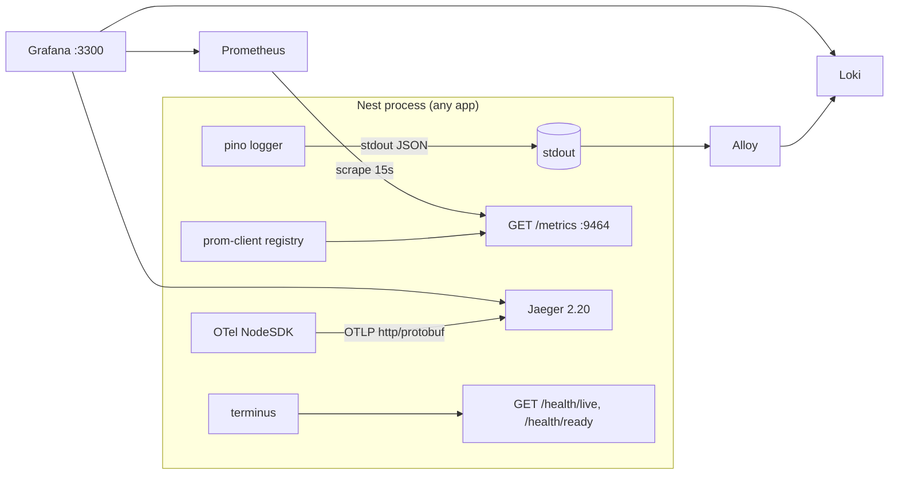

# Observability

How the boilerplate emits logs, metrics, traces and health signals, and how to read them.
Everything here is wired by one global module, `ObservabilityModule.forRoot()` from
[`@platform/observability`](../libs/observability/README.md), which every app imports right after
`AppConfigModule.forRoot()`. For the local stack (Prometheus, Grafana, Jaeger, Loki) see
[DOCKER.md](DOCKER.md). For the env var catalogue see [CONFIGURATION.md](CONFIGURATION.md).

## Overview

| Signal           | Produced by                                                                          | Where it goes                                              | Local UI                                    |
| ---------------- | ------------------------------------------------------------------------------------ | ---------------------------------------------------------- | ------------------------------------------- |
| Logs             | pino (nestjs-pino), JSON on stdout                                                   | container stdout → Grafana Alloy → Loki (`logs` profile)   | Grafana Explore, `http://localhost:3300`    |
| Metrics          | prom-client (`@willsoto/nestjs-prometheus`), `GET /metrics` on `METRICS_PORT` (9464) | scraped by Prometheus every 15 s (`observability` profile) | Grafana dashboard, `http://localhost:3300`  |
| Traces           | OpenTelemetry Node SDK, preloaded by `src/instrument.ts`                             | OTLP/HTTP → Jaeger 2.20 (`observability` profile)          | Jaeger `http://localhost:16686`, or Grafana |
| Health           | `@nestjs/terminus`, `GET /health/live` + `GET /health/ready`                         | orchestrator probes, Docker `HEALTHCHECK`, k6 `setup()`    | curl                                        |
| Observe (opt-in) | `@nestjs/observe`, only when its credentials are set                                 | the Observe backend                                        | Observe                                     |



One id ties the signals together: the **request id** is in every log line (`requestId`), in the
`x-request-id` response header, in GraphQL error `extensions.requestId`, in problem+json error
bodies, and it is the Observe trace id. When tracing is on, every log line also carries
`trace_id`/`span_id`, and Grafana links a Loki line to its Jaeger trace. The other direction works
too: HTTP, gRPC and Kafka spans carry `app.request_id` (and `app.correlation_id` for gRPC and Kafka),
so a Jaeger search by request id finds the trace behind a support ticket.

## Logs (pino)

Every app logs **one JSON object per line on stdout** through nestjs-pino. Use Nest's `Logger`
(`new Logger(MyService.name)`); `console.*` is banned by lint. The parameters come from
`buildLoggerParams()` in
[`libs/observability/src/logging/logger-params.ts`](../libs/observability/src/logging/logger-params.ts).

### Fields

| Field                                 | Value                                                                                                                                                             |
| ------------------------------------- | ----------------------------------------------------------------------------------------------------------------------------------------------------------------- |
| `level`                               | A label (`info`, `warn`, …), not pino's number. Alloy lifts it into a Loki stream label.                                                                          |
| `time`                                | Epoch milliseconds (pino default).                                                                                                                                |
| `service`, `pid`, `hostname`          | `SERVICE_NAME`, the process id and the host name, on every line.                                                                                                  |
| `requestId`                           | The request id of the HTTP request, gRPC call, Kafka message or WebSocket message being handled (see below).                                                      |
| `context`                             | The Nest `Logger` context (class name).                                                                                                                           |
| `trace_id`, `span_id`, `trace_flags`  | The active OpenTelemetry span, only when one is active (tracing on).                                                                                              |
| `req` / `res` (request-complete line) | Trimmed on purpose: `req { id, method, url, remoteAddress }` (no headers, no query string, which may carry tokens) and `res { statusCode }`, plus `responseTime`. |
| `err`                                 | A serialized error with stack, for server-side failures only.                                                                                                     |
| `error`                               | `{ type, message, code }` without a stack, for gRPC/Kafka handlers that failed because of the caller (see levels).                                                |

Loggers called inside a request bind only `requestId` (`quietReqLogger`), not the whole request,
so in-handler lines stay small.

### Request and correlation ids across transports

Two ids exist. The **request id** identifies one hop (one HTTP request, one gRPC call, one Kafka
message). The **correlation id** identifies the whole call chain and survives hops. Both must
match `[A-Za-z0-9._:-]{1,128}`. An invalid incoming value is replaced with a fresh UUIDv7, never
echoed back, which prevents log and header injection.

| Transport            | Request id                                                                                                                                | Correlation id                                                                      | Propagated outward as                                                                        |
| -------------------- | ----------------------------------------------------------------------------------------------------------------------------------------- | ----------------------------------------------------------------------------------- | -------------------------------------------------------------------------------------------- |
| HTTP (REST, GraphQL) | Valid incoming `x-request-id`, else a UUIDv7. Fastify `request.id`, the log `requestId` and `cls.getId()` all hold the same value.        | Valid incoming `x-correlation-id`, else the request id.                             | Both are response headers (exposed to browsers via CORS); `requestId` in problem+json bodies |
| gRPC (server side)   | Metadata `x-request-id`, else `x-correlation-id`, else a UUIDv7; stable per call.                                                         | Metadata `x-correlation-id`.                                                        | Outgoing gRPC metadata (`createOutgoingMetadata`), with `x-user-id` / `x-user-roles`         |
| Kafka consumer       | Log `requestId`: the record header `x-correlation-id` (records carry no `x-request-id`), else a UUIDv7. `cls.getId()`: the envelope `id`. | Header `x-correlation-id`, else the envelope `correlationId`, else the envelope id. | Envelope `correlationId` + `x-correlation-id` header on every event the handler publishes    |
| WebSocket            | A fresh id per message (a socket lives for hours; one id per socket would merge unrelated messages).                                      | —                                                                                   | —                                                                                            |

Because the gateway forwards its request id as gRPC metadata and the service adopts it, **one
`requestId` covers the gateway line and the gRPC service lines of the same request**. Kafka
consumers log under the event's correlation id (the `x-correlation-id` record header), so one
chain shares a `requestId` across events: observed live, the `event completed` lines of a
registration's `identity.user-registered.v1` and the resulting
`notifications.notification-created.v1` carry the same `requestId`. The lines do not carry a
separate `correlationId` field.

```bash
# No token → 401, logged at warn with requestId "demo-123" (probes would not be logged at all)
curl -si http://localhost:3000/v1/auth/me -H 'x-request-id: demo-123' | grep -i x-request-id
# x-request-id: demo-123
```

```logql
{service=~".+"} | json | requestId = "demo-123"
```

### Levels

`LOG_LEVEL` (default `info`; one of `fatal error warn info debug trace silent`) sets the minimum
level. On top of it, the boilerplate picks levels so that **errors mean "the service is broken"**
and a caller's mistake never pages anyone:

| What happened                                                                                                                                                                                                                                                                                     | Level                                                 |
| ------------------------------------------------------------------------------------------------------------------------------------------------------------------------------------------------------------------------------------------------------------------------------------------------- | ----------------------------------------------------- |
| HTTP request completed, 2xx/3xx                                                                                                                                                                                                                                                                   | `info`                                                |
| HTTP request completed, 4xx                                                                                                                                                                                                                                                                       | `warn`                                                |
| HTTP request completed, 5xx or with an error                                                                                                                                                                                                                                                      | `error`                                               |
| `GET /health*` and `GET /metrics`                                                                                                                                                                                                                                                                 | not auto-logged at all (probes, scrapes)              |
| `AllExceptionsFilter`, status ≥ 500                                                                                                                                                                                                                                                               | `error` with `err` (stack)                            |
| `AllExceptionsFilter`, status < 500 (the request-complete line already reports it as `warn`)                                                                                                                                                                                                      | `debug`                                               |
| gRPC/Kafka handler failed because of the caller: `DomainException`/`HttpException` < 500, zod errors, client-class gRPC codes (`INVALID_ARGUMENT`, `NOT_FOUND`, `ALREADY_EXISTS`, `PERMISSION_DENIED`, `RESOURCE_EXHAUSTED`, `FAILED_PRECONDITION`, `ABORTED`, `OUT_OF_RANGE`, `UNAUTHENTICATED`) | `warn` with `error { type, message, code }`, no stack |
| gRPC/Kafka handler failed server-side (anything else)                                                                                                                                                                                                                                             | `error` with `err`                                    |
| kafkajs' own retry and reconnect ERROR lines                                                                                                                                                                                                                                                      | `warn`                                                |
| Readiness contributor failed                                                                                                                                                                                                                                                                      | `warn`                                                |

Every line carries `requestId` exactly once: the `AllExceptionsFilter` line gets it from the
request-scoped logger and does not add its own copy (strict JSON parsers reject duplicate keys).
Keep the 5xx doubling in mind for alert rules: during an upstream outage each failed gateway
request writes **two** `error` lines (the filter line with the real exception and stack, and the
pino-http request-complete line with `res.statusCode` 503), and the circuit breaker adds a `warn`
(`Circuit "billing" OPEN: failing fast`) when it opens. Count requests from the metrics, not from
error lines.

### Redaction

These paths are replaced with `[REDACTED]` before a line is written (`LOG_REDACT_PATHS`):
`req.headers.authorization`, `req.headers.cookie`, `req.headers["x-api-key"]`,
`res.headers["set-cookie"]`, top-level `password`, `token`, `accessToken`, `refreshToken`, and one
level deep `*.password`, `*.passwordHash`, `*.token`, `*.accessToken`, `*.refreshToken`, `*.secret`,
`*.apiKey`. Domains add their own paths through the app composition: the monolith and the gateway
pass billing's `BILLING_LOG_REDACT_PATHS` (`req.headers["stripe-signature"]`) to
`ObservabilityModule.forRoot({ redactPaths })`. Headers are listed even though the serializers
already drop them, so a future serializer change cannot leak credentials. Keep the list short: every
wildcard costs time on every log line. Never log a request body wholesale. gRPC/Kafka payloads are
not logged (`includePayload: false`).

### Output and pretty printing

- Production writes through an **async** `pino.destination` (4 KiB buffer, flushed at least every
  second). On shutdown `TelemetryFlushService` flushes it, so the last lines are not lost.
- `LOG_PRETTY=true` switches to the `pino-pretty` worker transport (single-line, coloured). It
  defaults to on when `NODE_ENV=development`, costs about 5x the throughput, and needs the
  `pino-pretty` devDependency (absent from production images, where the flag falls back to JSON).
- Before Nest finishes booting, `createBootstrapLogger()` writes single-line JSON with the same
  `service` field, so boot errors are parseable too.
- Local log shipping: `docker compose --profile logs up -d` starts Loki and Grafana Alloy. Alloy
  tails this compose project's containers, keeps `trace_id`/`span_id` as structured metadata, and
  lifts `level` into a label. In Grafana, the Loki datasource turns `trace_id` into a link to Jaeger.

## Metrics (Prometheus)

### What is exported

| Metric                                                                | Type      | Labels                                     | Source                                                                                                                                                                                                                                                                                                                                                                                                                                                                                                                                                                                                                                                                                                                                                                                                                                                                               |
| --------------------------------------------------------------------- | --------- | ------------------------------------------ | ------------------------------------------------------------------------------------------------------------------------------------------------------------------------------------------------------------------------------------------------------------------------------------------------------------------------------------------------------------------------------------------------------------------------------------------------------------------------------------------------------------------------------------------------------------------------------------------------------------------------------------------------------------------------------------------------------------------------------------------------------------------------------------------------------------------------------------------------------------------------------------ |
| `http_request_duration_seconds` (`_bucket`, `_sum`, `_count`)         | histogram | `method`, `route`, `status_code`           | Fastify `onResponse` hook (`HttpMetricsHook`); buckets 5 ms, 10, 25, 50, 100, 250, 500 ms, 1, 2.5, 5 s                                                                                                                                                                                                                                                                                                                                                                                                                                                                                                                                                                                                                                                                                                                                                                               |
| `process_*`, `nodejs_*` (CPU, RSS, heap, GC, event-loop lag, handles) | various   | —                                          | prom-client default metrics (event-loop monitoring precision 10 ms)                                                                                                                                                                                                                                                                                                                                                                                                                                                                                                                                                                                                                                                                                                                                                                                                                  |
| `grpc_server_handled_total`                                           | counter   | `grpc_service`, `grpc_method`, `grpc_code` | every `@GrpcController()` (`GrpcMetricsInterceptor`); `grpc_code` is the grpc status name the controller's filter sends (`OK`, `NOT_FOUND`, …)                                                                                                                                                                                                                                                                                                                                                                                                                                                                                                                                                                                                                                                                                                                                       |
| `grpc_server_handling_seconds` (`_bucket`, `_sum`, `_count`)          | histogram | `grpc_service`, `grpc_method`              | same interceptor; HTTP buckets                                                                                                                                                                                                                                                                                                                                                                                                                                                                                                                                                                                                                                                                                                                                                                                                                                                       |
| `grpc_client_handled_total`                                           | counter   | `grpc_service`, `grpc_method`, `grpc_code` | every `grpcCall`; `grpc_code` is the grpc status name, `DEADLINE_EXCEEDED` for the local deadline, `CIRCUIT_OPEN` when the breaker rejected without sending, `UNKNOWN` otherwise                                                                                                                                                                                                                                                                                                                                                                                                                                                                                                                                                                                                                                                                                                     |
| `grpc_principal_assertions_total`                                     | counter   | `outcome`                                  | every gRPC server with `GRPC_PRINCIPAL_ASSERTION` `warn` or `enforce` (`GrpcContextInterceptor`): one per call carrying a user or an assertion, by outcome: `valid`, `missing` (an old gateway or ai-service), `expired`, `invalid` or `mismatch` (the plain headers differ from the claims). Anonymous calls are not counted; the series appear with the first counted call. Watch it during the rollout ([SECURITY.md](SECURITY.md#signed-principal-assertion))                                                                                                                                                                                                                                                                                                                                                                                                                    |
| `grpc_client_handling_seconds` (`_bucket`, `_sum`, `_count`)          | histogram | `grpc_service`, `grpc_method`              | same function; HTTP buckets                                                                                                                                                                                                                                                                                                                                                                                                                                                                                                                                                                                                                                                                                                                                                                                                                                                          |
| `grpc_client_circuit_breaker_state`                                   | gauge     | `upstream`, `state`                        | every `GrpcCircuitBreakers` (one per `GrpcClientsModule.register()`); one-hot, 1 for the current `state` (`closed`, `half_open`, `open`), 0 for the other two. A hung upstream cycles it `open` and `half_open` (the probe waits out `GRPC_DEADLINE_MS`), and an idle breaker stays `half_open` until its next call, so alert on `state!="closed"` together with that upstream's rejected or failed calls (`GrpcCircuitBreakerOpen`), not on `state="open"` alone                                                                                                                                                                                                                                                                                                                                                                                                                    |
| `grpc_client_circuit_breaker_events_total`                            | counter   | `upstream`, `event`                        | every `GrpcCircuitBreakers`, from the opossum events of each breaker: `success` (also a caller error such as `NOT_FOUND` that the breaker's `errorFilter` lets through: the upstream is healthy), `failure` (an upstream failure, including a failed half-open probe) and `reject` (refused without sending: open, or half-open with the probe already out). The three series of an upstream start at 0 when its breaker is created; a breaker is created by its first call, so `increase()` counts that first event only when a scrape saw the zeros first. `grpc_client_handled_total` has no `upstream` label: use this counter to tell the upstreams of one service apart                                                                                                                                                                                                        |
| `kafka_consumer_messages_total`                                       | counter   | `topic`, `outcome`                         | every `@KafkaConsumerController()` message. `success`: the handler completed, after in-process retries if any (`KafkaContextInterceptor`); `dead_letter`: published to `<topic>.dlq` (`KafkaDeadLetterFilter`); `redelivery`: left for kafkajs to redeliver, a `KafkaRetriableException` or a failed DLQ publish. `InstrumentedServerKafka` starts all three at 0 for every subscribed topic, so the first dead letter is an increase and `KafkaDeadLetters` pages on it                                                                                                                                                                                                                                                                                                                                                                                                             |
| `kafka_consumer_retries_total`                                        | counter   | `topic`                                    | in-process retries of a failing handler (`KafkaRetryInterceptor`), one per retry                                                                                                                                                                                                                                                                                                                                                                                                                                                                                                                                                                                                                                                                                                                                                                                                     |
| `kafka_consumer_lag`                                                  | gauge     | `group`, `topic`, `partition`              | kafkajs `END_BATCH_PROCESS` `offsetLag`, set by `InstrumentedServerKafka` at the end of each batch: it holds the last batch's value while a partition is idle or its handler hangs, so it shows a consumer that is too slow, not one that is stuck                                                                                                                                                                                                                                                                                                                                                                                                                                                                                                                                                                                                                                   |
| `kafka_consumergroup_lag`                                             | gauge     | `consumergroup`, `topic`, `partition`      | kafka-exporter (compose `observability` profile, scrape job `kafka`, `service="kafka"`), read from the broker: the log-end offset minus the group's committed offset, so it stays current while a handler hangs                                                                                                                                                                                                                                                                                                                                                                                                                                                                                                                                                                                                                                                                      |
| `kafka_consumergroup_current_offset`                                  | gauge     | `consumergroup`, `topic`, `partition`      | same exporter: the group's committed offset                                                                                                                                                                                                                                                                                                                                                                                                                                                                                                                                                                                                                                                                                                                                                                                                                                          |
| `kafka_consumergroup_members`                                         | gauge     | `consumergroup`                            | same exporter: the group's members; a group without members is still reported, with 0                                                                                                                                                                                                                                                                                                                                                                                                                                                                                                                                                                                                                                                                                                                                                                                                |
| `db_pool_connections_in_use`                                          | gauge     | `pool`                                     | `PoolUsage` of the runtime postgres.js pool (`pool="runtime"`) and, where `DATABASE_SYSTEM_URL` is set, of the `app_system` pool (`pool="system"`, at most `DATABASE_SYSTEM_POOL_MAX` connections): operations in flight, capped at the pool size. postgres.js exposes no pool statistics, so an operation is a top-level query from the moment it is awaited until it settles, or a `begin()` transaction for its whole callback (queries inside it are not counted again); `reserve()`, `listen()` and the migration client are not counted                                                                                                                                                                                                                                                                                                                                        |
| `db_pool_operations_waiting`                                          | gauge     | `pool`                                     | operations beyond the pool size (`max(0, outstanding - max)`): they wait for, or are pipelined behind, another operation on the same connection. These are operations, not connections. Sustained `> 0`: raise `DATABASE_POOL_MAX` or shorten transactions                                                                                                                                                                                                                                                                                                                                                                                                                                                                                                                                                                                                                           |
| `db_pool_connections_max`                                             | gauge     | `pool`                                     | the configured pool size (`DATABASE_POOL_MAX` for `pool="runtime"`, `DATABASE_SYSTEM_POOL_MAX` for `pool="system"`)                                                                                                                                                                                                                                                                                                                                                                                                                                                                                                                                                                                                                                                                                                                                                                  |
| `db_system_calls_total`                                               | counter   | `method`, `outcome`                        | `SystemDatabase.run` (`@platform/database`): one per call to the `app_system` (BYPASSRLS) pool, a refused one included. `method` is the system method name, `outcome` `ok` or `error`                                                                                                                                                                                                                                                                                                                                                                                                                                                                                                                                                                                                                                                                                                |
| `db_rls_elevations_total`                                             | counter   | `kind`, `name`                             | `RlsElevation`: one per RLS elevation of a runtime transaction. `kind` is `permission` (`elevate(permission)`) or `justified` (`justified(reason, work)`), `name` the permission or the reason from a closed list                                                                                                                                                                                                                                                                                                                                                                                                                                                                                                                                                                                                                                                                    |
| `outbox_backlog`                                                      | gauge     | `outbox`                                   | `OutboxRelay` (`@platform/outbox`), leader only: unpublished rows at its last poll. Removed when the term ends, so `sum()` over processes never counts a former leader                                                                                                                                                                                                                                                                                                                                                                                                                                                                                                                                                                                                                                                                                                               |
| `outbox_oldest_unpublished_age_seconds`                               | gauge     | `outbox`                                   | same relay, leader only: seconds since the `created_at` of the oldest unpublished row at its last poll, 0 when there is none; removed when the term ends. Alert when it keeps growing (a row the producer refuses blocks the outbox)                                                                                                                                                                                                                                                                                                                                                                                                                                                                                                                                                                                                                                                 |
| `outbox_publish_latency_seconds` (`_bucket`, `_sum`, `_count`)        | histogram | `outbox`, `topic`                          | same relay: acknowledgement time minus `created_at` (commit to publish), once per acknowledged row; buckets 50 ms, 100, 250, 500 ms, 1, 2.5, 5, 10, 30, 60, 300, 900 s                                                                                                                                                                                                                                                                                                                                                                                                                                                                                                                                                                                                                                                                                                               |
| `outbox_published_total`                                              | counter   | `outbox`, `topic`, `outcome`               | same relay: one per publish attempt, `ok` (the broker acknowledged) or `error` (the failed row that ends a batch; it goes out again)                                                                                                                                                                                                                                                                                                                                                                                                                                                                                                                                                                                                                                                                                                                                                 |
| `outbox_relay_leader`                                                 | gauge     | `outbox`                                   | same relay: 1 while this process holds the lock `outbox-relay:<outbox>`, 0 in a process whose relay runs without leading or whose term ended. `sum by (outbox)` should be 1                                                                                                                                                                                                                                                                                                                                                                                                                                                                                                                                                                                                                                                                                                          |
| `ledger_postings_total`                                               | counter   | `outcome`                                  | billing, `LEDGER_ENABLED=true`: ledger entries the posting consumer handled, `posted`, `replayed` (the entry already existed) or `conflict` (same id, different payload)                                                                                                                                                                                                                                                                                                                                                                                                                                                                                                                                                                                                                                                                                                             |
| `ledger_post_duration_seconds` (`_bucket`, `_sum`, `_count`)          | histogram | —                                          | billing: one `LedgerPort.post` (validation, the immudb transaction and its retries)                                                                                                                                                                                                                                                                                                                                                                                                                                                                                                                                                                                                                                                                                                                                                                                                  |
| `ledger_discrepancies_total`                                          | counter   | `kind`                                     | billing: new `billing.ledger_discrepancies` rows by kind (an identical stored finding is not counted)                                                                                                                                                                                                                                                                                                                                                                                                                                                                                                                                                                                                                                                                                                                                                                                |
| `ledger_verified_tx_id`                                               | gauge     | —                                          | billing, `LEDGER_VERIFY=true`: the immudb tx id of the trusted state stored in Postgres (R5)                                                                                                                                                                                                                                                                                                                                                                                                                                                                                                                                                                                                                                                                                                                                                                                         |
| `ledger_unverified_tx_lag`                                            | gauge     | —                                          | billing, `LEDGER_VERIFY=true`: immudb transactions past the trusted state, not yet proven (R5)                                                                                                                                                                                                                                                                                                                                                                                                                                                                                                                                                                                                                                                                                                                                                                                       |
| `ledger_reconciliation_runs_total`                                    | counter   | `status`                                   | billing: finished reconciliation runs, `succeeded` or `failed`                                                                                                                                                                                                                                                                                                                                                                                                                                                                                                                                                                                                                                                                                                                                                                                                                       |
| `ledger_reconciliation_last_success_timestamp_seconds`                | gauge     | —                                          | billing: Unix time of the last succeeded run (absent until the first success after a start)                                                                                                                                                                                                                                                                                                                                                                                                                                                                                                                                                                                                                                                                                                                                                                                          |
| `rate_limit_decisions_total`                                          | counter   | `throttler`, `scope`, `outcome`            | every rate-limit decision, counted once: the guards (`RateLimitGuardBase.recordDecision`: `ip`, `user`, `tenant`, `route`, `auth`, `lockout`, also over WebSocket) and `RateLimitCharger.charge` (`graphql` cost per operation whatever its weight, `ws-handshake`). `scope` is the policy name (`identity.credentials`), `global` or `cost`; `outcome` is `blocked` when the bucket refused, else `allowed` (a fail-open charge is `allowed`; the bypass itself is `rate_limit_fail_open_total{throttler}`). No tracker, key, IP, user or tenant label                                                                                                                                                                                                                                                                                                                              |
| `rate_limit_fail_open_total`                                          | counter   | `throttler`                                | `@platform/redis`: requests let through unmetered because Redis did not answer within `THROTTLE_REDIS_TIMEOUT_MS`, by throttler. Every throttler starts at 0 at boot, so the first fail-open is an increase and `RateLimitFailOpen` fires on it                                                                                                                                                                                                                                                                                                                                                                                                                                                                                                                                                                                                                                      |
| `redis_eviction_policy_safe`                                          | gauge     | —                                          | `@platform/redis`, set once at boot from `INFO memory`: `1` when `maxmemory_policy` is `noeviction`, `0` when Redis can evict keys (the denylist, queues, locks and throttle counters share it; an error line is logged too). Absent when the server hides the policy, or `INFO` fails or does not answer within 2 s. Alert on `== 0`                                                                                                                                                                                                                                                                                                                                                                                                                                                                                                                                                |
| `cache_requests_total`                                                | counter   | `cache`, `outcome`                         | `@platform/redis`: every `AppCacheService.getOrSet`, counted once: `miss` when the call ran the loader, else `hit` (a concurrent call that waited on another's loader is a `hit`). `cache` is the name the caller passes (the user read cache: `user`), else the key's prefix before the first `:` when it is short and made of `[a-z0-9_-]`, else `other`; never the key. A process labels at most 32 distinct names (the first 32 it sees); a further new name is counted as `other` and one warning is logged. The name and the key prefix must still come from a small fixed set of static strings, never from a tenant, user or id (they would use up the 32 and hide later caches under `other`; [libs/redis/README.md](../libs/redis/README.md)). Hit ratio: `sum(rate(cache_requests_total{outcome="hit"}[5m])) by (cache) / sum(rate(cache_requests_total[5m])) by (cache)` |
| `billing_checkout_paid_without_currency_total`                        | counter   | —                                          | billing: paid Stripe Checkout Sessions left pending because no currency was known                                                                                                                                                                                                                                                                                                                                                                                                                                                                                                                                                                                                                                                                                                                                                                                                    |
| `billing_checkout_paid_without_amount_total`                          | counter   | —                                          | billing: paid Stripe Checkout Sessions left pending because no amount was known                                                                                                                                                                                                                                                                                                                                                                                                                                                                                                                                                                                                                                                                                                                                                                                                      |
| `billing_checkout_paid_without_owner_total`                           | counter   | —                                          | billing: paid Stripe Checkout Sessions recorded without a user (first delivery only): the payment is left pending and no receipt is sent                                                                                                                                                                                                                                                                                                                                                                                                                                                                                                                                                                                                                                                                                                                                             |
| `billing_checkout_amount_mismatch_total`                              | counter   | —                                          | billing: paid Checkout Sessions whose charged amount or currency differs from the quote                                                                                                                                                                                                                                                                                                                                                                                                                                                                                                                                                                                                                                                                                                                                                                                              |
| `billing_stripe_api_version_mismatch_total`                           | counter   | —                                          | billing: Stripe webhook events whose `api_version` differs from `STRIPE_API_VERSION`                                                                                                                                                                                                                                                                                                                                                                                                                                                                                                                                                                                                                                                                                                                                                                                                 |
| `billing_checkout_without_idempotency_key_total`                      | counter   | —                                          | billing: checkout requests (REST, GraphQL, gRPC) that sent no `Idempotency-Key`; each is also logged at debug with only `userId` and `tenantId`. The header stays optional: this shows how many clients skip it                                                                                                                                                                                                                                                                                                                                                                                                                                                                                                                                                                                                                                                                      |
| `mail_jobs_total`                                                     | counter   | `outcome`                                  | `@platform/mailer` (`MailProcessor`), only in a process that runs the mail worker: one per finished attempt, `sent`, `retried` (failed, attempts left) or `failed` (out of attempts or a permanent error: the mail is not sent). All three start at 0, so the first `failed` is an increase and `MailJobsFailed` fires on it                                                                                                                                                                                                                                                                                                                                                                                                                                                                                                                                                         |
| `ai_requests_total`                                                   | counter   | `model`, `outcome`                         | `@platform/ai` (`AiMetrics`), the process that runs the AI chat (monolith or ai-service): one per model call, `success`, `error` (502 `AI_UPSTREAM_ERROR`), `timeout` (504 `AI_TIMEOUT`) or `aborted` (the caller left); `model` is the requested model, bounded by `AI_ALLOWED_MODELS`. Refusals before a call (`AI_DISABLED`, …) and a streamed turn whose caller left before its call are not counted                                                                                                                                                                                                                                                                                                                                                                                                                                                                             |
| `ai_tokens_total`                                                     | counter   | `model`, `kind`                            | same: tokens used, `input` or `output`, summed over a call's steps                                                                                                                                                                                                                                                                                                                                                                                                                                                                                                                                                                                                                                                                                                                                                                                                                   |
| `ai_request_duration_seconds`                                         | histogram | `model`                                    | same (`_bucket`, `_sum`, `_count`): one model call, a whole stream for streamed calls; buckets 0.25, 0.5, 1, 2, 5, 10, 20, 30, 60, 120, 300 s                                                                                                                                                                                                                                                                                                                                                                                                                                                                                                                                                                                                                                                                                                                                        |

The `db_pool_*` gauges describe the app's client pool: behind PgBouncer (program spec §16, sharding
design) they are the demand towards PgBouncer, whose `SHOW POOLS` columns `cl_waiting` and `sv_active` are the
server-side view.

Label rules:

- `route` is the matched route **template** (`/v1/users/:id`), never the raw URL. Raw paths carry
  ids and would create one time series per entity until Prometheus runs out of memory. Requests
  that match no route (404s, scanners) share one `route="UNMATCHED"` series.
- There is **no `service` label from the app**. Prometheus adds it from the scrape target (see
  below); a second one would conflict.
- The hook is a Fastify hook, not a Nest interceptor, so it also counts 404s, guard rejections
  (401/403), throttling (429), body-parser errors and the final status chosen by exception filters.
- GraphQL over HTTP shows up as `POST /graphql`. WebSocket, gRPC and Kafka traffic is not HTTP and
  is **not** in this histogram. `/metrics` itself is excluded; `/health/*` probes are counted.

`grpc_service` is the fully qualified proto service name on both sides (`billing.v1.BillingService`),
read from the grpc-js path on the server and from the adapter's `operation` on the client. There are
no Redis command or query-latency metrics: Postgres and Redis themselves are covered
by `postgres-exporter` and `redis-exporter` in the `observability` profile.

Add your own with the re-exported helpers:

```ts
import { InjectMetric, makeCounterProvider } from '@platform/observability';
import type { Counter } from 'prom-client';

// module providers
makeCounterProvider({ name: 'orders_placed_total', help: 'Orders placed', labelNames: ['plan'] });

// service
constructor(@InjectMetric('orders_placed_total') private readonly placed: Counter<'plan'>) {}
```

Keep label values bounded (enums, route templates), never ids or emails.

### `GET /metrics` and its protection

`/metrics` is served by a separate `node:http` listener on `METRICS_PORT` (default `9464`; host dev
`9464`-`9468`, see each `apps/*/.env.example`), **never on the API port**, which answers 404 for
it. The listener bypasses the API's auth guards, throttler, maintenance mode and logs by
construction. `METRICS_PORT` must differ from `PORT` and a port already in use fails the boot.

| Setting                                    | Effect                                                                                                                                                                                           |
| ------------------------------------------ | ------------------------------------------------------------------------------------------------------------------------------------------------------------------------------------------------ |
| `METRICS_ENABLED=false`                    | No metrics listener is opened and default metrics are not collected.                                                                                                                             |
| `METRICS_BEARER_TOKEN=<at least 16 chars>` | Scrapes must send `Authorization: Bearer <token>` (compared in constant time). A missing or wrong token gets **404**, the same as a disabled endpoint, so the route's existence is not revealed. |
| neither                                    | Open (the local default).                                                                                                                                                                        |

```bash
curl -s http://localhost:9464/metrics | grep '^http_request_duration_seconds_count' | head
curl -s -H "Authorization: Bearer $METRICS_BEARER_TOKEN" http://localhost:9464/metrics | head
```

In production, **never publish `METRICS_PORT` outside the cluster network** (and never route `/docs`
through the public ingress): scrape it from inside the cluster, and set `METRICS_BEARER_TOKEN` as defence in depth (Prometheus:
`authorization: { credentials_file: … }` on the scrape job). See [SECURITY.md](SECURITY.md).

### Cluster mode

With `CLUSTER_WORKERS` > 1 (monolith and gateway use `runClustered()`), each worker has its own
registry, so a worker's `/metrics` would only show its own counters. Instead, the primary serves the
aggregate on `METRICS_PORT`: it asks every worker over IPC and returns the sum of every worker's
registry (prom-client `AggregatorRegistry`). Workers never bind the metrics port, and the primary
refuses to start when `METRICS_PORT` equals `PORT`.

### Scrape configuration (local)

[`docker/prometheus/prometheus.yml`](../docker/prometheus/prometheus.yml) (scrape interval 15 s,
retention 7 days):

| Job                                         | Targets                                                                                                                                                                                      | `service` label               |
| ------------------------------------------- | -------------------------------------------------------------------------------------------------------------------------------------------------------------------------------------------- | ----------------------------- |
| `nestjs-apps`                               | DNS service discovery of `monolith`, `gateway`, `identity-service`, `notifications-service`, `billing-service`, `ai-service` on port 9464; one target per replica, so `--scale` is picked up | the compose service name      |
| `host-apps`                                 | `host.docker.internal:9464`…`9468` (apps started with `bun run dev:*`)                                                                                                                       | `host:9464` … `host:9468`     |
| `kafka`                                     | `kafka-exporter:9308` (broker-side consumer group lag, committed offsets and members)                                                                                                        | `kafka`                       |
| `postgres`, `redis`, `jaeger`, `prometheus` | exporters and the tools themselves                                                                                                                                                           | `postgres`, `redis`, `jaeger` |

Containers never publish `9464`, so the `host-apps` targets cannot duplicate the in-network
`nestjs-apps` job.

`KafkaConsumerGroupStalled` reads the `kafka` job's series, so a production cluster needs the same
exporter (or another source of `kafka_consumergroup_*`) for that alert to fire.

### Outbox, ledger and AI alerts

[`docker/prometheus/rules/`](../docker/prometheus/rules) holds five rule files (`outbox`, `ledger`, `ai`, `platform`, `billing`), loaded through `rule_files` in
`prometheus.yml` and mounted by the compose `prometheus` service. Prometheus only evaluates them: compose runs no
Alertmanager, so route `severity` in your own (`page` wakes someone, `ticket` waits for working hours).
`scripts/prometheus-rules.spec.ts` pins the alert names, severities, thresholds and that every `expr` reads a series
of the table above.

| Alert                             | Severity | Fires when                                                                                                                                                                                                                                                                                                                                                                                                                                                        | First look                                                                                                                                                                                                                                    |
| --------------------------------- | -------- | ----------------------------------------------------------------------------------------------------------------------------------------------------------------------------------------------------------------------------------------------------------------------------------------------------------------------------------------------------------------------------------------------------------------------------------------------------------------- | --------------------------------------------------------------------------------------------------------------------------------------------------------------------------------------------------------------------------------------------- |
| `OutboxBacklogStuck`              | page     | `outbox_oldest_unpublished_age_seconds` above 300 for 5 minutes                                                                                                                                                                                                                                                                                                                                                                                                   | the leader's logs (`OutboxRelay:<outbox>`), Kafka reachability, the first unpublished row; a poison row blocks the outbox                                                                                                                     |
| `OutboxPublishErrors`             | ticket   | `outbox_published_total{outcome="error"}` has a rate above 0 for 10 minutes                                                                                                                                                                                                                                                                                                                                                                                       | the `topic` label, then the broker and the envelope of the failing row                                                                                                                                                                        |
| `OutboxNoLeader`                  | page     | no process reports `outbox_relay_leader == 1` for 5 minutes                                                                                                                                                                                                                                                                                                                                                                                                       | `OUTBOX_RELAY_ENABLED`, `DATABASE_SYSTEM_URL` (no system pool, no relay), Redis (the lock), the owning service                                                                                                                                |
| `LedgerDiscrepancy`               | ticket   | any increase of `ledger_discrepancies_total` within one hour                                                                                                                                                                                                                                                                                                                                                                                                      | `billing.ledger_discrepancies` by `kind`: `expected` and `actual` JSON and `source_key`; the ledger is never corrected                                                                                                                        |
| `LedgerTamperEvidence`            | page     | `kind` `verification_failed` or `ledger_row_mutated` increases within one hour                                                                                                                                                                                                                                                                                                                                                                                    | an incident: immudb proofs or a rewritten row ([SECURITY.md](SECURITY.md#immudb-state-signing-key))                                                                                                                                           |
| `LedgerPostConflict`              | ticket   | `ledger_postings_total{outcome="conflict"}` increases within one hour                                                                                                                                                                                                                                                                                                                                                                                             | the `post_conflict` row names the source key; the same Stripe transaction produced a different payload                                                                                                                                        |
| `LedgerReconciliationStale`       | page     | the last success of the hourly reconciliation is older than 3 hours                                                                                                                                                                                                                                                                                                                                                                                               | `ledger_reconciliation_runs_total{status="failed"}`, the billing logs (`Ledger reconciliation run finished`), immudb health                                                                                                                   |
| `KafkaDeadLetters`                | page     | any increase of `kafka_consumer_messages_total{outcome="dead_letter"}` within 15 minutes, per `service` and `topic`                                                                                                                                                                                                                                                                                                                                               | the dead-letter runbook below: that service's logs and the `x-error-*` headers of the `.dlq` record                                                                                                                                           |
| `KafkaRedeliveries`               | ticket   | `kafka_consumer_messages_total{outcome="redelivery"}` has a rate above 0 for 15 minutes, per `service` and `topic`                                                                                                                                                                                                                                                                                                                                                | the retriable error in that service's logs (a dependency down, or the DLQ publish failing) and the consumer lag                                                                                                                               |
| `KafkaConsumerLagGrowing`         | ticket   | `kafka_consumer_lag` above 1000 and higher than 15 minutes ago, for 15 minutes: a consumer that progresses too slowly. A hung handler freezes the gauge and does not fire; `KafkaConsumerGroupStalled` covers it                                                                                                                                                                                                                                                  | the handler's latency, the redeliveries of the topic, the replica count against the partitions                                                                                                                                                |
| `KafkaConsumerGroupStalled`       | page     | `kafka_consumergroup_lag` above 0 while the group's `kafka_consumergroup_current_offset` on that partition has not moved for 10 minutes and `kafka_consumergroup_members` is above 0, for 5 minutes (kafka-exporter, per `consumergroup`, `topic` and `partition`): a live consumer that stopped committing, a hung handler or a message redelivered in a loop. A group without members (its service is down, or the other topology left it behind) fires nothing | the consuming service's logs and `kafka_consumer_messages_total` of the topic; a group that no longer reads the topic pages until its offsets there are deleted (`kafka-consumer-groups.sh --delete-offsets --group <group> --topic <topic>`) |
| `GrpcCircuitBreakerOpen`          | page     | `grpc_client_circuit_breaker_state{state!="closed"}` is 1 for 5 minutes, per `service` and `upstream`, while that same upstream rejects or fails calls (`grpc_client_circuit_breaker_events_total{event=~"reject\|failure"}` rate over 2 m above 0). An idle `half_open` breaker next to a refusing one stays silent; failed half-open probes count, so it covers traffic of at least about one call a minute; one burst followed by silence never pages          | the upstream's health, latency and logs; `grpc_client_circuit_breaker_events_total` of that `upstream` by `event`                                                                                                                             |
| `GrpcUpstreamFailing`             | ticket   | at least 3 `failure` events of `grpc_client_circuit_breaker_events_total` in 15 minutes and more failures than successes in the same window, per `service` and `upstream`, for 5 minutes: failing calls on a path too quiet to open its breaker (10 calls in 10 s). Fewer than 3 calls in 15 minutes raise nothing; `reject` is left out (those calls never reached the upstream)                                                                                 | the upstream's health and logs; `grpc_client_handled_total` by `grpc_code` for its `grpc_service`                                                                                                                                             |
| `RateLimitFailOpen`               | ticket   | any increase of `rate_limit_fail_open_total` within 5 minutes, per `service` and `throttler`                                                                                                                                                                                                                                                                                                                                                                      | Redis latency, memory and connections, `THROTTLE_REDIS_TIMEOUT_MS`; rate limiting is off for that throttler meanwhile                                                                                                                         |
| `DbPoolSaturated`                 | ticket   | `db_pool_operations_waiting` above 0 for 10 minutes, per `service` and `pool`                                                                                                                                                                                                                                                                                                                                                                                     | slow queries and long transactions; `db_pool_connections_in_use` against `db_pool_connections_max`                                                                                                                                            |
| `HttpServerErrorRatio`            | page     | 5xx responses above 5 % of a service's `http_request_duration_seconds_count` (5 m rates) for 10 minutes                                                                                                                                                                                                                                                                                                                                                           | the 5xx count by `route`, that route's error logs by `requestId`, the circuit breaker state                                                                                                                                                   |
| `RedisEvictionPolicyUnsafe`       | ticket   | `redis_eviction_policy_safe` is 0 for 5 minutes                                                                                                                                                                                                                                                                                                                                                                                                                   | `maxmemory-policy` must be `noeviction` ([SECURITY.md](SECURITY.md)); restart the service so the boot check runs again                                                                                                                        |
| `MailJobsFailed`                  | ticket   | any increase of `mail_jobs_total{outcome="failed"}` within 15 minutes, per `service`                                                                                                                                                                                                                                                                                                                                                                              | the worker's "Giving up on" log lines (recipients masked), the SMTP settings; failed jobs stay 7 days in the `mail` queue                                                                                                                     |
| `BillingPaidWithoutCurrency`      | page     | any increase of `billing_checkout_paid_without_currency_total` within 15 minutes                                                                                                                                                                                                                                                                                                                                                                                  | the Stripe dashboard: the session is paid, the payment stays pending and no receipt is sent                                                                                                                                                   |
| `BillingPaidWithoutAmount`        | page     | any increase of `billing_checkout_paid_without_amount_total` within 15 minutes                                                                                                                                                                                                                                                                                                                                                                                    | the Stripe dashboard: the same, with no amount known                                                                                                                                                                                          |
| `BillingPaidWithoutOwner`         | page     | any increase of `billing_checkout_paid_without_owner_total` within 15 minutes                                                                                                                                                                                                                                                                                                                                                                                     | the session's metadata in the Stripe dashboard: attribute the payment by hand                                                                                                                                                                 |
| `BillingAmountMismatch`           | ticket   | any increase of `billing_checkout_amount_mismatch_total` within 15 minutes                                                                                                                                                                                                                                                                                                                                                                                        | promotion codes, tax and price changes in Stripe; the charged values were recorded                                                                                                                                                            |
| `BillingStripeApiVersionMismatch` | ticket   | any increase of `billing_stripe_api_version_mismatch_total` within 15 minutes                                                                                                                                                                                                                                                                                                                                                                                     | the webhook endpoint's API version in Stripe against `STRIPE_API_VERSION`                                                                                                                                                                     |
| `AiErrorRate`                     | ticket   | `error` and `timeout` calls of `ai_requests_total` above 10 % of a model's calls (5 m rates) for 10 minutes; `aborted` excluded                                                                                                                                                                                                                                                                                                                                   | OpenRouter's status and the model's provider, the app logs (error name and upstream status only), the key's credit, `AI_REQUEST_TIMEOUT_MS`; consider `AI_FALLBACK_MODELS` ([AI.md](AI.md#models))                                            |

Reading the series:

- **Leader only.** The backlog and age are set by the leader of an outbox and removed when its term ends, so
  `max by (outbox)` is the right aggregation over replicas, and a missing series means no leader or an empty,
  never-polled outbox (`OutboxNoLeader` covers the first).
- **Ledger series exist only where `LEDGER_ENABLED=true`.** With the ledger off nothing reports and no ledger alert
  fires. `LedgerReconciliationStale` needs one success since the process started to have a series: a ledger that never
  reconciles shows in `ledger_reconciliation_runs_total{status="failed"}` and in the billing logs.
- **AI series exist only where the chat runs** (the monolith or ai-service) and only after a first call; with
  `AI_ENABLED=false` nothing calls a model and `AiErrorRate` never fires. Client aborts are a user closing a stream,
  not an outage, so the alert leaves them out; a high `aborted` share is worth a look at latency instead.
- **Counters that start at 0.** Prometheus' `increase()` misses the first increment of a series that appears with
  it, so an alert on "any increase" needs the series to exist before the event. The billing counters and
  `MailJobsFailed`'s `mail_jobs_total` (all three outcomes, started by `MailProcessor`) and
  `rate_limit_fail_open_total` (every throttler, at boot) and the `kafka_consumer_messages_total` series of each
  subscribed topic are created at 0 when the process starts. A new alert on a labelled counter must do the same
  (the billing counters have no labels, so registering them is enough).
- **Platform and billing rules.** `platform.rules.yml` covers Kafka, gRPC breakers, rate limiting, the database pool,
  the HTTP 5xx ratio, the Redis eviction check and mail; `billing.rules.yml` covers money that Stripe reported paid
  but the platform did not apply or that differs from the quote. Alerts on series that only the process owning the
  feature reports stay silent where nothing reports them: the `redis_eviction_policy_safe` gauge (set once at boot),
  the `db_pool_*` gauges and the `mail_jobs_total` counter (started by the processes that run the mail worker). Billing alerts are `page` when a customer paid and nothing was applied, `ticket` when the
  platform recorded the charge and only differs from the quote or the pinned API version.
- **Outbox runbook.** A relay that stopped: fix the cause, the rows go out in `created_at` order and are delivered at
  least once. A row the broker always refuses (an oversized or invalid envelope): inspect it as `app_system` and decide;
  deleting an unpublished row loses that event, so prefer fixing the topic. Consumers deduplicate on the envelope id.
- **Dead-letter runbook (`KafkaDeadLetters`).** A consumer gave up on a message after its in-process retries (or at
  once, for a 4xx-class error or a `ZodError`) and published it to `<topic>.dlq`; the event's effect is missing until
  it is replayed. For example, a dead-lettered `identity.membership-created.v1` means the notifications recipient row is
  missing and that member's payment receipts are not mailed. Find the cause in the service's logs and the
  `x-error-type` / `x-error-message` headers of the `.dlq` record, fix and deploy it, then replay the topic as a
  one-off Job from the consuming app's image (gateway, monolith, notifications-service or billing-service), with the
  app's Kafka settings (`KAFKA_BROKERS`, `KAFKA_SSL`, `KAFKA_SASL_*`):
  `node dist/cli/dlq-replay.js <topic> --dry-run`, then without `--dry-run`. Kubernetes: a Job with
  `args: [dist/cli/dlq-replay.js, <topic>]`. Compose:
  `docker compose run --rm --no-deps notifications-service dist/cli/dlq-replay.js <topic>`.
  Exit codes: 0 replayed, 1 a record from another topic was skipped or the replay failed, 2 usage.
  Progress is committed to `<topic>.dlq-replay`, so a second run replays only newer dead letters, and consumers deduplicate on the envelope id ([API.md](API.md#replaying-a-dead-letter-topic)). In notifications-service a dead-lettered `identity.user-registered.v1` or `billing.payment-succeeded.v1` may be a push-only failure (the inbox row and the mail were already written), and replaying it after the dedupe window sends the mail again (BullMQ keeps the deduplicated mail job for 24 h, or until 10,000 newer mail jobs have completed, whichever comes first). The shipped
  `docker/kafka/topics.txt` keeps `.dlq` records for **14 days** (`retention.ms=1209600000`); a dead letter not
  replayed by then is deleted. In production, raise the `.dlq` retention on your cluster or archive the topics
  elsewhere so an incident found late can still be replayed. The alert resolves 15 minutes after the last dead
  letter, so it does not say whether the replay ran: check the replay's log line (`Replayed N record(s)`).
- **Enabling the ledger later.** `LEDGER_ENABLED=false` writes no posting rows. After enabling it, backfill history with
  one `ReconcileLedgerCommand` with an explicit window (reconciliation R4 re-enqueues every Stripe balance
  transaction without an entry); see [domains/billing/README.md](../domains/billing/README.md#ledger-immudb).

## Grafana dashboard

```bash
bun run docker:observability             # Prometheus, Grafana, Jaeger, postgres/redis exporters
docker compose --profile logs up -d      # optional: Loki + Alloy (container logs → Grafana)
# then browse to http://localhost:3300   (Grafana: admin / admin, anonymous users are Viewers)
```

Grafana listens on host port **3300** (`GRAFANA_HOST_PORT`), not 3000–3003, which belong to the
API and the services' host-dev ports. Datasources are provisioned
([`docker/grafana/provisioning/datasources/datasources.yml`](../docker/grafana/provisioning/datasources/datasources.yml)):
Prometheus, Jaeger (with trace → logs links) and Loki (with a `trace_id` → Jaeger derived field).

The home dashboard is **NestJS overview**
([`docker/grafana/dashboards/nestjs-overview.json`](../docker/grafana/dashboards/nestjs-overview.json)),
with a multi-select `service` variable:

| Row                          | Panels                                                                                                                                                                            |
| ---------------------------- | --------------------------------------------------------------------------------------------------------------------------------------------------------------------------------- |
| Overview (selected services) | Throughput, Latency p95, 5xx error ratio, Event-loop lag p99 (worst), Targets up                                                                                                  |
| HTTP                         | Request rate by service; Latency p50/p95/p99 by service; Error ratio by service (4xx / 5xx); Responses by status code; Top 10 routes by request rate; Top 10 slowest routes (p95) |
| Node.js runtime              | Event-loop lag p99; CPU (cores); GC time per second; Memory (RSS / heap used / heap total); Active handles / requests (libuv)                                                     |
| k6 load test                 | k6 throughput; k6 `http_req_duration` p95/p99; k6 failed requests / VUs (filled by `bun run loadtest`)                                                                            |
| Kafka consumers              | Dead-lettered messages by topic (15 m increase, the `KafkaDeadLetters` series)                                                                                                    |

How to read it under load is covered in [PERFORMANCE.md](PERFORMANCE.md#reading-the-grafana-dashboard).
Other local UIs: Prometheus `http://localhost:9090`, Jaeger `http://localhost:16686`.

## Tracing (OpenTelemetry)

### How it boots

OpenTelemetry has to patch modules (http, grpc-js, kafkajs, ioredis…) **before** they are first
imported. Under ESM that means a loader hook registered before the app's own imports, so every app
has a preload file, `apps/<app>/src/instrument.ts`:

```ts
import { startTracing } from '@platform/observability/otel';
await startTracing({ serviceName: 'gateway' });
```

It is loaded with `--import`, in every way an app starts:

| How                                | Command                                                                                            |
| ---------------------------------- | -------------------------------------------------------------------------------------------------- |
| Dev (`bun run dev:<app>`)          | `node --watch … --import @swc-node/register/esm-register --import ./src/instrument.ts src/main.ts` |
| Built (`bun run start` in the app) | `node --env-file-if-exists=… --import ./dist/instrument.js dist/main.js`                           |
| Docker image                       | `CMD ["--import", "./dist/instrument.js", "dist/main.js"]`                                         |
| Cluster workers                    | inherit `execArgv`, so each worker preloads it too                                                 |

`@platform/observability/otel` imports nothing from Nest or `@platform/config` (anything it imported would
load before the hook and never be patched), so it is the one place outside `libs/config` that reads
`process.env`. The SDK is imported lazily: with tracing off, `startTracing()` returns at once and
the ~40 auto-instrumentation packages are never loaded. Spans are flushed on shutdown by
`TelemetryFlushService`.

### Turning it on

Tracing is **on only when an OTLP endpoint is set**, so a laptop without a collector never logs
connection errors. An explicit `OTEL_SDK_DISABLED` always wins.

| Where            | How                                                                                                                                                                                                                                                                                    |
| ---------------- | -------------------------------------------------------------------------------------------------------------------------------------------------------------------------------------------------------------------------------------------------------------------------------------- |
| Apps on the host | `bun run docker:observability`, then in `.env`: `OTEL_EXPORTER_OTLP_ENDPOINT=http://localhost:4318` (Jaeger's OTLP/HTTP port)                                                                                                                                                          |
| Apps in compose  | `DOCKER_OTEL_SDK_DISABLED=false bun run docker:microservices` (or `docker:monolith`) with the `observability` profile running. Compose points them at `http://jaeger:4318`, `http/protobuf`, sampler `parentbased_traceidratio` with ratio `DOCKER_OTEL_SAMPLER_RATIO` (default `1.0`) |
| Production       | Point `OTEL_EXPORTER_OTLP_ENDPOINT` at your collector; lower `OTEL_TRACES_SAMPLER_ARG`                                                                                                                                                                                                 |

| Variable                                                             | Meaning                                                                                              |
| -------------------------------------------------------------------- | ---------------------------------------------------------------------------------------------------- |
| `OTEL_EXPORTER_OTLP_ENDPOINT` / `OTEL_EXPORTER_OTLP_TRACES_ENDPOINT` | Collector URL; setting either turns tracing on                                                       |
| `OTEL_SDK_DISABLED`                                                  | `true` forces off, `false` forces on (then the SDK default endpoint is used)                         |
| `OTEL_SERVICE_NAME`                                                  | `service.name`; precedence `OTEL_SERVICE_NAME` > `SERVICE_NAME` > the name passed in `instrument.ts` |
| `OTEL_TRACES_EXPORTER`, `OTEL_EXPORTER_OTLP_PROTOCOL`                | Standard SDK settings (compose uses `http/protobuf`)                                                 |
| `OTEL_TRACES_SAMPLER`, `OTEL_TRACES_SAMPLER_ARG`                     | Standard samplers, e.g. `parentbased_traceidratio` + `0.1`                                           |
| `OTEL_RESOURCE_ATTRIBUTES`                                           | Extra resource attributes; `deployment.environment.name` is set from `NODE_ENV`                      |

Resource detectors are limited to env, host, OS, process and service instance id; the default set
would probe AWS/GCP/Azure metadata endpoints at startup.

### What is and isn't instrumented

| Instrumented automatically                                                                                                                                   | Not instrumented (or deliberately off)                                                                                                                                                                 |
| ------------------------------------------------------------------------------------------------------------------------------------------------------------ | ------------------------------------------------------------------------------------------------------------------------------------------------------------------------------------------------------ |
| Incoming and outgoing HTTP (server spans named `GET /v1/users/:id` + `http.route` by `HttpMetricsHook`)                                                      | NestJS 12 internals, graphql 17 and postgres.js: no OTel instrumentation supports them yet. Add `@Span()` / `@Traceable()` (re-exported from nestjs-otel) on repositories, resolvers and CQRS handlers |
| grpc-js client and server calls (trace context travels in gRPC metadata)                                                                                     | `fs`, `dns`, `net` (noise), `runtime-node` (metrics; prom-client owns metrics)                                                                                                                         |
| kafkajs produce/consume; an outbox event is relayed under the writer's span (`traceparent` in its envelope), so its consumers join the request's trace       | ioredis commands **without a parent span** (`requireParentSpan`), so health pings and BullMQ polling create no root spans                                                                              |
| ioredis commands inside a traced request                                                                                                                     | `/health*`, `/metrics`, `/favicon.ico` (never traced)                                                                                                                                                  |
| `@platform/ai`: a span per model call (`ai.generate` / `ai.stream`; model, max tokens, token usage, finish reason, outcome; never prompt or completion text) |                                                                                                                                                                                                        |
| pino: `trace_id`/`span_id` injected into log lines                                                                                                           | Log export over OTLP (logs ship from stdout) and OTLP metrics (`metricReaders: []`)                                                                                                                    |

```ts
import { Span } from '@platform/observability';

@Span('UsersRepository.findById')
async findById(id: string): Promise<User | null> { … }
```

### Jaeger 2.20 pin

The local stack runs `jaegertracing/jaeger:2.20.0` (all-in-one, in-memory store, OTLP gRPC 4317 /
HTTP 4318, UI 16686). It is pinned **below 2.21** on purpose: 2.21 removed the `/api/services` and
`/api/traces` endpoints that Grafana's Jaeger datasource calls, so the datasource health check
returns 404 and trace search breaks. Revisit when Grafana's datasource moves to the new API.

## @nestjs/observe (opt-in)

`@nestjs/observe` (provider-level spans, request timelines) is wired **only when both
`OBSERVE_APP_KEY` and `OBSERVE_APP_SECRET` are set**. Otherwise no `ObserveModule` exists and no
provider is proxied, so it costs nothing. `@platform/bootstrap` passes `observeInstrument()` to
`NestFactory.create(…, { instrument })`, and `ObservabilityModule.forRoot()` adds the module.

| Variable                                | Meaning                                                                |
| --------------------------------------- | ---------------------------------------------------------------------- |
| `OBSERVE_APP_KEY`, `OBSERVE_APP_SECRET` | Credentials; both required to enable it                                |
| `OBSERVE_SERVICE_ID`                    | Service id; defaults to `SERVICE_NAME`                                 |
| `OBSERVE_ENDPOINT`                      | Read by `@nestjs/observe` itself (not validated by `@platform/config`) |

Deliberate defaults, and why:

- **Trace id = our request id** (`observeTraceIdGenerator`), so one id finds a request in the logs,
  in Observe and in downstream services.
- `sourceContext: false`: otherwise Observe uploads application source fragments around every
  error frame to a third party. Opt in deliberately.
- `forwardLogs: false`: logs already go to stdout → Loki; shipping them twice doubles cost and PII
  exposure.
- `attachTraceIdToLogs: false`: it patches Nest's `ConsoleLogger`, which the apps don't use.
- Logger, CLS and prom-client instances are never instrumented (a span per log line would cost
  more than the work), and `/health*` / `/metrics` are ignored.
- Tests: pass `ObservabilityModule.forRoot({ observe: false })`, because `forRoot()` reads the env
  once at definition time.

## Health endpoints

Every app serves both probes on its HTTP port, including the gRPC/Kafka services whose HTTP port
serves nothing else. Both are VERSION_NEUTRAL (`/health/…`, never `/v1/health/…`), `@Public()`,
`Cache-Control: no-store`, not auto-logged and not traced.

| Endpoint            | Checks                                                                                                                            | Status                                                                                                                           | Use it for                               |
| ------------------- | --------------------------------------------------------------------------------------------------------------------------------- | -------------------------------------------------------------------------------------------------------------------------------- | ---------------------------------------- |
| `GET /health/live`  | Nothing: the process and its event loop answer                                                                                    | Always 200 while the process runs, **including during graceful shutdown**                                                        | Liveness probe, Docker `HEALTHCHECK`     |
| `GET /health/ready` | Every contributor of the app, in parallel, each bounded by 3000 ms (`readinessTimeoutMs`); a throw, rejection or timeout = `down` | 200 when all are up; 503 when one is down, and 503 `shutting_down` while draining after SIGTERM (`SHUTDOWN_DRAIN_MS`, default 0) | Readiness probe, load balancer, k6 setup |

Liveness deliberately checks no dependency: a database outage must not make the orchestrator
restart every replica. In production (`exposeHealthDetails` defaults to `NODE_ENV !== 'production'`)
failure messages are stripped from the body, because they leak hosts and IPs; they are logged at
`warn` instead.

Readiness contributors per app:

| App                     | Contributors (`key`)                                                                                                                  |
| ----------------------- | ------------------------------------------------------------------------------------------------------------------------------------- |
| `monolith`              | `postgres`, `cassandra`, `redis`                                                                                                      |
| `gateway`               | `redis`                                                                                                                               |
| `identity-service`      | `postgres`, `redis`                                                                                                                   |
| `notifications-service` | `cassandra`, `redis`, `kafka`                                                                                                         |
| `billing-service`       | `postgres`, `redis`                                                                                                                   |
| `ai-service`            | `postgres` (OpenRouter is not a contributor: a model outage fails chat turns with 502/504, it must not take replicas out of rotation) |

Contributor details: `postgres` runs `select 1` with a 2 s timeout and cancels the query;
`kafka` runs `describeCluster` through a reused admin client with no retries and a short result
cache; `redis` sends `PING`; `cassandra` runs `SELECT release_version FROM system.local`. Every app
reads `SHUTDOWN_DRAIN_MS` (default 0) for its drain delay; no app module passes `shutdownDrainMs`. The gateway's readiness does not include its gRPC
upstreams; failing calls to them are handled by deadlines and circuit breakers (see
[PERFORMANCE.md](PERFORMANCE.md#grpc)). gRPC servers additionally expose the standard `grpc.health.v1` service
(`SERVING` only after `listen()`, `NOT_SERVING` as soon as shutdown starts).

```bash
curl -s http://localhost:3000/health/live
# {"status":"ok","info":{},"error":{},"details":{}}
curl -s http://localhost:3000/health/ready
# {"status":"ok","info":{"postgres":{"status":"up"},…},"error":{},"details":{…}}
```

To add a contributor, implement `HealthContributor` (`key` + `check()`) and list the class in
`ObservabilityModule.forRoot({ healthContributors: [...] })`. Kubernetes: use `httpGet` probes
on `/health/live` and `/health/ready` (it ignores the image `HEALTHCHECK`), and set
`SHUTDOWN_DRAIN_MS` to about 5000 behind a Service so endpoints are removed before the server closes
(it must stay below `SHUTDOWN_TIMEOUT_MS`, which bounds drain and close together).

## Configuration reference

All validated by the `observability` / `app` namespaces of [`@platform/config`](../libs/config/src/namespaces/observability.config.ts)
except the `OTEL_*` variables that only `otel.ts` reads. Full catalogue: [CONFIGURATION.md](CONFIGURATION.md).

| Variable                                                                                                                                                 | Default                                              | Notes                                                                  |
| -------------------------------------------------------------------------------------------------------------------------------------------------------- | ---------------------------------------------------- | ---------------------------------------------------------------------- |
| `SERVICE_NAME`                                                                                                                                           | `app` (each `apps/<app>/.env.example` sets its name) | `service` log field, OTel `service.name` fallback, Observe service id  |
| `LOG_LEVEL`                                                                                                                                              | `info`                                               | `fatal` `error` `warn` `info` `debug` `trace` `silent`                 |
| `LOG_PRETTY`                                                                                                                                             | `true` only in development                           | ~5x slower; needs the `pino-pretty` devDependency                      |
| `METRICS_ENABLED`                                                                                                                                        | `true`                                               | `false` → `/metrics` 404, no default metrics                           |
| `METRICS_PORT`                                                                                                                                           | `9464`                                               | separate listener; must differ from `PORT`; `0` = OS-picked            |
| `METRICS_BEARER_TOKEN`                                                                                                                                   | unset                                                | min 16 chars; wrong/missing token → 404                                |
| `OTEL_EXPORTER_OTLP_ENDPOINT`                                                                                                                            | unset                                                | setting it turns tracing on (`http://localhost:4318` for local Jaeger) |
| `OTEL_EXPORTER_OTLP_TRACES_ENDPOINT`                                                                                                                     | unset                                                | traces-only override; also turns tracing on                            |
| `OTEL_SDK_DISABLED`                                                                                                                                      | unset                                                | explicit on/off; wins over the endpoint rule                           |
| `OTEL_SERVICE_NAME`, `OTEL_TRACES_SAMPLER`, `OTEL_TRACES_SAMPLER_ARG`, `OTEL_EXPORTER_OTLP_PROTOCOL`, `OTEL_TRACES_EXPORTER`, `OTEL_RESOURCE_ATTRIBUTES` | SDK defaults                                         | standard OpenTelemetry semantics                                       |
| `OBSERVE_APP_KEY`, `OBSERVE_APP_SECRET`                                                                                                                  | unset                                                | both set → `@nestjs/observe` on                                        |
| `OBSERVE_SERVICE_ID`                                                                                                                                     | `SERVICE_NAME`                                       |                                                                        |
| `DOCKER_OTEL_SDK_DISABLED`                                                                                                                               | `true`                                               | compose only: set `false` to trace the containers                      |
| `DOCKER_OTEL_SAMPLER_RATIO`                                                                                                                              | `1.0`                                                | compose only                                                           |
| `DOCKER_LOG_LEVEL`                                                                                                                                       | `info`                                               | compose only                                                           |
| `GRAFANA_HOST_PORT`, `PROMETHEUS_HOST_PORT`, `JAEGER_UI_HOST_PORT`, `LOKI_HOST_PORT`                                                                     | `3300`, `9090`, `16686`, `3100`                      | compose host ports (127.0.0.1 only)                                    |
| `GRAFANA_ADMIN_USER`, `GRAFANA_ADMIN_PASSWORD`                                                                                                           | `admin` / `admin`                                    | compose only                                                           |

## Known follow-ups

- **Tracing gaps** for NestJS 12, graphql 17 and postgres.js: rely on `@Span()` / `@Traceable()`
  until upstream instrumentations support them. Re-checked 2026-11-20:
  `@opentelemetry/instrumentation-nestjs-core` 0.72.1 supports `@nestjs/core <12`,
  `@opentelemetry/instrumentation-graphql` 0.73.0 supports `graphql <17`, and there is no
  postgres.js instrumentation.
- **Jaeger** stays on 2.20 until Grafana's Jaeger datasource stops calling the endpoints 2.21
  removed. Re-checked 2026-11-20 (Grafana 13.3.1, Jaeger 2.23.0): trace search
  ([grafana/grafana#112336](https://github.com/grafana/grafana/issues/112336)) and dependencies
  ([grafana/grafana#112348](https://github.com/grafana/grafana/issues/112348), waiting on
  [jaegertracing/jaeger#7595](https://github.com/jaegertracing/jaeger/issues/7595)) still use them.

Related: [PERFORMANCE.md](PERFORMANCE.md), [DOCKER.md](DOCKER.md), [SECURITY.md](SECURITY.md),
[ARCHITECTURE.md](ARCHITECTURE.md), [README](../README.md).
