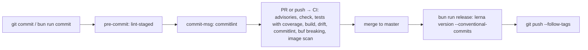

# Releasing

This page explains how a change goes from a commit to a versioned release with a changelog. Commit messages drive everything: they are validated locally and in CI, and Lerna derives each package's next version and changelog from them.



See also: [DEVELOPMENT.md](DEVELOPMENT.md), [TESTING.md](TESTING.md), [DOCKER.md](DOCKER.md).

## Conventional commits

The format is [Conventional Commits](https://www.conventionalcommits.org/), enforced by `@commitlint/config-conventional` (`commitlint.config.ts`):

```text
<type>(<scope>[,<scope>…]): <subject>

[body: wrap at 100 columns (warning)]

[footer: BREAKING CHANGE: …, Refs #123]
```

| Type                                                                          | Effect on the next version (Lerna, `conventionalcommits` preset)                                  |
| ----------------------------------------------------------------------------- | ------------------------------------------------------------------------------------------------- |
| `fix`                                                                         | patch                                                                                             |
| `feat`                                                                        | minor                                                                                             |
| `feat!` / `fix!` or a `BREAKING CHANGE:` footer                               | major (**minor** while the package is still `0.x`: Lerna downgrades major bumps below 1.0.0)      |
| `perf`, `refactor`, `docs`, `test`, `build`, `ci`, `chore`, `style`, `revert` | patch. A package whose files changed always gets at least a patch bump, whatever the commit type. |

Examples from this repo's history: `chore(repo): scaffold nestjs 12 boilerplate`, `fix(repo): apply verified review findings`.

## Commitizen

```bash
git add -p
bun run commit        # = cz, with the @commitlint/cz-commitlint adapter (package.json "config.commitizen")
```

The prompt reads its choices from `commitlint.config.ts`: types, the allowed scopes, and multiple scopes separated by `,` (`enableMultipleScopes`). A message built this way always passes the `commit-msg` hook. `inquirer` is pinned to **12** because it is the peer dependency of `@commitlint/cz-commitlint`.

You can still type messages by hand with `git commit -m`. The hook validates them the same way.

## Commitlint scopes

`scope-enum` is computed at lint time:

1. **Every workspace package**, via `@commitlint/config-workspace-scopes`, with the scope prefix (`@app/`, `@domain/`, `@platform/`) removed:
   - apps: `gateway`, `monolith`, `identity-service`, `notifications-service`, `billing-service`
   - domains: `billing`, `files`, `identity`, `notifications`
   - contracts: `billing-contracts`, `identity-contracts`, `notifications-contracts`
   - libs: `auth`, `bootstrap`, `cassandra`, `common`, `config`, `contracts`, `database`, `graphql`, `mailer`, `observability`, `redis`, `storage`, `testing`, `transport`
2. **Extra scopes** (`EXTRA_SCOPES`): `deps`, `deps-dev`, `release`, `docker`, `ci`, `config`, `repo`, `tooling`, `docs`.

Other rules:

- `scope-case` is `kebab-case` (error).
- `body-max-line-length` is 100 (warning).
- A new package becomes a valid scope automatically. Nothing needs editing.

Name the package(s) the commit changes, for example `feat(billing): …` or `fix(gateway,transport): …`. Use `repo`, `tooling`, `ci`, `docker` or `docs` for changes that belong to no package.

The scope is for humans. Lerna decides which packages a commit affects from the **files** it touches, not from the scope. So keep commits focused: a commit that touches five packages bumps all five.

## Git hooks (husky)

`bun install` runs the root `prepare` script (`husky`), which points `core.hooksPath` at `.husky/_`.

| Hook         | Runs                     | Blocks the commit when                              |
| ------------ | ------------------------ | --------------------------------------------------- |
| `pre-commit` | `lint-staged`            | Biome, ESLint or Prettier cannot fix a staged file. |
| `commit-msg` | `commitlint --edit "$1"` | The message breaks a rule above.                    |

- `HUSKY=0` disables the hooks. CI sets it.
- `git commit --no-verify` and commits made in the GitHub web editor skip the hooks. CI therefore re-runs commitlint over the whole PR range, and on a push to `master` over the commits the push added (from `github.event.before`; see [CI pipeline](#ci-pipeline)).
- The hooks only touch staged files. The full gate is still `bun run check` (Biome CI + ESLint `--max-warnings=0` + Prettier check + `tsc`). Run it before pushing.

## lint-staged

`lint-staged.config.ts` splits files between three tools. The globs **do not overlap**: lint-staged runs different globs concurrently, and two tools writing the same file would race.

| Glob                                        | Commands (in order)                                                                                                                                                            |
| ------------------------------------------- | ------------------------------------------------------------------------------------------------------------------------------------------------------------------------------ |
| `*.{ts,mts,cts}`                            | 1. `biome check --write` (format, lint, import sorting) 2. `eslint --fix --max-warnings=0` (type-aware rules: floating promises, decorator-aware `consistent-type-imports`, …) |
| `*.{js,mjs,cjs,json,jsonc,graphql,gql,css}` | `biome check --write`                                                                                                                                                          |
| `*.{md,yml,yaml}`                           | `prettier --write`                                                                                                                                                             |

Why three tools:

- **Biome** is the fast formatter and linter for code.
- **ESLint** (typescript-eslint supports TypeScript <6.1, hence the 6.0.3 pin) runs only the rules that need type information or decorator awareness.
- **Prettier** covers Markdown and YAML, which Biome does not format.

The ESLint cache lives in `node_modules/.cache/eslint/`. The config file is loaded by Node's native type stripping, so it may contain only erasable TypeScript syntax.

## Versioning and changelogs (lerna)

`lerna.json` configures **independent** versioning: every app and lib has its own version (all start at `0.0.0`) and its own `CHANGELOG.md`. Nx 23 runs the tasks (`build`, `typecheck` and `test` are cached; `build` depends on `^build`).

| Setting (`command.version`)               | Value                         | Meaning                                                                                                                                |
| ----------------------------------------- | ----------------------------- | -------------------------------------------------------------------------------------------------------------------------------------- |
| `version`                                 | `independent`                 | One version and one tag per package (`@domain/billing@0.2.0`).                                                                         |
| `conventionalCommits` + `changelogPreset` | `true`, `conventionalcommits` | Bump levels and changelog entries come from the commit messages. The preset is pinned to **9.3.1** because Lerna 10 crashes with 10.x. |
| `allowBranch`                             | `master`, `main`, `release/*` | Releases are refused on feature branches.                                                                                              |
| `private`                                 | `true`                        | Private packages are versioned too (every package here is `"private": true`).                                                          |
| `message`                                 | `chore(release): publish`     | The release commit. It is a valid conventional commit (`release` is an extra scope).                                                   |
| `push`, `createRelease`                   | `false`, `false`              | Nothing leaves your machine until you push. No GitHub Release is created.                                                              |
| `npmClient`                               | `bun`                         |                                                                                                                                        |

### Cutting a release

```bash
git switch master && git pull
bunx lerna changed          # preview: packages changed since their last tag
bun run release             # = lerna version --conventional-commits --yes --no-push
git push --follow-tags      # push the release commit and the per-package tags
```

`bun run release`:

1. finds the packages whose files changed since their last tag (on the first release, every package),
2. picks each package's bump from the commits that touched it,
3. writes or updates `<package>/CHANGELOG.md` and `package.json#version`,
4. creates one commit (`chore(release): publish`) and one tag per package.

The repository has no `CHANGELOG.md` files yet. The first release creates them.

**Nothing is published to a registry.** Every package is private, and the boilerplate has no `lerna publish` step. The deliverables are the Docker images, one per app: `docker build --build-arg APP=<app> .`. Tag them with the app's version from its tag (`@app/gateway@1.4.0` → image `gateway:1.4.0`) in your CD pipeline. The Dockerfile already accepts a `VCS_REF` build argument. See [DOCKER.md](DOCKER.md).

**Database releases.** Ship Drizzle migrations as a release job before rolling out the new app version (`DATABASE_RUN_MIGRATIONS=false` in production, then each app image's own `dist/migrate.js`: the platform set plus that app's domain histories). Cassandra CQL migrations run at service boot and are LWT-claimed. See [DEVELOPMENT.md](DEVELOPMENT.md#database-migrations-postgres--drizzle).

**Lock waits in a database release.** The migration session runs with `lock_timeout` (`DATABASE_MIGRATION_LOCK_TIMEOUT_MS`, 5 s; on Citus the `app_owner` role default carries it to the worker connections). An `ALTER` that meets an open transaction gives up instead of queueing every query on its table behind it. The set is rolled back and retried with backoff (`DATABASE_MIGRATION_LOCK_RETRIES`, 5).

- **One lock-taking change per release.** All pending files of a set run in one transaction, so every lock is held until the set commits. Ship one `ALTER` (or one group on one table) per set and release, and spread expand/contract steps over separate releases.
- **A job that fails with `55P03`** (`Migration set "<name>" … lock_timeout (<ms>ms) expired on all <n> attempts`) applied nothing of that set; the sets before it stay applied. Some transaction kept a lock on the table for the whole retry window. Find it (`pg_stat_activity`, `pg_locks`, `pg_blocking_pids()`), let it end or stop it, then rerun the job before rolling out the new app version. Details: [libs/database/README.md](../libs/database/README.md#lock-waits).

**Contract changes.** A breaking change to a gRPC proto or a Kafka payload needs a new version (`orders.v2` package, `.v2` topic), served side by side with v1 until every consumer has moved. CI runs `buf breaking` for every contracts package against the pull request's base, and on a push to `master` against the commit before the push (`github.event.before`), with `scripts/check-proto-breaking.mjs` (packages that are new on the branch are skipped). Run `bun run proto:breaking` locally before pushing a proto change. There is no override label: a change the gate rejects ships as a new package version (`<ctx>.v2`, above), never as an edit of v1. Changes to an existing v1 package stay additive: add fields and RPCs, mark the ones you retire `deprecated`, and never delete, renumber or retype a field (phase B2 extends `identity.v1` this way).

Related root scripts: `bun run build:affected` (`lerna run build --since origin/master`), `bun run graph` (Nx project graph) and `bun run clean` (every package's `clean`, plus the Nx cache).

## CI pipeline

[`.github/workflows/ci.yml`](../.github/workflows/ci.yml) runs on pushes to `master`, on pull requests and on manual dispatch (`workflow_dispatch`). A new push to a pull request cancels the run already in progress for it. A push to `master` is never cancelled or replaced: each push has its own concurrency group (`ci-<ref>-<sha>`, from `github.ref` and `github.sha`), because a group keeps only one pending run and a push run checks only its own `github.event.before` range (commitlint, buf breaking), so a replaced pending run would leave its range unchecked. A weekly schedule (Mondays 05:17 UTC) runs the `advisories` job alone; every other job is skipped on a scheduled run.

The `verify` and `integration` jobs install with `bun install --frozen-lockfile` (Bun 1.4.3) on Node from `.nvmrc`, with `HUSKY=0` and the Nx daemon and Cloud off. The Bun download cache and the Nx/ESLint caches are kept between runs.

| Job                                       | Steps                                                                                                                                                                                                                                                                                                                                                                                                                                                                                                                                                                                                                                                                                                                                                                                                                                                                                                                                                                                                                                                                                                                                                                                                                           |
| ----------------------------------------- | ------------------------------------------------------------------------------------------------------------------------------------------------------------------------------------------------------------------------------------------------------------------------------------------------------------------------------------------------------------------------------------------------------------------------------------------------------------------------------------------------------------------------------------------------------------------------------------------------------------------------------------------------------------------------------------------------------------------------------------------------------------------------------------------------------------------------------------------------------------------------------------------------------------------------------------------------------------------------------------------------------------------------------------------------------------------------------------------------------------------------------------------------------------------------------------------------------------------------------- |
| **verify** (lint, typecheck, test, build) | 1. **production advisories**: `node scripts/check-audit.mjs` (see [Advisory gate](#advisory-gate)) 2. `bun run check` (biome ci, eslint `--max-warnings=0`, prettier `--check`, tsc) 3. `bun run test:cov` (unit + e2e with v8 coverage; fails under the thresholds, see [Coverage gate](#coverage-gate)) 4. `bun run build` 5. **generated artefacts drift**: `bun run proto:gen`, `buf lint`, `bun run db:generate`, then `bun run db:check` (`drizzle-kit check`: no forked snapshot chain), then `git diff --exit-code` plus an untracked check on `domains/*/contracts/src/generated` and `domains/*/src/infrastructure/persistence/migrations` 6. **commitlint** over the PR range (`--from base.sha --to head.sha`), or on a push over `github.event.before..github.sha` 7. **proto breaking changes**: `node scripts/check-proto-breaking.mjs --against <base>`, the base being the PR's base or, on a push, `github.event.before` 8. **config drift**: `node scripts/check-env-example.mjs` and `node scripts/docker/check-kafka-topics.mjs`. Steps 6 and 7 pass with a note when there is no range to check: a new branch (`before` is all zeros), a manual run, or a force push whose old head is not in the history |
| **integration**                           | `bun run test:int` (`INTEGRATION=1`, every `<pkg>:int` Vitest project). The specs start Citus, Cassandra, Kafka, immudb, RustFS and fake-gcs-server through testcontainers (a first step pulls every image, from `node scripts/int-images.mjs`), and Redis comes from a `redis:8.10.3-alpine3.23` service container.                                                                                                                                                                                                                                                                                                                                                                                                                                                                                                                                                                                                                                                                                                                                                                                                                                                                                                            |
| **image** (matrix)                        | Builds the `runtime` target for `gateway`, `monolith`, `identity-service`, `notifications-service`, `billing-service` and `ai-service` with `APP=<app>` and `VCS_REF=<sha>`, then scans it with Trivy (see [Image gate](#image-gate)). Images are loaded and inspected (size, user, the runtime `node --version`), never pushed. Each app has its own GitHub Actions build cache scope. Each image is also saved as an artifact (one-day retention) for the topology job.                                                                                                                                                                                                                                                                                                                                                                                                                                                                                                                                                                                                                                                                                                                                                       |
| **topology** (matrix)                     | Loads the `image` job's images and runs `node scripts/docker/check-topology.ts up <monolith\|microservices>`: isolated project, every app healthy and `/health/ready`, `POST /v1/auth/register` + `GET /v1/auth/me` through the API, then `down -v`.                                                                                                                                                                                                                                                                                                                                                                                                                                                                                                                                                                                                                                                                                                                                                                                                                                                                                                                                                                            |
| **compose**                               | `scripts/docker/validate-compose.sh` (`docker compose config` for every profile combination), then `scripts/docker/check-infra.sh`, which boots the infra and asserts topics, keyspace, buckets, extensions and host ports, then tears it down.                                                                                                                                                                                                                                                                                                                                                                                                                                                                                                                                                                                                                                                                                                                                                                                                                                                                                                                                                                                 |
| **advisories** (schedule only)            | `node scripts/check-audit.mjs` without an install (`bun audit` reads `bun.lock` alone): an advisory published against an unchanged lockfile turns the weekly run red.                                                                                                                                                                                                                                                                                                                                                                                                                                                                                                                                                                                                                                                                                                                                                                                                                                                                                                                                                                                                                                                           |

### Advisory gate

`scripts/check-audit.mjs` (`bun run check:audit`) runs `bun audit --json --production`, which covers the dependencies the apps ship and leaves out the dev tooling. It reads the JSON report, not the exit code, because `bun audit` also exits 1 on a moderate advisory. It fails on:

- a **high or critical** advisory that no unexpired entry of [`.github/audit-ignore.json`](../.github/audit-ignore.json) covers;
- an **expired** ignore entry, whether or not its advisory is still reported, so every entry is revisited;
- an ignore entry whose `expires` is **more than 90 days** after the day of the check, so no entry can be parked for longer than a quarter;
- a malformed entry, or a report that is not JSON (registry unreachable, no lockfile): the gate fails closed.

Moderate and low advisories are listed and do not fail. An ignore entry covers one advisory in one package until the end of its expiry day (UTC), at most 90 days ahead; renew it with a new date and reason when it runs out:

```json
{
  "id": "GHSA-xxxx-xxxx-xxxx",
  "package": "undici",
  "reason": "no fixed version yet; the fix needs a major the repo cannot take",
  "expires": "2026-12-31"
}
```

`id` is the GHSA id from the advisory URL, or `bun audit`'s numeric id. Upgrade first: bump a catalog pin in `package.json`, or add an `overrides` entry for a transitive dependency. Add an ignore entry only when no fixed version exists, or when the fix needs a major the repo cannot take yet. No bot proposes npm updates: the root `catalog` pins every version, and neither Dependabot nor Renovate was confirmed to update it. This gate and its weekly run are how an advisory reaches you.

### Image gate

The `image` job scans each built image with [`aquasecurity/trivy-action`](https://github.com/aquasecurity/trivy-action) v0.36.0, pinned to commit `ed142fd0673e97e23eac54620cfb913e5ce36c25`, with `scanners: vuln`, `vuln-type: os`, `severity: HIGH,CRITICAL`, `ignore-unfixed: true`, `exit-code: 1` and `version: v0.76.2` (the Trivy binary it installs; the action's own default is v0.70.0). A fixable high or critical vulnerability in the image's OS packages fails the job. `scanners: vuln` keeps Trivy's secret scanner out: it would flag the development Stripe key placeholder in the `billing-service` and `monolith` images. The npm packages belong to the advisory gate. The fix is usually a newer base image: bump the digest (below). To run the same scan locally on a built image, with the same Trivy (pinned by digest) reading a `docker save` tarball, so the Docker socket is not mounted:

```bash
docker save boilerplate/gateway:local -o gateway.tar
docker run --rm -v "$PWD/gateway.tar:/scan/image.tar:ro" \
  aquasec/trivy:0.76.2@sha256:8f6bb947dbc528902e11f2f5be52f7b519f6a39d5d148f41166f2040499768fb \
  image --input /scan/image.tar --scanners vuln --pkg-types os --severity HIGH,CRITICAL \
  --ignore-unfixed --exit-code 1
```

When CI moves to another Trivy version, change `version:` in `ci.yml` and this image tag and digest together (`docker buildx imagetools inspect aquasec/trivy:<version>` prints the index digest).

### Coverage gate

The verify job runs `bun run test:cov`. `COVERAGE_THRESHOLDS` in `vitest.config.ts` sets global floors for statements, branches, functions and lines. They are the baseline measured on 2026-11-24 (92.16 %, 87.53 %, 90.51 %, 93.29 %) minus two points, and a run under any of them fails. Raise them when coverage grows; lower them only with a reason in the commit. Details: [TESTING.md](TESTING.md#commands).

### Pinned actions and base image

Every `uses:` in `ci.yml` names a full commit SHA with its tag in a comment (`actions/checkout@3d3c42e… # v7.0.1`), so a re-pointed tag cannot change what runs. [`.github/dependabot.yml`](../.github/dependabot.yml) proposes weekly updates for `github-actions` (grouped) and `docker`, with commit headers `ci(deps): …` and `build(deps): …` that commitlint accepts.

`DISTROLESS_IMAGE`, the default runtime base in the `Dockerfile`, is pinned by its multi-arch index digest (`gcr.io/distroless/nodejs24-debian13:nonroot@sha256:…`), so a rebuild gets the same Node and Debian packages. The `image` job prints the runtime `node --version`. That is the distroless image's Node 24, not `NODE_VERSION`, which pins only the toolchain and `runtime-alpine`. Whether Dependabot bumps a digest in an `ARG` default is untested, so bump it by hand, for example when the image gate reports a fixed vulnerability:

```bash
# With Docker: the index digest is the "Digest:" line.
docker buildx imagetools inspect gcr.io/distroless/nodejs24-debian13:nonroot
# Without Docker: the registry API (an anonymous token, then the index manifest's digest header).
TOKEN=$(curl -fsS 'https://gcr.io/v2/token?scope=repository:distroless/nodejs24-debian13:pull&service=gcr.io' | jq -r .token)
curl -fsSI -H "Authorization: Bearer $TOKEN" \
  -H 'Accept: application/vnd.oci.image.index.v1+json, application/vnd.docker.distribution.manifest.list.v2+json' \
  https://gcr.io/v2/distroless/nodejs24-debian13/manifests/nonroot | grep -i docker-content-digest
```

Check that the digest belongs to an index that lists `linux/amd64` and `linux/arm64` (`imagetools inspect` lists the platforms). Put it in the `ARG DISTROLESS_IMAGE` default after `:nonroot@`, and commit it as `build(docker): …` so the release notes carry the base change.

Before you push, run the same gate locally:

```bash
bun run check:audit                # = node scripts/check-audit.mjs; needs the npm registry
bun run check && bun run test:cov && bun run build
bun run proto:gen && bun run db:generate && bun run db:check && git status --porcelain -- domains/*/contracts/src/generated 'domains/*/src/infrastructure/persistence/migrations/*'
node scripts/check-env-example.mjs && node scripts/docker/check-kafka-topics.mjs
INTEGRATION=1 bun run test:int     # needs Docker (testcontainers) and REDIS_URL
```

What CI does **not** do (yet):

- No deployment, and images are not pushed to a registry.
- No `lerna version` run. Releases are cut by hand with `bun run release` (above).

Which packages have integration specs, and what they cover, is in [TESTING.md](TESTING.md#integration-tests-testcontainers).
