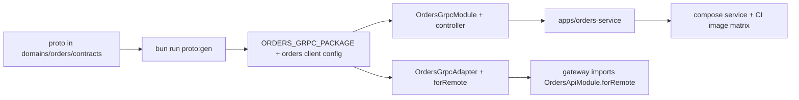

# Lane `platform` — B1: make `libs/` domain-free

Conventions for every task in this lane:

- Run commands from the repo root (`/Users/maddie/Desktop/Work/BE/nestjs-boilerplate`).
- Edits are written old → new. The old text is the anchor. Line numbers are those of `74f70b7` and shift as other lanes land. Lines that D or F own (for example `requireTLS` in `mailer-options.factory.ts` and `defaultTimeoutMs` in the app modules) are never rewritten here.
- After editing TS or JSON, run `npx biome check --write <files>`, which settles import/export order and formatting. After editing Markdown, run `npx prettier --write <files>`.
- Fixture dry runs live under `${TMPDIR:-/tmp}`, never inside the repo.

Behaviour of `@nestjs-modules/mailer` 2.3.7 (`dist/adapters/handlebars.adapter.js`), checked in a lab against the installed package:

- A template name is looked up in `template.dir` first. Only if that file is missing does the adapter try each entry of `template.dirs`, in order (:31-46).
- Compiled templates are cached under the name relative to `template.dir` (:35-37, :47). So the same name in two dirs silently resolves to the first one found.
- A name that no dir defines throws inside nodemailer's compile step as an uncaught exception, not as a rejected `sendMail` (:47-55, :63).
- Partials registered on the global Handlebars instance (`registerMailPartials`) are visible to templates in every dir.

---

### Task platform-1: Template-agnostic `@platform/mailer`; notifications owns its mail templates

**Files:**
- Create: `libs/mailer/test/fixtures/template-dirs.ts`
- Create: `libs/mailer/test/fixtures/templates/greeting.hbs`
- Create: `libs/mailer/test/fixtures/more-templates/farewell.hbs`
- Modify: `libs/mailer/src/app-mailer.module.spec.ts:9-28,96-102`
- Modify: `libs/mailer/src/mail.service.spec.ts:10,15,21,109-144,152`
- Modify: `libs/mailer/src/mail.processor.spec.ts:9,27`
- Modify: `libs/mailer/src/mail.util.spec.ts:1,50-68`
- Modify: `libs/mailer/src/mailer.constants.ts:7-16`
- Modify: `libs/mailer/src/mail.types.ts:1-69`
- Modify: `libs/mailer/src/mail.util.ts:4-5,40-45,58-71`
- Modify: `libs/mailer/src/mail.service.ts:8,33`
- Modify: `libs/mailer/src/mail.processor.ts:10,12,15-17`
- Modify: `libs/mailer/src/mailer-options.factory.ts:1,10,42-54,76-80`
- Modify: `libs/mailer/src/app-mailer.module.ts:5,11-17,28-30,42`
- Move: `libs/mailer/src/templates/welcome.hbs` -> `domains/notifications/src/infrastructure/mail/templates/welcome.hbs`
- Move: `libs/mailer/src/templates/payment-receipt.hbs` -> `domains/notifications/src/infrastructure/mail/templates/payment-receipt.hbs`
- Move: `libs/mailer/src/templates/daily-digest.hbs` -> `domains/notifications/src/infrastructure/mail/templates/daily-digest.hbs`
- Move: `libs/mailer/src/mail-templates.spec.ts` -> `domains/notifications/src/infrastructure/mail/notifications-mail-templates.spec.ts`
- Create: `domains/notifications/src/application/mail/notifications-mail.ts`
- Create: `domains/notifications/src/infrastructure/mail/notifications-mail-templates.ts`
- Modify: `domains/notifications/src/index.ts`
- Modify: `domains/notifications/src/application/commands/welcome-user/welcome-user.handler.ts:3,38`
- Modify: `domains/notifications/src/application/commands/send-payment-receipt/send-payment-receipt.handler.ts:4,42`
- Modify: `domains/notifications/src/application/commands/send-daily-digest/send-daily-digest.handler.ts:4,75`
- Modify: `domains/notifications/src/notifications-core.module.ts:31-34`
- Modify: `domains/notifications/package.json` (devDependencies), `bun.lock`
- Modify: `apps/monolith/src/app.module.ts` (`@domain/notifications` import, the `AppMailerModule.forRootAsync()` line)
- Modify: `apps/notifications-service/src/app.module.ts` (`@domain/notifications` import, mailer lines 43-46)
- Modify: `libs/mailer/README.md:8-55` plus one gotcha, `domains/notifications/README.md:48,78,245`, `apps/notifications-service/README.md:33`, `docs/ARCHITECTURE.md` (§5 mailer row)
- Test: `libs/mailer/src/app-mailer.module.spec.ts`, `libs/mailer/src/mail.service.spec.ts`, `domains/notifications/src/infrastructure/mail/notifications-mail-templates.spec.ts`

**Interfaces:**
- Consumes: nothing from other lanes. `MAIL_TEMPLATE_HELPERS` and `MAIL_PARTIALS_DIR` already exist.
- Produces:
  - `interface AppMailerModuleOptions { templateDirs: readonly string[]; worker?: boolean }`
  - `AppMailerModule.forRootAsync(options: AppMailerModuleOptions): DynamicModule`, which throws when `worker` is on and `templateDirs` is empty
  - `interface MailMessage<TTemplate extends string = string>`
  - `interface TypedMailMessage<TContextMap, TTemplate extends keyof TContextMap & string>`
  - `function defineMail<TContextMap extends Record<keyof TContextMap, object>>(): <TTemplate extends keyof TContextMap & string>(mail: TypedMailMessage<TContextMap, TTemplate>) => MailMessage<TTemplate>`
  - `createMailerOptions(cfg: MailConfig, templateDirs: readonly string[] = []): MailerOptions`
  - `listMailTemplates(templateDirs: readonly string[]): string[]`
  - Removed from `@platform/mailer`: `MAIL_TEMPLATES`, `MailTemplate`, `MAIL_TEMPLATES_DIR` and the notification context types.
  - `@domain/notifications` exports `NOTIFICATIONS_MAIL_TEMPLATES_DIR`, `NOTIFICATIONS_MAIL_TEMPLATES`, `NotificationsMailTemplate`, `WelcomeMailContext`, `PaymentReceiptMailContext`, `DigestItem`, `DailyDigestMailContext`, `NotificationsMailContextMap` and `defineNotificationsMail`.

- [ ] **Step 1: Add the template-dir fixtures**

`libs/mailer/test/fixtures/template-dirs.ts`:
```ts
import { join } from 'node:path';

/**
 * Two template folders for the mailer specs, standing in for two domains that register templates:
 * `greeting.hbs` lives in the first, `farewell.hbs` only in the second.
 */
export const FIXTURE_TEMPLATES_DIR = join(import.meta.dirname, 'templates');
export const FIXTURE_MORE_TEMPLATES_DIR = join(import.meta.dirname, 'more-templates');
export const FIXTURE_TEMPLATE_DIRS = [FIXTURE_TEMPLATES_DIR, FIXTURE_MORE_TEMPLATES_DIR] as const;
```
`libs/mailer/test/fixtures/templates/greeting.hbs`:
```hbs
{{> header title="Greeting" preheader="A fixture template in the first dir."}}
<p>Hello {{name}}!</p>
{{> footer}}
```
`libs/mailer/test/fixtures/more-templates/farewell.hbs`:
```hbs
{{> header title="Farewell" preheader="A fixture template in the second dir."}}
<p>Goodbye {{name}}.</p>
{{> footer}}
```

- [ ] **Step 2: Write the failing module and options tests** in `libs/mailer/src/app-mailer.module.spec.ts`

Old:
```ts
import { MAIL_PARTIALS_DIR, MAIL_TEMPLATES, MAIL_TEMPLATES_DIR } from './mailer.constants.js';
import {
  createMailerOptions,
  registerMailPartials,
  SMTP_TIMEOUTS,
} from './mailer-options.factory.js';

describe('AppMailerModule.forRootAsync', () => {
  it('is global, exports MailService and registers the worker by default', () => {
    const module = AppMailerModule.forRootAsync();

    expect(module.global).toBe(true);
    expect(module.exports).toEqual([MailService]);
    expect(module.providers).toEqual([MailService, MailProcessor]);
  });

  it('omits the worker for enqueue-only processes', () => {
    expect(AppMailerModule.forRootAsync({ worker: false }).providers).toEqual([MailService]);
  });
});
```
New:
```ts
import {
  FIXTURE_MORE_TEMPLATES_DIR,
  FIXTURE_TEMPLATE_DIRS,
  FIXTURE_TEMPLATES_DIR,
} from '../test/fixtures/template-dirs.js';
import { MAIL_PARTIALS_DIR } from './mailer.constants.js';
import {
  createMailerOptions,
  listMailTemplates,
  registerMailPartials,
  SMTP_TIMEOUTS,
} from './mailer-options.factory.js';

describe('AppMailerModule.forRootAsync', () => {
  it('is global, exports MailService and registers the worker by default', () => {
    const module = AppMailerModule.forRootAsync({ templateDirs: FIXTURE_TEMPLATE_DIRS });

    expect(module.global).toBe(true);
    expect(module.exports).toEqual([MailService]);
    expect(module.providers).toEqual([MailService, MailProcessor]);
  });

  it('omits the worker for enqueue-only processes, which need no template dir', () => {
    expect(AppMailerModule.forRootAsync({ templateDirs: [], worker: false }).providers).toEqual([
      MailService,
    ]);
  });

  it('refuses a mail worker without template dirs (it could render nothing)', () => {
    expect(() => AppMailerModule.forRootAsync({ templateDirs: [] })).toThrow(
      'AppMailerModule: a process that delivers mail (worker) needs at least one template dir',
    );
  });
});
```
Old (the last test of the file):
```ts
  it('points at template files that exist', () => {
    for (const template of MAIL_TEMPLATES) {
      expect(existsSync(join(MAIL_TEMPLATES_DIR, `${template}.hbs`))).toBe(true);
    }
    expect(existsSync(join(MAIL_PARTIALS_DIR, 'header.hbs'))).toBe(true);
    expect(existsSync(join(MAIL_PARTIALS_DIR, 'footer.hbs'))).toBe(true);
  });
});
```
New:
```ts
  it('ships the shared layout partials', () => {
    for (const partial of ['header', 'footer', 'button']) {
      expect(existsSync(join(MAIL_PARTIALS_DIR, `${partial}.hbs`))).toBe(true);
    }
  });

  it('registers the template dirs in order: the first as `dir`, every one in `dirs`', () => {
    const options = createMailerOptions(mailConfig.parse({}), FIXTURE_TEMPLATE_DIRS);

    expect(options.template?.dir).toBe(FIXTURE_TEMPLATES_DIR);
    expect(options.template?.dirs).toEqual([FIXTURE_TEMPLATES_DIR, FIXTURE_MORE_TEMPLATES_DIR]);
  });

  it('fails at boot on a template dir that does not exist', () => {
    expect(() =>
      createMailerOptions(mailConfig.parse({}), ['/nonexistent/mail-templates']),
    ).toThrow('Mail template dir not found: /nonexistent/mail-templates');
  });

  it('fails at boot when two dirs define the same template name', () => {
    expect(() =>
      createMailerOptions(mailConfig.parse({}), [FIXTURE_TEMPLATES_DIR, FIXTURE_TEMPLATES_DIR]),
    ).toThrow(
      `Mail template "greeting" is defined in both ${FIXTURE_TEMPLATES_DIR} and ${FIXTURE_TEMPLATES_DIR}`,
    );
  });
});

describe('listMailTemplates', () => {
  it('lists the template names of every dir, sorted', () => {
    expect(listMailTemplates(FIXTURE_TEMPLATE_DIRS)).toEqual(['farewell', 'greeting']);
  });
});
```
D's test `makes STARTTLS mandatory (nodemailer requireTLS)…` keeps its single-argument `createMailerOptions(production)` call. That still works because `templateDirs` defaults to `[]`.

- [ ] **Step 3: Write the failing multi-dir render test** in `libs/mailer/src/mail.service.spec.ts`

Add `import { FIXTURE_TEMPLATE_DIRS } from '../test/fixtures/template-dirs.js';` to the imports. Then replace the whole `it('renders the real template through MailerService + HandlebarsAdapter (JSON transport)', …)` block (lines 109-144) with:
```ts
  it('renders templates from every registered dir with the shared partials (JSON transport)', async () => {
    @Module({
      imports: [
        MailerModule.forRootAsync({
          imports: [],
          useFactory: () => ({
            ...createMailerOptions(cfg, FIXTURE_TEMPLATE_DIRS),
            transport: { jsonTransport: true },
          }),
        }),
      ],
    })
    class TestMailModule {}
    const app = await NestFactory.createApplicationContext(TestMailModule, { logger: false });
    try {
      const mailer = app.get(MailerService);
      const send = vi.spyOn(mailer, 'sendMail');
      const service = new MailService(createQueue(), mailer, cfg);
      const sent = async (call: number): Promise<{ from: unknown; subject: string; html: string }> => {
        const info = (await send.mock.results[call]?.value) as { message: string };
        return JSON.parse(info.message) as { from: unknown; subject: string; html: string };
      };

      await service.sendNow({
        to: 'jane@example.com',
        subject: 'Hello',
        template: 'greeting',
        context: { name: 'Jane' },
      });
      await service.sendNow({
        to: 'jane@example.com',
        subject: 'Goodbye',
        template: 'farewell',
        context: { name: 'Jane' },
      });

      const greeting = await sent(0);
      const farewell = await sent(1);
      expect(greeting.from).toEqual({ address: 'no-reply@acme.test', name: 'Acme' });
      expect(greeting.html).toContain('Hello Jane!');
      expect(farewell.subject).toBe('Goodbye');
      expect(farewell.html).toContain('Goodbye Jane.');
      expect(farewell.html).toContain(`&copy; ${new Date().getUTCFullYear()} Acme`);
    } finally {
      await app.close();
    }
  });
```

- [ ] **Step 4: Run the mailer tests to see them fail**

Run: `npx vitest run --project mailer`

Expected: FAIL.
- `refuses a mail worker without template dirs` fails because nothing is thrown.
- `registers the template dirs in order…` fails: expected `…/libs/mailer/test/fixtures/templates`, received `…/libs/mailer/src/templates`.
- `fails at boot on a template dir that does not exist` and `…the same template name` fail because nothing is thrown.
- `listMailTemplates` fails with `TypeError: listMailTemplates is not a function`.
- `renders templates from every registered dir…` fails with an unhandled `ENOENT … libs/mailer/src/templates/greeting.hbs`, thrown inside nodemailer's compile step, followed by a 5000 ms timeout.

- [ ] **Step 5: Partials-only constants and generic message types**

`libs/mailer/src/mailer.constants.ts`. Old:
```ts
/** Every template shipped in `templates/` (file name without `.hbs`). */
export const MAIL_TEMPLATES = ['welcome', 'payment-receipt', 'daily-digest'] as const;
export type MailTemplate = (typeof MAIL_TEMPLATES)[number];

/**
 * Template locations, resolved next to this module. SWC `copyFiles` mirrors `src/templates/**` into
 * `dist/templates/**`, so the same expression works from sources (dev/tests) and from the build.
 */
export const MAIL_TEMPLATES_DIR = join(import.meta.dirname, 'templates');
export const MAIL_PARTIALS_DIR = join(MAIL_TEMPLATES_DIR, 'partials');
```
New:
```ts
/**
 * The shared layout partials (`header`, `footer`, `button`), resolved next to this module. SWC
 * `copyFiles` mirrors `src/templates/partials/**` into `dist/templates/partials/**`, so the same
 * expression works from sources (dev/tests) and from the build. The mail templates belong to the
 * domains that send them: apps register their folders with `AppMailerModule.forRootAsync({
 * templateDirs })`.
 */
export const MAIL_PARTIALS_DIR = join(import.meta.dirname, 'templates', 'partials');
```
`libs/mailer/src/mail.types.ts`. Replace the whole file, which neither D nor F touches:
```ts
/**
 * A templated mail. Rendered with Handlebars (`strict`), so misspelled variables fail loudly.
 * `TTemplate` narrows the template name for typed builders (`defineMail`); `MailService` takes any.
 */
export interface MailMessage<TTemplate extends string = string> {
  /** Recipient address. */
  to: string;
  subject: string;
  /** File name (without `.hbs`) of a template in one of the registered template dirs. */
  template: TTemplate;
  /**
   * Template variables. `appName` and `year` are filled in by default (`BaseMailContext`); the
   * domain that owns the template declares what else it reads.
   */
  context: Record<string, unknown>;
  /**
   * Deduplicates `enqueue()`: the same key within the retention window (24h) sends one mail.
   * Derive it from the business event, e.g. `order-confirmed-${orderId}`.
   */
  idempotencyKey?: string;
}

/** Payload stored in the BullMQ job (the idempotency key is carried by the job id). */
export type MailJobData = Omit<MailMessage, 'idempotencyKey'>;

/** Variables shared by every template (layout partials). */
export interface BaseMailContext {
  /** Product name in header/footer. Default: display name of `MAIL_FROM`. */
  appName?: string;
  /** Footer copyright year. Default: current year. */
  year?: number;
  /** Where "Open the app" buttons point to (omitted → no button). */
  appUrl?: string;
}

/**
 * A `MailMessage` whose `context` is checked against `TContextMap[TTemplate]`, where `TContextMap`
 * is one domain's template → context map (see `defineMail`).
 */
export interface TypedMailMessage<TContextMap, TTemplate extends keyof TContextMap & string>
  extends Omit<MailMessage<TTemplate>, 'context'> {
  context: TContextMap[TTemplate];
}
```

- [ ] **Step 6: A generic `defineMail<TContextMap>()`** in `libs/mailer/src/mail.util.ts`

The curried signature below type-checks in a lab with the repo's TS 6.0.3.
- An interface map is accepted.
- An unknown template or a mismatched context is a compile error.
- `{ x: number }` is rejected as a map.

Old:
```ts
import type { BaseMailContext, MailMessage, MailTemplateContextMap } from './mail.types.js';
import { DEFAULT_MAIL_APP_NAME, type MailTemplate } from './mailer.constants.js';
```
New:
```ts
import type { BaseMailContext, MailMessage, TypedMailMessage } from './mail.types.js';
import { DEFAULT_MAIL_APP_NAME } from './mailer.constants.js';
```
Old:
```ts
/**
 * Formats an amount in minor units (Stripe/`PaymentSucceededPayload.amountTotal`), e.g.
```
New:
```ts
/**
 * Formats an amount in minor units (cents for USD), e.g.
```
Old:
```ts
/**
 * Builds a `MailMessage` whose `context` is type-checked against the template
 * (`MailTemplateContextMap`). This is optional sugar: `MailService` accepts any `MailMessage`.
 */
export function defineMail<T extends MailTemplate>(mail: {
  to: string;
  subject: string;
  template: T;
  context: MailTemplateContextMap[T];
  idempotencyKey?: string;
}): MailMessage {
  const { context, ...rest } = mail;
  return { ...rest, context: { ...context } };
}
```
New:
```ts
/** Shallow copy typed as the plain record a `MailMessage` carries. */
const toContextRecord = (context: object): Record<string, unknown> => ({ ...context });

/**
 * Returns a `MailMessage` builder for one domain's templates. `context` is type-checked against the
 * template the mail names, through the domain's template → context map. Bind it once per domain,
 * e.g. `export const defineOrdersMail = defineMail<OrdersMailContextMap>();`. Optional sugar:
 * `MailService` accepts any `MailMessage`.
 */
export function defineMail<TContextMap extends Record<keyof TContextMap, object>>(): <
  TTemplate extends keyof TContextMap & string,
>(
  mail: TypedMailMessage<TContextMap, TTemplate>,
) => MailMessage<TTemplate> {
  return (mail) => {
    const { context, ...rest } = mail;
    return { ...rest, context: toContextRecord(context) };
  };
}
```

- [ ] **Step 7: Queue and job names are plain strings**

`libs/mailer/src/mail.service.ts`:
```ts
// old
import { MAIL_JOB_OPTIONS, MAIL_QUEUE, type MailTemplate } from './mailer.constants.js';
// new
import { MAIL_JOB_OPTIONS, MAIL_QUEUE } from './mailer.constants.js';
```
```ts
// old
    @InjectQueue(MAIL_QUEUE) private readonly queue: Queue<MailJobData, void, MailTemplate>,
// new
    @InjectQueue(MAIL_QUEUE) private readonly queue: Queue<MailJobData, void, string>,
```
`libs/mailer/src/mail.processor.ts`:
```ts
// old
import { DEFAULT_MAIL_CONCURRENCY, MAIL_QUEUE, type MailTemplate } from './mailer.constants.js';

type MailJob = Job<MailJobData, void, MailTemplate>;
// new
import { DEFAULT_MAIL_CONCURRENCY, MAIL_QUEUE } from './mailer.constants.js';

type MailJob = Job<MailJobData, void, string>;
```
```ts
// old
 * BullMQ worker for the `mail` queue. Register it only in processes that should deliver mail
 * (`AppMailerModule.forRootAsync({ worker: true })`, e.g. notifications-service). Producers can
 * enqueue from anywhere.
// new
 * BullMQ worker for the `mail` queue. Register it only in processes that should deliver mail
 * (`AppMailerModule.forRootAsync({ templateDirs, worker: true })`). Producers can enqueue from
 * anywhere.
```

- [ ] **Step 8: Template dirs in `createMailerOptions` and `AppMailerModule`**

`libs/mailer/src/mailer-options.factory.ts`:
```ts
// old
import { readdirSync, readFileSync } from 'node:fs';
// new
import { existsSync, readdirSync, readFileSync } from 'node:fs';
```
```ts
// old
import { MAIL_PARTIALS_DIR, MAIL_TEMPLATES_DIR } from './mailer.constants.js';
// new
import { MAIL_PARTIALS_DIR } from './mailer.constants.js';
```
Insert after the closing `}` of `registerMailPartials` (`  return names.sort();\n}`):
```ts

/**
 * Template names (`*.hbs` file names without the extension) across `templateDirs`, sorted. Throws
 * on a missing dir, and on a name defined in two dirs: `HandlebarsAdapter` resolves a name in
 * `template.dir` first, then in `template.dirs` order, and caches the first file it compiled under
 * that name, so a second definition would be silently ignored.
 */
export function listMailTemplates(templateDirs: readonly string[]): string[] {
  const owners = new Map<string, string>();
  for (const dir of templateDirs) {
    if (!existsSync(dir)) throw new Error(`Mail template dir not found: ${dir}`);
    for (const file of readdirSync(dir)) {
      if (extname(file) !== '.hbs') continue;
      const name = file.slice(0, -'.hbs'.length);
      const owner = owners.get(name);
      if (owner !== undefined) {
        throw new Error(`Mail template "${name}" is defined in both ${owner} and ${dir}`);
      }
      owners.set(name, dir);
    }
  }
  return [...owners.keys()].sort();
}
```
Old:
```ts
/**
 * `MailerModule` options built from the `mail` namespace:
 * - Pooled SMTP (`SMTP_POOL`), which reuses TLS sessions across mails.
 * - Handlebars in strict mode, so an unknown variable throws instead of rendering blank.
```
New:
```ts
/**
 * `MailerModule` options built from the `mail` namespace and the template dirs the app registers:
 * - Pooled SMTP (`SMTP_POOL`), which reuses TLS sessions across mails.
 * - Handlebars in strict mode, so an unknown variable throws instead of rendering blank.
 * - Templates looked up by name in `templateDirs`, first match wins (the first dir is the
 *   adapter's `template.dir`, every dir is in `template.dirs`). `listMailTemplates` fails boot on
 *   a missing dir or a name defined twice. No dirs: the process can enqueue but not render.
```
Old:
```ts
export function createMailerOptions(cfg: MailConfig): MailerOptions {
```
New:
```ts
export function createMailerOptions(
  cfg: MailConfig,
  templateDirs: readonly string[] = [],
): MailerOptions {
  listMailTemplates(templateDirs);
```
Old:
```ts
    template: {
      dir: MAIL_TEMPLATES_DIR,
```
New:
```ts
    template: {
      // HandlebarsAdapter looks a name up in `dir`, then in every `dirs` entry, in order.
      dir: templateDirs[0],
      dirs: [...templateDirs],
```
`libs/mailer/src/app-mailer.module.ts`:
```ts
// old
import { mailConfig } from '@platform/config';
// new
import { type MailConfig, mailConfig } from '@platform/config';
```
Old:
```ts
export interface AppMailerModuleOptions {
  /**
   * Register `MailProcessor` in this process. Default `true`. Set `false` in processes that only
```
New:
```ts
export interface AppMailerModuleOptions {
  /**
   * Folders of `*.hbs` mail templates, one per domain whose mails this process renders (each domain
   * exports its folder, e.g. `ORDERS_MAIL_TEMPLATES_DIR`). A template is looked up by file name in
   * each folder, in order. A missing folder or a name defined twice fails at boot. The shared layout
   * partials (`header`, `footer`, `button`) come from this package. `[]` is only valid with
   * `worker: false` (the process enqueues; other processes render and send).
   */
  templateDirs: readonly string[];
  /**
   * Register `MailProcessor` in this process. Default `true`. Set `false` in processes that only
```
Old:
```ts
  static forRootAsync(options: AppMailerModuleOptions = {}): DynamicModule {
    const providers: Provider[] = [MailService];
    if (options.worker ?? true) providers.push(MailProcessor);
```
New:
```ts
  static forRootAsync(options: AppMailerModuleOptions): DynamicModule {
    const worker = options.worker ?? true;
    if (worker && options.templateDirs.length === 0) {
      throw new Error(
        'AppMailerModule: a process that delivers mail (worker) needs at least one template dir',
      );
    }
    const providers: Provider[] = [MailService];
    if (worker) providers.push(MailProcessor);
```
```ts
// old
          useFactory: createMailerOptions,
// new
          useFactory: (cfg: MailConfig) => createMailerOptions(cfg, options.templateDirs),
```

- [ ] **Step 9: Point the remaining mailer specs at the generic API**

`libs/mailer/src/mail.processor.spec.ts`:
- Delete the line `import type { MailTemplate } from './mailer.constants.js';`.
- Change `} as unknown as Job<MailJobData, void, MailTemplate>;` to `} as unknown as Job<MailJobData, void, string>;`.

`libs/mailer/src/mail.service.spec.ts`:
- Change `import { MAIL_JOB_OPTIONS, type MailTemplate } from './mailer.constants.js';` to `import { MAIL_JOB_OPTIONS } from './mailer.constants.js';`.
- Replace all three `Queue<MailJobData, void, MailTemplate>` with `Queue<MailJobData, void, string>`.

`libs/mailer/src/mail.util.spec.ts`:
- Change `import { describe, expect, it } from 'vitest';` to `import { describe, expect, expectTypeOf, it } from 'vitest';`.
- Replace the whole `describe('defineMail', …)` block with:
```ts
/** A domain's template → context map, test-local (platform specs name no domain). */
interface FixtureMailContextMap {
  greeting: { name: string };
  reminder: { dueAt: string; items: string[] };
}

const defineFixtureMail = defineMail<FixtureMailContextMap>();

describe('defineMail', () => {
  it('builds a MailMessage from a context typed by the domain template map', () => {
    const mail = defineFixtureMail({
      to: 'a@b.c',
      subject: 'Reminder',
      template: 'reminder',
      context: { dueAt: '2026-10-12', items: [] },
      idempotencyKey: 'reminder-u1-2026-10-12',
    });

    expect(mail).toEqual({
      to: 'a@b.c',
      subject: 'Reminder',
      template: 'reminder',
      context: { dueAt: '2026-10-12', items: [] },
      idempotencyKey: 'reminder-u1-2026-10-12',
    });
    expectTypeOf(mail.template).toEqualTypeOf<'reminder'>();
  });

  it('types the context by the template it names', () => {
    expectTypeOf(defineFixtureMail<'greeting'>)
      .parameter(0)
      .toHaveProperty('context')
      .toEqualTypeOf<{ name: string }>();
  });
});
```

- [ ] **Step 10: Move the notifications templates and their spec into the domain**

```bash
mkdir -p domains/notifications/src/infrastructure/mail/templates domains/notifications/src/application/mail
git mv libs/mailer/src/templates/welcome.hbs domains/notifications/src/infrastructure/mail/templates/welcome.hbs
git mv libs/mailer/src/templates/payment-receipt.hbs domains/notifications/src/infrastructure/mail/templates/payment-receipt.hbs
git mv libs/mailer/src/templates/daily-digest.hbs domains/notifications/src/infrastructure/mail/templates/daily-digest.hbs
git mv libs/mailer/src/mail-templates.spec.ts domains/notifications/src/infrastructure/mail/notifications-mail-templates.spec.ts
```
`domains/notifications/src/application/mail/notifications-mail.ts`. This is the application-level mail contract, so the handlers never import from infrastructure:
```ts
import { type BaseMailContext, defineMail } from '@platform/mailer';

/**
 * The notifications mail templates: file names (without `.hbs`) in
 * `NOTIFICATIONS_MAIL_TEMPLATES_DIR`. They are also the BullMQ job names: keep them stable.
 */
export const NOTIFICATIONS_MAIL_TEMPLATES = ['welcome', 'payment-receipt', 'daily-digest'] as const;
export type NotificationsMailTemplate = (typeof NOTIFICATIONS_MAIL_TEMPLATES)[number];

/** `welcome.hbs` */
export interface WelcomeMailContext extends BaseMailContext {
  displayName: string;
}

/** `payment-receipt.hbs` */
export interface PaymentReceiptMailContext extends BaseMailContext {
  displayName?: string;
  paymentId: string;
  /** Pre-formatted amount incl. currency, e.g. `formatMoney(1999, 'usd')` → `$19.99`. */
  amount: string;
  /** ISO-8601 or pre-formatted date. */
  paidAt: string;
  description?: string;
}

/** One line of `daily-digest.hbs`. */
export interface DigestItem {
  title: string;
  body: string;
  createdAt: string;
}

/** `daily-digest.hbs` */
export interface DailyDigestMailContext extends BaseMailContext {
  displayName?: string;
  unreadCount: number;
  items: DigestItem[];
}

/** Template → context: what `defineNotificationsMail` checks each mail against. */
export interface NotificationsMailContextMap {
  welcome: WelcomeMailContext;
  'payment-receipt': PaymentReceiptMailContext;
  'daily-digest': DailyDigestMailContext;
}

/** Builds a `MailMessage` for a notifications template, its `context` type-checked against it. */
export const defineNotificationsMail = defineMail<NotificationsMailContextMap>();
```
`domains/notifications/src/infrastructure/mail/notifications-mail-templates.ts`:
```ts
import { join } from 'node:path';

/**
 * Folder of the notifications mail templates, next to this module. SWC `copyFiles` ships the
 * `.hbs` files to `dist`, so `import.meta.dirname` resolves the folder from `src` (dev, tests) and
 * from `dist` (production). Processes that deliver notifications mail register it:
 * `AppMailerModule.forRootAsync({ templateDirs: [NOTIFICATIONS_MAIL_TEMPLATES_DIR] })`. The layout
 * partials come from `@platform/mailer`.
 */
export const NOTIFICATIONS_MAIL_TEMPLATES_DIR = join(import.meta.dirname, 'templates');
```
Replace the content of the moved `domains/notifications/src/infrastructure/mail/notifications-mail-templates.spec.ts` with the following. It keeps the original assertions; only the imports, the folder and the describe name change, plus one type-level test:
```ts
import { readdirSync, readFileSync } from 'node:fs';
import { basename, join } from 'node:path';
import { MAIL_PARTIALS_DIR, MAIL_TEMPLATE_HELPERS } from '@platform/mailer';
import Handlebars from 'handlebars';
import { beforeAll, describe, expect, expectTypeOf, it } from 'vitest';
import {
  NOTIFICATIONS_MAIL_TEMPLATES,
  type NotificationsMailContextMap,
  type NotificationsMailTemplate,
} from '../../application/mail/notifications-mail.js';
import { NOTIFICATIONS_MAIL_TEMPLATES_DIR } from './notifications-mail-templates.js';

/**
 * Compiles the .hbs files with an isolated Handlebars environment, using the same compile options
 * (strict), helpers and shared layout partials (`@platform/mailer`) as the mailer's
 * HandlebarsAdapter.
 */
function createRenderer(): (template: string, context: Record<string, unknown>) => string {
  const hbs = Handlebars.create();
  hbs.registerHelper(MAIL_TEMPLATE_HELPERS);
  for (const file of readdirSync(MAIL_PARTIALS_DIR)) {
    const source = readFileSync(join(MAIL_PARTIALS_DIR, file), 'utf8');
    hbs.registerPartial(basename(file, '.hbs'), hbs.compile(source, { strict: true }));
  }
  const compiled = new Map<string, Handlebars.TemplateDelegate>();
  return (template, context) => {
    let fn = compiled.get(template);
    if (fn === undefined) {
      fn = hbs.compile(
        readFileSync(join(NOTIFICATIONS_MAIL_TEMPLATES_DIR, `${template}.hbs`), 'utf8'),
        { strict: true },
      );
      compiled.set(template, fn);
    }
    return fn(context);
  };
}

const base = { appName: 'Acme', year: 2026 };

describe('notifications mail templates', () => {
  let render: ReturnType<typeof createRenderer>;

  beforeAll(() => {
    render = createRenderer();
  });

  it('ships exactly the declared templates', () => {
    const files = readdirSync(NOTIFICATIONS_MAIL_TEMPLATES_DIR)
      .filter((f) => f.endsWith('.hbs'))
      .map((f) => basename(f, '.hbs'))
      .sort();

    expect(files).toEqual([...NOTIFICATIONS_MAIL_TEMPLATES].sort());
  });

  it('declares a context type for every template', () => {
    expectTypeOf<keyof NotificationsMailContextMap>().toEqualTypeOf<NotificationsMailTemplate>();
  });

  it.each(NOTIFICATIONS_MAIL_TEMPLATES)(
    '%s renders a complete HTML document with header and footer',
    (name) => {
      const html = render(name, {
        ...base,
        displayName: 'Jane',
        paymentId: 'pay_1',
        amount: '$19.99',
        paidAt: '2026-09-29',
        unreadCount: 0,
        items: [],
      });

      expect(html).toMatch(/^<!doctype html>/);
      expect(html).toContain('</html>');
      expect(html).toContain('&copy; 2026 Acme');
    },
  );

  it('welcome: greets the user and escapes HTML in variables', () => {
    const html = render('welcome', { ...base, displayName: '<script>alert(1)</script>' });

    expect(html).toContain('Welcome, &lt;script&gt;alert(1)&lt;/script&gt;!');
    expect(html).not.toContain('<script>');
    expect(html).toContain('<title>Welcome to Acme</title>');
    expect(html).not.toContain('Open the app'); // no appUrl → no button
  });

  it('welcome: renders the call-to-action partial when appUrl is set', () => {
    const html = render('welcome', { ...base, displayName: 'Jane', appUrl: 'https://app.test' });

    expect(html).toContain('href="https://app.test"');
    expect(html).toContain('Open the app');
  });

  it('payment-receipt: shows amount, reference and the optional description', () => {
    const html = render('payment-receipt', {
      ...base,
      paymentId: 'pay_123',
      amount: '€42.00',
      paidAt: '2026-09-29 10:00 UTC',
      description: 'Pro plan × 2',
    });

    expect(html).toContain('We received your payment of €42.00.');
    expect(html).toContain('pay_123');
    expect(html).toContain('Pro plan × 2');
    expect(html).toContain('Thanks for your payment'); // no displayName
  });

  it('daily-digest: lists items and pluralizes', () => {
    const items = [
      { title: 'Payment received', body: '$19.99', createdAt: '09:00' },
      { title: 'Welcome', body: 'Hello!', createdAt: '08:00' },
    ];

    const many = render('daily-digest', { ...base, displayName: 'Jane', unreadCount: 2, items });
    const one = render('daily-digest', { ...base, unreadCount: 1, items: items.slice(0, 1) });
    const none = render('daily-digest', { ...base, unreadCount: 0, items: [] });

    expect(many).toContain('Jane, here is your daily digest');
    expect(many).toContain('unread notifications.');
    expect(many.match(/Payment received|Welcome</g)).toHaveLength(2);
    expect(one).toContain('unread notification.');
    expect(none).toContain('Nothing new since yesterday.');
  });

  it('strict mode: a missing required variable throws instead of rendering blank', () => {
    expect(() => render('welcome', base)).toThrow(/"displayName" not defined/);
    expect(() =>
      render('daily-digest', { ...base, unreadCount: 1, items: [{ title: 'x', body: 'y' }] }),
    ).toThrow(/"createdAt" not defined/);
  });
});
```

- [ ] **Step 11: Run the mailer tests**

Run: `npx biome check --write libs/mailer && npx vitest run --project mailer`
Expected: PASS. Every mailer spec is green, including the new `listMailTemplates` and multi-dir render tests.

- [ ] **Step 12: Notifications sends through its own builder**

In each of the three handlers:
- Remove `defineMail` from the `@platform/mailer` import. `welcome-user` and `send-daily-digest` keep `import { MailService } from '@platform/mailer';`. `send-payment-receipt` keeps `import { formatMoney, MailService } from '@platform/mailer';`.
- Add `import { defineNotificationsMail } from '../../mail/notifications-mail.js';`.
- Rename the call `defineMail({` to `defineNotificationsMail({`. That is line 38 in `welcome-user.handler.ts`, line 42 in `send-payment-receipt.handler.ts` and line 75 in `send-daily-digest.handler.ts`.

`domains/notifications/src/index.ts`: add these two lines; biome orders them:
```ts
export * from './application/mail/notifications-mail.js';
export * from './infrastructure/mail/notifications-mail-templates.js';
```
`domains/notifications/src/notifications-core.module.ts`, old:
```ts
 * `AppQueueModule.forRootAsync()` + `AppMailerModule.forRootAsync()` (MailService),
```
New:
```ts
 * `AppQueueModule.forRootAsync()` + `AppMailerModule.forRootAsync({ templateDirs:
 * [NOTIFICATIONS_MAIL_TEMPLATES_DIR] })` (MailService; the worker renders these templates),
```
`domains/notifications/package.json`: the moved spec compiles templates with Handlebars directly. In `devDependencies`, change `"@types/lodash-es": "catalog:"` to:
```json
    "@types/lodash-es": "catalog:",
    "handlebars": "catalog:"
```
Run: `bun install`
Expected: `bun.lock` gains the notifications `handlebars` devDependency (`git diff --stat bun.lock` shows one file changed).

- [ ] **Step 13: Run the notifications tests**

Run: `npx biome check --write domains/notifications && npx vitest run --project notifications`
Expected: PASS, including `notifications mail templates` (10 tests) and the three handler specs. Their `enqueue` payloads are unchanged.

- [ ] **Step 14: The apps register the notifications template folder**

`apps/monolith/src/app.module.ts`:
- Add `NOTIFICATIONS_MAIL_TEMPLATES_DIR` to the existing `@domain/notifications` import.
- Change `    AppMailerModule.forRootAsync(),` to:
```ts
    AppMailerModule.forRootAsync({ templateDirs: [NOTIFICATIONS_MAIL_TEMPLATES_DIR] }),
```
`apps/notifications-service/src/app.module.ts`: add `NOTIFICATIONS_MAIL_TEMPLATES_DIR` to the existing `@domain/notifications` import. Then, old:
```ts
    // BullMQ connection for the `mail` queue; AppMailerModule registers the queue, MailService
    // and the MailProcessor worker (this service delivers mail).
    AppQueueModule.forRootAsync(),
    AppMailerModule.forRootAsync({ worker: true }),
```
New:
```ts
    // BullMQ connection for the `mail` queue; AppMailerModule registers the queue, MailService
    // and the MailProcessor worker (this service delivers mail, rendering the notifications
    // templates).
    AppQueueModule.forRootAsync(),
    AppMailerModule.forRootAsync({
      templateDirs: [NOTIFICATIONS_MAIL_TEMPLATES_DIR],
      worker: true,
    }),
```

- [ ] **Step 15: Boot both apps that deliver mail**

Run: `npx biome check --write apps/monolith/src/app.module.ts apps/notifications-service/src/app.module.ts && npx vitest run --project monolith:e2e --project notifications-service:e2e`
Expected: PASS. Both `AppModule`s boot, so `createMailerOptions` has found the source template folder.

- [ ] **Step 16: Docs**

`libs/mailer/README.md`: replace everything from `## Public API` up to (not including) `## Environment (\`mail\` namespace)` with:
~~~markdown
## Public API

| Export | Kind | Purpose |
| --- | --- | --- |
| `AppMailerModule.forRootAsync({ templateDirs, worker? })` | global module | `MailerModule` (SMTP + Handlebars over the given template folders), `BullModule.registerQueue({ name: 'mail' })`, `MailService`, and `MailProcessor` unless `worker: false`. A worker needs at least one template folder. |
| `MailService` | provider | `enqueue(mail: MailMessage): Promise<EnqueuedMail>` (job id = idempotency key), `sendNow(mail: MailMessage \| MailJobData): Promise<void>` (render + send in-process, no retry). |
| `MailProcessor` | BullMQ worker | `@Processor('mail')`. Applies `MAIL_QUEUE_CONCURRENCY` at bootstrap, marks permanent failures `UnrecoverableError`, and logs retries (warn) and final failures (error) with the recipient masked. |
| `MailMessage<TTemplate extends string = string>` | type | `{ to, subject, template: TTemplate, context: Record<string, unknown>, idempotencyKey? }` |
| `MailJobData`, `EnqueuedMail` | types | Job payload (`MailMessage` without the key); `{ jobId }`. |
| `BaseMailContext`, `TypedMailMessage<TContextMap, TTemplate>` | types | Variables every template gets (`appName`, `year`, `appUrl`); a mail whose context is checked against a domain's template map. |
| `defineMail<TContextMap>()` | function | Returns a `MailMessage` builder that type-checks `context` against `TContextMap[template]`. Each domain binds its own. |
| `formatMoney(amountMinor, currency, locale = 'en-US')` | function | Minor units → localized string with the right decimals (`1999, 'usd'` → `$19.99`). |
| `toMailJobId(key)`, `mailFromName(from)`, `defaultMailContext(from, now?)` | functions | BullMQ-safe job ids; the `MAIL_FROM` display name; `{ appName, year }`. |
| `isPermanentMailError(error)` | function | Handlebars errors, SMTP 5xx, `EENVELOPE`/`ENOENT`/`EMESSAGE` → `true`. |
| `createMailerOptions(cfg, templateDirs = [])`, `listMailTemplates(templateDirs)`, `registerMailPartials(dir?)`, `SMTP_TIMEOUTS`, `MAIL_SEND_TIMEOUT_MS` | factory | `MailerOptions` from the `mail` namespace and the template folders; the template names (fails on a missing folder or a duplicate name). |
| `MAIL_QUEUE` (`'mail'`), `MAIL_PARTIALS_DIR`, `MAIL_JOB_OPTIONS`, `DEFAULT_MAIL_CONCURRENCY`, `DEFAULT_MAIL_APP_NAME`, `MAIL_TEMPLATE_HELPERS` | constants | |

## Templates

This package ships no mail templates, only the layout partials (`src/templates/partials`, copied to `dist` by SWC `copyFiles`): `header` (`title`, `preheader`), `footer` and `button` (`url`, `label`). Helpers: `concat`, `plural`. Every template gets `appName` (the display name of `MAIL_FROM`) and `year`; callers can override both.

Each domain that sends mail owns its templates and their context types:
- a folder of `*.hbs` files next to its code, exported as `<DOMAIN>_MAIL_TEMPLATES_DIR`;
- a template → context map;
- a builder bound with `defineMail<TheMap>()`.

The app that renders those mails registers the folder. Names are looked up in the registered folders in order. A missing folder or a name defined by two folders fails at boot.

## Usage

```ts
// the domain (e.g. @domain/orders)
export const ORDERS_MAIL_TEMPLATES_DIR = join(import.meta.dirname, 'templates'); // order-confirmed.hbs
export interface OrdersMailContextMap {
  'order-confirmed': BaseMailContext & { orderId: string; total: string };
}
export const defineOrdersMail = defineMail<OrdersMailContextMap>();

// a process that delivers mail registers the folder of every domain it renders
imports: [
  AppQueueModule.forRootAsync(),
  AppMailerModule.forRootAsync({ templateDirs: [ORDERS_MAIL_TEMPLATES_DIR] }),
];
// an edge process that only enqueues
imports: [
  AppQueueModule.forRootAsync(),
  AppMailerModule.forRootAsync({ templateDirs: [], worker: false }),
];

// Kafka consumer: redelivery-safe
await this.mail.enqueue(
  defineOrdersMail({
    to: event.payload.email,
    subject: 'Order confirmed',
    template: 'order-confirmed',
    context: { orderId: event.payload.orderId, total: formatMoney(event.payload.totalMinor, 'usd') },
    idempotencyKey: `order-confirmed-${event.payload.orderId}`,
  }),
);
```

~~~
Append to `## Gotchas`:
```markdown
- **A template name that no registered folder defines** makes the `@nestjs-modules/mailer` 2.3.7
  Handlebars adapter throw inside nodemailer's compile step, outside the `sendMail` promise (an
  uncaught exception, not a failed job). Boot already fails on a missing folder or a duplicate name.
  Build mails with the owning domain's `defineMail` builder so names are type-checked.
```
`domains/notifications/README.md`:
- Line 48: change `  AppMailerModule.forRootAsync(), // MailService + MailProcessor (worker)` to `  AppMailerModule.forRootAsync({ templateDirs: [NOTIFICATIONS_MAIL_TEMPLATES_DIR] }), // MailService + MailProcessor (worker)`.
- Line 78: change `` `AppQueueModule` + `AppMailerModule` `` to `` `AppQueueModule` + `AppMailerModule` (`templateDirs` must include `NOTIFICATIONS_MAIL_TEMPLATES_DIR`) ``. Then add this bullet after it:
  ```markdown
  - Mail: `application/mail/notifications-mail.ts` declares the templates and their contexts
    (`defineNotificationsMail`). The `.hbs` files live in `infrastructure/mail/templates/`
    (`NOTIFICATIONS_MAIL_TEMPLATES_DIR`) and render with `@platform/mailer`'s layout partials.
  ```
- Tests section: change `` `bunx vitest run --project notifications`: 26 files and 128 tests. None need infrastructure. `` to `` `bunx vitest run --project notifications` needs no infrastructure. ``. Then add the bullet `` - Mail templates (`infrastructure/mail/notifications-mail-templates.spec.ts`): every declared template ships, has a context type and renders with the shared layout partials in strict mode, with HTML escaping. ``

`apps/notifications-service/README.md`: change the cell `` `AppQueueModule.forRootAsync()`, `AppMailerModule.forRootAsync({ worker: true })` `` to `` `AppQueueModule.forRootAsync()`, `AppMailerModule.forRootAsync({ templateDirs: [NOTIFICATIONS_MAIL_TEMPLATES_DIR], worker: true })` ``. Append ` rendering the notifications templates` to its description cell.

`docs/ARCHITECTURE.md` §5, the mailer row:
- Change `` `AppQueueModule.forRootAsync()` + `AppMailerModule.forRootAsync()` `` to `` `AppQueueModule.forRootAsync()` + `AppMailerModule.forRootAsync({ templateDirs })` ``.
- Change `✓ (worker on by default)` to `✓ (notifications templates, worker on by default)`.
- Change `` ✓ (`worker: true`) `` to `` ✓ (notifications templates, `worker: true`) ``.

Run: `npx prettier --write libs/mailer/README.md domains/notifications/README.md apps/notifications-service/README.md docs/ARCHITECTURE.md`

- [ ] **Step 17: Full gate**

Run: `bun run check`
Expected: PASS. biome ci, ESLint with 0 warnings, prettier, tsc, and the last line `Layer boundaries OK (…)`.

- [ ] **Step 18: Commit**

```bash
git add libs/mailer/README.md libs/mailer/src/app-mailer.module.ts libs/mailer/src/app-mailer.module.spec.ts \
  libs/mailer/src/mail.processor.ts libs/mailer/src/mail.processor.spec.ts libs/mailer/src/mail.service.ts \
  libs/mailer/src/mail.service.spec.ts libs/mailer/src/mail.types.ts libs/mailer/src/mail.util.ts \
  libs/mailer/src/mail.util.spec.ts libs/mailer/src/mailer-options.factory.ts libs/mailer/src/mailer.constants.ts \
  libs/mailer/test/fixtures/template-dirs.ts libs/mailer/test/fixtures/templates/greeting.hbs \
  libs/mailer/test/fixtures/more-templates/farewell.hbs \
  domains/notifications/src/infrastructure/mail domains/notifications/src/application/mail \
  domains/notifications/src/index.ts domains/notifications/src/notifications-core.module.ts \
  domains/notifications/src/application/commands/welcome-user/welcome-user.handler.ts \
  domains/notifications/src/application/commands/send-payment-receipt/send-payment-receipt.handler.ts \
  domains/notifications/src/application/commands/send-daily-digest/send-daily-digest.handler.ts \
  domains/notifications/package.json domains/notifications/README.md bun.lock \
  apps/monolith/src/app.module.ts apps/notifications-service/src/app.module.ts \
  apps/notifications-service/README.md docs/ARCHITECTURE.md
git commit -F - <<'EOF'
refactor(mailer,notifications): make @platform/mailer template-agnostic

- AppMailerModule.forRootAsync({ templateDirs, worker? }): apps register the
  template folders of the domains whose mails they render; a missing folder, a
  template name defined twice or a mail worker without folders fails at boot
- MailMessage<TTemplate>, TypedMailMessage and defineMail<TContextMap>() replace
  the closed MailTemplate union and the notification context types
- the welcome, payment-receipt and daily-digest templates, their context types
  and their spec move to @domain/notifications (NOTIFICATIONS_MAIL_TEMPLATES_DIR,
  defineNotificationsMail); the shared layout partials stay in @platform/mailer
- the monolith and notifications-service register the notifications folder

Template names, BullMQ job names and the rendered HTML are unchanged.

Co-Authored-By: Claude Opus 5.5 <noreply@anthropic.com>
EOF
```

---

### Task platform-2: `check-env-example` reads the domain config namespaces too

**Files:**
- Modify: `scripts/check-env-example.mjs:1-9,37-50,61-66`
- Modify: `docs/CONFIGURATION.md` ("Keeping .env.example in sync" table, the `check-env-example` row)
- Test: fixture dry run in `${TMPDIR:-/tmp}/b1-env-example-fixture`

**Interfaces:**
- Consumes: nothing. The red/green runs on a fixture tree, so this task can land before or after the namespace moves. Running it before the billing, identity and files moves keeps CI's drift step green throughout.
- Produces: `node scripts/check-env-example.mjs [--root <dir>] [--list]`.
  - The scan covers `libs/config/src/namespaces/*.config.ts`, then every `*.config.ts` below a `src/` folder of `domains/` (contracts packages included, `domains/<x>/drizzle.config.ts` excluded).
  - A variable is attributed to the first file that declares it (platform first).
  - `--list` prints `VAR<TAB>file`, sorted.
  - Messages name the declaring file.

- [ ] **Step 1: Build the fixture tree**

```bash
FIX="${TMPDIR:-/tmp}/b1-env-example-fixture"
rm -rf "$FIX" && mkdir -p "$FIX/libs/config/src/namespaces" "$FIX/domains/orders/src/infrastructure" "$FIX/scripts"
cat > "$FIX/libs/config/src/namespaces/app.config.ts" <<'EOF'
export const appEnvSchema = z.object({
  PORT: zPort(3000),
});
EOF
cat > "$FIX/domains/orders/src/infrastructure/orders.config.ts" <<'EOF'
export const ordersEnvSchema = z.object({
  ORDERS_PAGE_SIZE: zInt(20, { min: 1 }),
});
EOF
cat > "$FIX/domains/orders/drizzle.config.ts" <<'EOF'
// Outside src/: not an env namespace, the drift check must ignore it.
export const notAnEnvNamespace = z.object({
  DRIZZLE_ONLY: z.string(),
});
EOF
printf 'PORT=3000\n# ORDERS_PAGE_SIZE=20\n' > "$FIX/.env.example"
```

- [ ] **Step 2: Run the current script on the fixture to see it fail**

```bash
FIX="${TMPDIR:-/tmp}/b1-env-example-fixture"
cp scripts/check-env-example.mjs "$FIX/scripts/" && node "$FIX/scripts/check-env-example.mjs"; echo "exit=$?"
```
Expected: `.env.example lists ORDERS_PAGE_SIZE, which @platform/config does not read`, then `exit=1`. The domain namespace is invisible to the current script.

- [ ] **Step 3: Implement the domain scan**

Old (lines 1-9):
```js
// Fails when the root .env.example drifts from @platform/config: every env var a config namespace
// schema reads must be documented there (as `KEY=` or `# KEY=`), and nothing unknown may be
// listed above the compose-only section. Reads the schema SOURCES (no build needed):
//   node scripts/check-env-example.mjs
import { readdirSync, readFileSync } from 'node:fs';
import { join } from 'node:path';

const root = join(import.meta.dirname, '..');
const namespacesDir = join(root, 'libs', 'config', 'src', 'namespaces');
```
New:
```js
// Fails when the root .env.example drifts from the config namespaces: every env var a namespace
// schema reads must be documented there (as `KEY=` or `# KEY=`), and nothing unknown may be
// listed above the compose-only section. The namespaces are the platform ones
// (libs/config/src/namespaces/*.config.ts) and the domain-owned ones: every *.config.ts under a
// src/ folder of domains/ (contracts packages included; domains/<x>/drizzle.config.ts is not).
// Reads the schema SOURCES (no build needed):
//   node scripts/check-env-example.mjs [--root <dir>] [--list]
// --list prints every variable with the file that declares it (platform files first; the first
// file that declares a variable owns it). --root checks another tree (fixtures).
import { existsSync, readdirSync, readFileSync } from 'node:fs';
import { join, relative } from 'node:path';
import { parseArgs } from 'node:util';

const { values: args } = parseArgs({
  options: { root: { type: 'string' }, list: { type: 'boolean', default: false } },
});
const root = args.root ?? join(import.meta.dirname, '..');
const namespacesDir = join(root, 'libs', 'config', 'src', 'namespaces');
const domainsDir = join(root, 'domains');
const SKIPPED_DIRS = new Set(['node_modules', 'dist', 'coverage', 'generated']);
```
Old (lines 37-50):
```js
/** Top-level keys of the namespace schemas (env var names are UPPER_CASE). */
const configVars = new Map();
for (const file of readdirSync(namespacesDir).filter((f) => f.endsWith('.config.ts'))) {
  const source = readFileSync(join(namespacesDir, file), 'utf8');
  for (const body of objectBodies(source)) {
    for (const [, key] of body.matchAll(/^\s*([A-Z][A-Z0-9_]*)\s*:/gm)) {
      configVars.set(key, file.replace('.config.ts', ''));
    }
  }
}
if (configVars.size === 0) {
  console.error(`no env vars found under ${namespacesDir}: did the schema layout change?`);
  process.exit(1);
}
```
New:
```js
/** Every `*.config.ts` below a `src/` folder under `dir` (domains/<x>/src, domains/<x>/contracts/src). */
function* domainConfigFiles(dir, inSrc = false) {
  if (!existsSync(dir)) return;
  const entries = readdirSync(dir, { withFileTypes: true }).sort((a, b) =>
    a.name < b.name ? -1 : 1,
  );
  for (const entry of entries) {
    if (SKIPPED_DIRS.has(entry.name)) continue;
    const path = join(dir, entry.name);
    if (entry.isDirectory()) yield* domainConfigFiles(path, inSrc || entry.name === 'src');
    else if (inSrc && entry.name.endsWith('.config.ts')) yield path;
  }
}

/** Top-level keys of the namespace schemas (env var names are UPPER_CASE) → declaring file. */
const configVars = new Map();
function collect(file) {
  for (const body of objectBodies(readFileSync(file, 'utf8'))) {
    for (const [, key] of body.matchAll(/^\s*([A-Z][A-Z0-9_]*)\s*:/gm)) {
      if (!configVars.has(key)) configVars.set(key, relative(root, file));
    }
  }
}
for (const file of readdirSync(namespacesDir).filter((f) => f.endsWith('.config.ts')).sort()) {
  collect(join(namespacesDir, file));
}
const platformCount = configVars.size;
if (platformCount === 0) {
  console.error(`no env vars found under ${namespacesDir}: did the schema layout change?`);
  process.exit(1);
}
for (const file of domainConfigFiles(domainsDir)) collect(file);
if (args.list) {
  for (const [key, file] of [...configVars].sort(([a], [b]) => (a < b ? -1 : 1))) {
    console.info(`${key}\t${file}`);
  }
}
```
Old (lines 61-66):
```js
for (const [key, ns] of missing)
  console.error(`missing from .env.example: ${key} (${ns} namespace)`);
for (const key of unknown)
  console.error(`.env.example lists ${key}, which @platform/config does not read`);
if (missing.length > 0 || unknown.length > 0) process.exit(1);
console.info(`.env.example documents all ${configVars.size} @platform/config variables`);
```
New:
```js
for (const [key, file] of missing) console.error(`missing from .env.example: ${key} (${file})`);
for (const key of unknown)
  console.error(`.env.example lists ${key}, which no config namespace (libs/config, domains) reads`);
if (missing.length > 0 || unknown.length > 0) process.exit(1);
const domainCount = configVars.size - platformCount;
console.info(
  `.env.example documents all ${configVars.size} config variables (${platformCount} from libs/config, ${domainCount} from domains)`,
);
```
Run: `npx biome check --write scripts/check-env-example.mjs`

- [ ] **Step 4: Run the new script on the fixture**

```bash
FIX="${TMPDIR:-/tmp}/b1-env-example-fixture"
node scripts/check-env-example.mjs --root "$FIX" --list | tr '\t' ' '
cp scripts/check-env-example.mjs "$FIX/scripts/" && node "$FIX/scripts/check-env-example.mjs"; echo "exit=$?"
```
Expected:
```
ORDERS_PAGE_SIZE domains/orders/src/infrastructure/orders.config.ts
PORT libs/config/src/namespaces/app.config.ts
.env.example documents all 2 config variables (1 from libs/config, 1 from domains)
.env.example documents all 2 config variables (1 from libs/config, 1 from domains)
exit=0
```
`DRIZZLE_ONLY` appears nowhere, which proves `domains/<x>/drizzle.config.ts` is skipped. The copied run proves the default root still works.

- [ ] **Step 5: An undocumented domain variable fails, naming its file**

```bash
FIX="${TMPDIR:-/tmp}/b1-env-example-fixture"
printf 'PORT=3000\n' > "$FIX/.env.example"
node scripts/check-env-example.mjs --root "$FIX"; echo "exit=$?"
```
Expected: `missing from .env.example: ORDERS_PAGE_SIZE (domains/orders/src/infrastructure/orders.config.ts)`, then `exit=1`.

- [ ] **Step 6: Run on the repo**

Run: `node scripts/check-env-example.mjs; echo "exit=$?"`
Expected: `.env.example documents all <total> config variables (<platform> from libs/config, <domain> from domains)`, then `exit=0`. `<domain>` is `0` before the identity, billing and files namespace moves and `17` after them. Task platform-8 Step 9 checks the per-variable attribution.

- [ ] **Step 7: Docs**

`docs/CONFIGURATION.md`, in the "Keeping .env.example in sync" table:
- Change the substring ``Every variable a schema in `libs/config/src/namespaces` reads`` to ``Every variable a schema in `libs/config/src/namespaces` or in a domain's `domains/<x>/src/**/*.config.ts` reads``.
- In the same row, change the first cell `` `node scripts/check-env-example.mjs` `` to `` `node scripts/check-env-example.mjs` (`--list`: every variable and the file that declares it) ``.

Run: `npx prettier --write docs/CONFIGURATION.md && npx prettier --check docs/CONFIGURATION.md`
Expected: `All matched files use Prettier code style!`

- [ ] **Step 8: Commit**

```bash
git add scripts/check-env-example.mjs docs/CONFIGURATION.md
git commit -F - <<'EOF'
chore(tooling): check-env-example reads the domain config namespaces too

- scans libs/config/src/namespaces and every *.config.ts under a src/ folder of
  domains/ (contracts packages included, drizzle.config.ts excluded), so the
  STRIPE_*, ARGON2_*, JWT_REFRESH_*, *_GRPC_URL and STORAGE_MAX_* variables stay
  checked after their namespaces move into the domains
- messages name the declaring file; --list prints every variable with its file;
  --root <dir> checks another tree

Co-Authored-By: Claude Opus 5.5 <noreply@anthropic.com>
EOF
```

---

### Task platform-3: Platform-only `CONFIG_NAMESPACES`; `validateAllEnv` takes the domain namespaces

**Files:**
- Create: `libs/config/src/all-config.spec.ts`
- Modify: `libs/config/src/all-config.ts:1,22,62-87`
- Modify: `apps/billing-service/test/env-example.spec.ts:4,7-11,16,20,24`
- Modify: `apps/identity-service/test/env-example.spec.ts:4,7-11,16,20,24`
- Modify: `libs/config/README.md:20-21`
- Modify: `docs/CONFIGURATION.md` (Namespaces bullet, "Fail fast" bullet, "Environment variables by namespace" intro, the env-example.spec and namespaces.spec rows)
- Test: `npx vitest run --project config --project billing-service --project identity-service --project notifications-service`

**Interfaces:**
- Consumes (identity lane):
  - `passwordConfig` (namespace `password`) and `refreshTokenConfig` (namespace `refreshToken`), exported from the `@domain/identity` barrel.
- Consumes (billing lane):
  - `stripeConfig` (namespace `stripe`), exported from the `@domain/billing` barrel.
  - `stripe` already removed from `CONFIG_NAMESPACES`, `AllConfig` and `libs/config/src/index.ts`.
- Produces:
  - `CONFIG_NAMESPACES` = `app, observability, database, cassandra, redis, kafka, grpc, auth, throttle, cache, graphql, mail, storage`.
  - `interface EnvNamespace<TName extends string = string, TConfig = unknown> { readonly namespace: TName; parse(env?: EnvSource): TConfig }`
  - `type ConfigOfNamespaces<TNamespaces extends readonly EnvNamespace[]>`
  - `validateAllEnv<const TExtra extends readonly EnvNamespace[] = []>(env: EnvSource = process.env, extraNamespaces?: TExtra): AllConfig & ConfigOfNamespaces<TExtra>`. The default for `extraNamespaces` is `[]`. It throws `Error('Config namespace "<n>" is registered twice')` when two namespaces share a name.

notifications-service declares no domain namespace in B1. The gRPC client URL namespaces are read by the gateway's `forRemote()`, so its env-example spec stays unchanged.

- [ ] **Step 1: Write the failing aggregator spec** at `libs/config/src/all-config.spec.ts`
```ts
import { describe, expect, expectTypeOf, it } from 'vitest';
import { z } from 'zod';
import { CONFIG_NAMESPACES, validateAllEnv } from './all-config.js';
import { defineConfigNamespace } from './define-config-namespace.js';
import { zInt } from './env/env.helpers.js';
import { EnvValidationError } from './env/parse-env.js';

/** A namespace declared the way a domain declares its own (test-local: platform specs name no domain). */
const ordersConfig = defineConfigNamespace(
  'orders',
  z
    .object({ ORDERS_PAGE_SIZE: zInt(20, { min: 1, max: 100 }) })
    .transform((env) => ({ pageSize: env.ORDERS_PAGE_SIZE })),
);

const errorOf = (fn: () => unknown): EnvValidationError => {
  try {
    fn();
  } catch (error) {
    if (error instanceof EnvValidationError) return error;
    throw error;
  }
  throw new Error('expected an EnvValidationError');
};

describe('CONFIG_NAMESPACES', () => {
  it('registers the platform namespaces only (domains pass their own to validateAllEnv)', () => {
    expect(Object.keys(CONFIG_NAMESPACES)).toEqual([
      'app',
      'observability',
      'database',
      'cassandra',
      'redis',
      'kafka',
      'grpc',
      'auth',
      'throttle',
      'cache',
      'graphql',
      'mail',
      'storage',
    ]);
  });
});

describe('validateAllEnv with domain namespaces', () => {
  it('parses each domain namespace passed in, keyed and typed by its name', () => {
    const config = validateAllEnv({ ORDERS_PAGE_SIZE: '50' }, [ordersConfig]);

    expect(config.orders).toEqual({ pageSize: 50 });
    expect(config.app.port).toBe(3000);
    expectTypeOf(config.orders).toEqualTypeOf<{ pageSize: number }>();
  });

  it('reports platform and domain failures in one error', () => {
    const error = errorOf(() =>
      validateAllEnv({ PORT: 'x', ORDERS_PAGE_SIZE: '0' }, [ordersConfig]),
    );

    expect(error.namespace).toBe('*');
    expect(error.message).toContain('→ at app.PORT');
    expect(error.message).toContain('→ at orders.ORDERS_PAGE_SIZE');
  });

  it('refuses two namespaces with the same name', () => {
    expect(() => validateAllEnv({}, [ordersConfig, ordersConfig])).toThrow(
      'Config namespace "orders" is registered twice',
    );
    const shadow = defineConfigNamespace('mail', z.object({}));
    expect(() => validateAllEnv({}, [shadow])).toThrow(
      'Config namespace "mail" is registered twice',
    );
  });
});
```

- [ ] **Step 2: Make the service env-example specs pass their domain namespaces**

`apps/billing-service/test/env-example.spec.ts`:
- Add `import { stripeConfig } from '@domain/billing';` above the `@platform/config` import.
- Replace both `validateAllEnv(env)` calls with `validateAllEnv(env, [stripeConfig])`.
- Add `    expect(config).toHaveProperty('stripe');` after `    expect(config.database.runMigrations).toBe(true);`.
- In the doc comment, change ``it must stay valid for every config`` to ``it must stay valid for every config namespace this service loads (the platform ones plus billing's `stripe`)``, removing the following word `namespace`.

`apps/identity-service/test/env-example.spec.ts`:
- Add `import { passwordConfig, refreshTokenConfig } from '@domain/identity';`.
- Replace both `validateAllEnv(env)` calls with `validateAllEnv(env, [passwordConfig, refreshTokenConfig])`.
- After `    expect(config.database.runMigrations).toBe(true);` add:
```ts
    // identity's own namespaces (Argon2id cost, refresh tokens) are validated too.
    expect(config).toHaveProperty('password');
    expect(config).toHaveProperty('refreshToken');
```

- [ ] **Step 3: Run them to see them fail**

Run: `npx vitest run --project config --project billing-service --project identity-service`
Expected: FAIL.
- `parses each domain namespace passed in…`: `expected undefined to deeply equal { pageSize: 50 }`.
- `reports platform and domain failures…`: the message lacks `→ at orders.ORDERS_PAGE_SIZE`.
- `refuses two namespaces with the same name`: no throw.
- Both `pins the service identity…` tests: `expected {…} to have property "stripe"` and `"password"`.

`registers the platform namespaces only` already passes once the billing lane has removed `stripe`.

- [ ] **Step 4: Implement** in `libs/config/src/all-config.ts`

Delete `import { mapValues } from 'lodash-es';`. Then change the doc comment
```ts
/** Every namespace keyed by name — the single registry for docs, tests and `validateAllEnv`. */
```
to
```ts
/**
 * Every PLATFORM namespace keyed by name: the registry for docs, tests and `validateAllEnv`.
 * Domains own their namespaces (e.g. billing's `stripe`) and pass them to `validateAllEnv`.
 */
```
Replace everything from `/**\n * Validates EVERY namespace against \`env\`` to the end of the file with:
```ts
/** What `validateAllEnv` needs from a namespace: its name and a pure `parse(env)`. */
export interface EnvNamespace<TName extends string = string, TConfig = unknown> {
  readonly namespace: TName;
  parse(env?: EnvSource): TConfig;
}

/** `{ [namespace]: parsed config }` for the domain namespaces passed to `validateAllEnv`. */
export type ConfigOfNamespaces<TNamespaces extends readonly EnvNamespace[]> = {
  [TNamespace in TNamespaces[number] as TNamespace['namespace']]: ReturnType<TNamespace['parse']>;
};

/**
 * Validates every platform namespace plus the domain-owned ones the caller passes (default `[]`,
 * e.g. `validateAllEnv(env, [ordersConfig])`) against `env`, and reports ALL problems at once
 * instead of one namespace per boot attempt. Script/CI-friendly. Throws an `EnvValidationError`
 * (namespace `'*'`, paths `<ns>.<VAR>`) listing every invalid variable, or an `Error` when two
 * namespaces share a name.
 */
export function validateAllEnv<const TExtra extends readonly EnvNamespace[] = []>(
  env: EnvSource = process.env,
  extraNamespaces?: TExtra,
): AllConfig & ConfigOfNamespaces<TExtra> {
  const namespaces: readonly EnvNamespace[] = [
    ...ALL_CONFIG_NAMESPACES,
    ...(extraNamespaces ?? []),
  ];
  const names = new Set<string>();
  for (const { namespace } of namespaces) {
    if (names.has(namespace)) throw new Error(`Config namespace "${namespace}" is registered twice`);
    names.add(namespace);
  }
  const failures: EnvValidationError[] = [];
  const parsed: Record<string, unknown> = {};
  for (const ns of namespaces) {
    try {
      parsed[ns.namespace] = ns.parse(env);
    } catch (error) {
      if (!(error instanceof EnvValidationError)) throw error;
      failures.push(error);
    }
  }
  if (failures.length > 0) {
    const issues = failures.flatMap((failure) =>
      failure.issues.map((issue) => ({ ...issue, path: [failure.namespace, ...issue.path] })),
    );
    throw new EnvValidationError('*', issues);
  }
  return parsed as unknown as AllConfig & ConfigOfNamespaces<TExtra>;
}
```
This typing was checked in a lab with the repo's TS 6.0.3 against the real `zod`/`@nestjs/config` types:
- `validateAllEnv({})` has no `stripe` key.
- `validateAllEnv({}, [stripeConfig, passwordConfig])` types `config.stripe.secretKey` and `config.password.timeCost`.
- `validateAllEnv()` still compiles.

- [ ] **Step 5: Run the specs**

Run: `npx biome check --write libs/config/src apps/billing-service/test apps/identity-service/test && npx vitest run --project config --project billing-service --project identity-service --project notifications-service`
Expected: PASS. `namespaces.spec.ts`'s `every namespace parses {}` stays green.

- [ ] **Step 6: Docs**

`libs/config/README.md`:
- In the registry row, change `registry of all namespaces` to `registry of the platform namespaces (domains define and pass their own)`.
- In the `validateAllEnv` row:
  - Change the first cell `` `validateAllEnv(env = process.env)` `` to `` `validateAllEnv(env = process.env, extraNamespaces = [])`, `EnvNamespace`, `ConfigOfNamespaces<T>` ``.
  - Change the second cell `` parses every namespace, throws ONE aggregated error (paths `ns.VAR`) `` to `` parses every platform namespace plus the given domain namespaces (result keyed and typed by namespace name), throws ONE aggregated error (paths `ns.VAR`); two namespaces with one name throw ``.

`docs/CONFIGURATION.md`:
- Change
  ```
  Variables are grouped into 14 shared namespaces
    (`libs/config/src/namespaces/*.config.ts`, registered in `CONFIG_NAMESPACES` in
    [all-config.ts](../libs/config/src/all-config.ts)) plus two app-local ones
  ```
  to
  ```
  Variables are grouped into 13 platform namespaces
    (`libs/config/src/namespaces/*.config.ts`, registered in `CONFIG_NAMESPACES` in
    [all-config.ts](../libs/config/src/all-config.ts)), the namespaces each domain owns
    (`domains/<x>/src/**/*.config.ts`: billing's `stripe`, identity's `password` and `refreshToken`,
    the gRPC client URLs, files' limits) plus two app-local ones
  ```
- Change
  ```
  `validateAllEnv()` (exported by `@platform/config`) checks all 14 shared
    namespaces at once, for scripts and CI.
  ```
  to
  ```
  `validateAllEnv(env, domainNamespaces)` (exported by `@platform/config`)
    checks the platform namespaces plus the domain namespaces passed in, all at once, for scripts and CI.
  ```
- Change
  ```
  121 distinct variables across the 14 shared namespaces (`node scripts/check-env-example.mjs` prints
  the count).
  ```
  to
  ```
  The distinct variables of the platform and domain namespaces (`node scripts/check-env-example.mjs`
  prints the count; `--list` names the file that declares each).
  ```
- In the env-example.spec row, change ``The app's `.env.example` parses against the config namespaces`` to ``The app's `.env.example` parses against the platform namespaces plus the domain namespaces the service loads (`validateAllEnv(env, [...])`)``.
- In the namespaces.spec row, change `every shared namespace` to `every platform namespace`.
- Add the row `` | `libs/config/src/all-config.spec.ts` | `CONFIG_NAMESPACES` holds platform namespaces only; `validateAllEnv` with domain namespaces | `bun run test` | ``.

Run: `npx prettier --write libs/config/README.md docs/CONFIGURATION.md`

- [ ] **Step 7: Full gate**

Run: `bun run check`
Expected: PASS.

- [ ] **Step 8: Commit**

```bash
git add libs/config/src/all-config.ts libs/config/src/all-config.spec.ts libs/config/README.md docs/CONFIGURATION.md \
  apps/billing-service/test/env-example.spec.ts apps/identity-service/test/env-example.spec.ts
git commit -F - <<'EOF'
refactor(config): platform-only CONFIG_NAMESPACES; validateAllEnv takes domain namespaces

- validateAllEnv(env, extraNamespaces = []) validates the platform namespaces plus
  the domain-owned ones passed in, keyed and typed by namespace name
  (EnvNamespace, ConfigOfNamespaces), and refuses two namespaces with one name
- billing-service's env-example spec passes stripe, identity-service's passes
  password and refreshToken

Co-Authored-By: Claude Opus 5.5 <noreply@anthropic.com>
EOF
```

---

### Task platform-4: Domains contribute their own log redaction paths

**Files:**
- Modify: `libs/observability/src/logging/logger-params.ts:15-37,92-99,122`
- Modify: `libs/observability/src/logging/logger.module.ts:1-25`
- Modify: `libs/observability/src/observability.module.ts:28-34,61`
- Modify: `libs/observability/src/logging/logger-params.spec.ts` (new test after the redaction test)
- Modify: `libs/observability/src/observability.module.spec.ts:6,39` (+ one test)
- Create: `domains/billing/src/billing-log-redaction.ts`
- Modify: `domains/billing/src/index.ts`
- Modify: `apps/monolith/src/app.module.ts` (`@domain/billing` import, `ObservabilityModule.forRoot`)
- Modify: `apps/gateway/src/app.module.ts` (`@domain/billing` import, line 42)
- Modify: `libs/observability/README.md:18,32`, `docs/SECURITY.md` (Log redaction), `docs/OBSERVABILITY.md` (Redaction)
- Test: `npx vitest run --project observability --project billing --project monolith:e2e --project gateway:e2e`

**Interfaces:**
- Consumes: nothing.
- Produces:
  - `ObservabilityModuleOptions.redactPaths?: readonly string[]`
  - `LoggerParamsOptions.redactPaths?: readonly string[]`
  - internal `AppLoggerModule.forRoot(redactPaths?: readonly string[]): DynamicModule`
  - `LOG_REDACT_PATHS` without `req.headers["stripe-signature"]`
  - `@domain/billing` exports `BILLING_LOG_REDACT_PATHS: readonly string[]` = `['req.headers["stripe-signature"]']`

`*.passwordHash` stays in the platform list: it is a generic credential field name, not a domain name.

- [ ] **Step 1: Write the failing tests**

`libs/observability/src/logging/logger-params.spec.ts`: insert after the test `redacts credentials and never auto-logs probes or scrapes`:
```ts
  it('appends the app-supplied redact paths after the platform list', () => {
    const params = buildLoggerParams(observabilityConfig.parse(env), appConfig.parse(env), {
      sync: true,
      redactPaths: ['req.headers["x-webhook-signature"]'],
    });

    expect((params.pinoHttp as PinoHttpOptions).redact).toEqual({
      paths: [...LOG_REDACT_PATHS, 'req.headers["x-webhook-signature"]'],
      censor: '[REDACTED]',
    });
  });
```
`libs/observability/src/observability.module.spec.ts`:
- Change `import { Logger, PinoLogger } from 'nestjs-pino';` to `import { Logger, PARAMS_PROVIDER_TOKEN, type Params, PinoLogger } from 'nestjs-pino';`.
- Add `import type { Options as PinoHttpOptions } from 'pino-http';` and `import { LOG_REDACT_PATHS } from './logging/logger-params.js';`.
- Change `        ObservabilityModule.forRoot({ observe: false, healthContributors: [QueueContributor] }),` to:
```ts
        ObservabilityModule.forRoot({
          observe: false,
          healthContributors: [QueueContributor],
          redactPaths: ['req.headers["x-webhook-signature"]'],
        }),
```
Add after `resolves the configured health contributors`:
```ts
  it('hands the app-supplied redact paths to the pino logger', () => {
    const { pinoHttp } = app.get<Params>(PARAMS_PROVIDER_TOKEN);

    expect((pinoHttp as PinoHttpOptions).redact).toEqual({
      paths: [...LOG_REDACT_PATHS, 'req.headers["x-webhook-signature"]'],
      censor: '[REDACTED]',
    });
  });
```

- [ ] **Step 2: Run them to see them fail**

Run: `npx vitest run --project observability`
Expected: FAIL. Both new tests show `paths` without `req.headers["x-webhook-signature"]` (the option is ignored today).

- [ ] **Step 3: Implement the option**

`libs/observability/src/logging/logger-params.ts`. Old:
```ts
/**
 * Log paths masked with `[REDACTED]`. Headers are listed although our serializers drop them, so a
 * future serializer change can't leak credentials; `*.x` covers one level of nesting
 * (`{ body: { password } }`). Keep the list short: every wildcard costs on every log line.
 */
export const LOG_REDACT_PATHS: readonly string[] = [
  'req.headers.authorization',
  'req.headers.cookie',
  'req.headers["x-api-key"]',
  'req.headers["stripe-signature"]',
  'res.headers["set-cookie"]',
```
New:
```ts
/**
 * Log paths masked with `[REDACTED]` in every process. Headers are listed although our serializers
 * drop them, so a future serializer change can't leak credentials; `*.x` covers one level of
 * nesting (`{ body: { password } }`). Keep the list short: every wildcard costs on every log line.
 * Domain-specific paths (a webhook signature header, …) are appended by the app composition:
 * `ObservabilityModule.forRoot({ redactPaths })`.
 */
export const LOG_REDACT_PATHS: readonly string[] = [
  'req.headers.authorization',
  'req.headers.cookie',
  'req.headers["x-api-key"]',
  'res.headers["set-cookie"]',
```
Old:
```ts
  sync?: boolean;
}
```
New:
```ts
  sync?: boolean;
  /** Extra paths to mask, appended to `LOG_REDACT_PATHS` (contributed by the app's domains). */
  redactPaths?: readonly string[];
}
```
Old:
```ts
    redact: { paths: [...LOG_REDACT_PATHS], censor: '[REDACTED]' },
```
New:
```ts
    redact: { paths: [...LOG_REDACT_PATHS, ...(options.redactPaths ?? [])], censor: '[REDACTED]' },
```
`libs/observability/src/logging/logger.module.ts`. Old (from the `import { Module }` line to the end):
```ts
import { Module } from '@nestjs/common';
```
…through…
```ts
@Module({
  imports: [
    LoggerModule.forRootAsync({
      inject: [observabilityConfig.KEY, appConfig.KEY],
      useFactory: (observability: ObservabilityConfig, app: AppConfig) =>
        buildLoggerParams(observability, app),
    }),
  ],
})
export class AppLoggerModule {}
```
New:
```ts
import { type DynamicModule, Module } from '@nestjs/common';
```
…keep the `@platform/config`, `nestjs-pino` and `./logger-params.js` imports and the doc comment, adding ``, plus the app's extra `redactPaths``` before its closing period…
```ts
@Module({})
export class AppLoggerModule {
  static forRoot(redactPaths: readonly string[] = []): DynamicModule {
    return {
      module: AppLoggerModule,
      imports: [
        LoggerModule.forRootAsync({
          inject: [observabilityConfig.KEY, appConfig.KEY],
          useFactory: (observability: ObservabilityConfig, app: AppConfig) =>
            buildLoggerParams(observability, app, { redactPaths }),
        }),
      ],
    };
  }
}
```
`libs/observability/src/observability.module.ts`. After `  observe?: boolean;` add:
```ts
  /**
   * Extra log paths to mask, contributed by the domains this app composes (e.g. a webhook
   * signature header). Appended to the platform's `LOG_REDACT_PATHS`; fixed at boot, before any
   * domain module loads.
   */
  redactPaths?: readonly string[];
```
Change `        AppLoggerModule,` to `        AppLoggerModule.forRoot(options.redactPaths),`.

- [ ] **Step 4: Run the observability tests**

Run: `npx biome check --write libs/observability/src && npx vitest run --project observability`
Expected: PASS.

- [ ] **Step 5: Billing contributes the Stripe signature header; the edge apps pass it**

`domains/billing/src/billing-log-redaction.ts`:
```ts
/**
 * Log paths the billing context needs masked, passed by the apps that serve its HTTP edge (the
 * Stripe webhook): `ObservabilityModule.forRoot({ redactPaths: BILLING_LOG_REDACT_PATHS })`. The
 * request serializers drop headers already; this keeps the signature masked if one ever logs them.
 */
export const BILLING_LOG_REDACT_PATHS: readonly string[] = ['req.headers["stripe-signature"]'];
```
`domains/billing/src/index.ts`: add `export * from './billing-log-redaction.js';` under `// Modules`, next to `./billing.constants.js`.

`apps/monolith/src/app.module.ts`:
- Add `BILLING_LOG_REDACT_PATHS` to the existing `@domain/billing` import.
- Old:
```ts
    ObservabilityModule.forRoot({
      healthContributors: [DatabaseHealthIndicator, CassandraHealthIndicator, RedisHealthIndicator],
    }),
```
- New:
```ts
    ObservabilityModule.forRoot({
      healthContributors: [DatabaseHealthIndicator, CassandraHealthIndicator, RedisHealthIndicator],
      redactPaths: BILLING_LOG_REDACT_PATHS,
    }),
```
`apps/gateway/src/app.module.ts`:
- Change `import { BillingApiModule } from '@domain/billing';` to `import { BILLING_LOG_REDACT_PATHS, BillingApiModule } from '@domain/billing';`.
- Change `    ObservabilityModule.forRoot({ healthContributors: [RedisHealthIndicator] }),` to:
```ts
    ObservabilityModule.forRoot({
      healthContributors: [RedisHealthIndicator],
      redactPaths: BILLING_LOG_REDACT_PATHS,
    }),
```

- [ ] **Step 6: Run the affected projects**

Run: `npx biome check --write domains/billing/src apps/monolith/src apps/gateway/src && npx vitest run --project billing --project monolith:e2e --project gateway:e2e`
Expected: PASS.

- [ ] **Step 7: Docs**

`libs/observability/README.md`:
- Row 18: append `` , `redactPaths?` (extra log paths to mask, appended to `LOG_REDACT_PATHS`) `` to the options list.
- Row 32: change `` `buildLoggerParams(obs, app, { sync? })` `` to `` `buildLoggerParams(obs, app, { sync?, redactPaths? })` ``.

`docs/SECURITY.md` (Log redaction) and `docs/OBSERVABILITY.md` (Redaction):
- Delete ``, `req.headers["stripe-signature"]`` from the path lists.
- Add this sentence at the end of the list sentence: ``Domains add their own paths through the app composition: the monolith and the gateway pass billing's `BILLING_LOG_REDACT_PATHS` (`req.headers["stripe-signature"]`) to `ObservabilityModule.forRoot({ redactPaths })`.``
- In SECURITY.md, change `add paths here if you introduce new secret fields` to `add paths here (or to the owning domain's list) if you introduce new secret fields`.

Run: `npx prettier --write libs/observability/README.md docs/SECURITY.md docs/OBSERVABILITY.md`

- [ ] **Step 8: Full gate**

Run: `bun run check`
Expected: PASS.

- [ ] **Step 9: Commit**

```bash
git add libs/observability/src/logging/logger-params.ts libs/observability/src/logging/logger-params.spec.ts \
  libs/observability/src/logging/logger.module.ts libs/observability/src/observability.module.ts \
  libs/observability/src/observability.module.spec.ts libs/observability/README.md \
  domains/billing/src/billing-log-redaction.ts domains/billing/src/index.ts \
  apps/monolith/src/app.module.ts apps/gateway/src/app.module.ts docs/SECURITY.md docs/OBSERVABILITY.md
git commit -F - <<'EOF'
refactor(observability,billing): domains contribute their log redaction paths

- ObservabilityModule.forRoot({ redactPaths }) appends app-supplied paths to the
  platform LOG_REDACT_PATHS (buildLoggerParams option, AppLoggerModule.forRoot)
- req.headers["stripe-signature"] leaves the platform list: billing exports it
  as BILLING_LOG_REDACT_PATHS, and the monolith and gateway, which receive the
  Stripe webhook, pass it

Co-Authored-By: Claude Opus 5.5 <noreply@anthropic.com>
EOF
```

---

### Task platform-5: Domain test fakes move to `./testing` subpaths

No billing domain fake lives in an app: billing's in-memory repositories (`domains/billing/test/billing-test.utils.ts`) are used only inside billing. So no `@domain/billing/testing` is created.

**Files:**
- Move: `apps/monolith/test/support/in-memory-identity.ts` -> `domains/identity/src/testing/in-memory-identity.ts`
- Move: `apps/gateway/test/support/fake-upstreams.ts` -> `domains/identity/src/testing/fake-identity-ports.ts`
- Create: `domains/identity/src/testing/index.ts`
- Create: `domains/notifications/src/testing/fake-notifications-port.ts`
- Create: `domains/notifications/src/testing/index.ts`
- Modify: `domains/identity/package.json` (`exports`), `domains/notifications/package.json` (`exports`)
- Modify: `apps/monolith/test/support/monolith-e2e-app.ts:32`, `apps/gateway/test/support/gateway-e2e-app.ts:18-23`
- Modify: `docs/TESTING.md` (two helper rows), `apps/gateway/README.md:112`, `domains/identity/README.md` (Tests), `domains/notifications/README.md` (Tests)
- Test: `npx vitest run --project monolith:e2e --project gateway:e2e`

**Interfaces:**
- Consumes (identity lane):
  - `FakeAuthPort` in `apps/gateway/test/support/fake-upstreams.ts` and its construction in `gateway-e2e-app.ts` no longer call `TokenService.issueAccessToken`, `issueRefreshToken` or `verifyRefreshToken` (for example, the lane switched to `signTestAccessToken` from `@platform/auth/testing`).
  - `normalizeEmail` is exported from `@domain/identity`.
- Consumes (contracts lane):
  - The fake's contract types are imported from `@domain/identity-contracts` and `@domain/notifications-contracts`.
  - `@domain/notifications-contracts` exports `ListNotificationsRequest`, `MarkNotificationReadRequest`, `Notification` and `NotificationPage` flat.
- Produces:
  - `@domain/identity/testing` exports `InMemoryIdentityStore`, `InMemoryUsersRepository`, `InMemorySessionsRepository`, `InlineTransactionRunner`, `createInMemoryIdentityPersistence(store?)`, `FakeIdentityState`, `FakeAuthPort` and `FakeUsersPort`.
  - `@domain/notifications/testing` exports `FakeNotificationsPort`.

- [ ] **Step 1: Switch the e2e apps to the subpaths (the failing test)**

`apps/monolith/test/support/monolith-e2e-app.ts`: change `import { createInMemoryIdentityPersistence } from './in-memory-identity.js';` to `import { createInMemoryIdentityPersistence } from '@domain/identity/testing';`.

`apps/gateway/test/support/gateway-e2e-app.ts`. Old (whatever symbol list the identity lane left, from `'./fake-upstreams.js'`):
```ts
import {
  FakeAuthPort,
  FakeIdentityState,
  FakeNotificationsPort,
  FakeUsersPort,
} from './fake-upstreams.js';
```
New:
```ts
import { FakeAuthPort, FakeIdentityState, FakeUsersPort } from '@domain/identity/testing';
import { FakeNotificationsPort } from '@domain/notifications/testing';
```

- [ ] **Step 2: Run the e2e suites to see them fail**

Run: `npx vitest run --project monolith:e2e --project gateway:e2e`
Expected: FAIL in both suites with ``Missing "./testing" specifier in "@domain/identity" package``, or Vite's `Failed to resolve import "@domain/identity/testing"`.

- [ ] **Step 3: Move the identity fakes into the domain**

```bash
mkdir -p domains/identity/src/testing domains/notifications/src/testing
git mv apps/monolith/test/support/in-memory-identity.ts domains/identity/src/testing/in-memory-identity.ts
git mv apps/gateway/test/support/fake-upstreams.ts domains/identity/src/testing/fake-identity-ports.ts
sed -i '' "s#from '@domain/identity';#from '../index.js';#" domains/identity/src/testing/in-memory-identity.ts domains/identity/src/testing/fake-identity-ports.ts
```
On Linux, use `sed -i` with no `''`. Each file imports its own package barrel through a relative path: one module instance, no self-reference.

In `domains/identity/src/testing/fake-identity-ports.ts`:
- Delete the whole block from the line `/** The fake notifications-service inbox. */` to the end of the file (the `FakeNotificationsPort` class).
- Delete the line `import { NotificationNotFoundException, NotificationsPort } from '@domain/notifications';`.
- Delete the type-import statement from `@domain/notifications-contracts` (the 4 notification types).
- Change ` * In-memory stand-ins for identity- and notifications-service, bound IN PLACE OF the gRPC` to ` * In-memory stand-ins for identity-service (\`AuthPort\`, \`UsersPort\`), bound IN PLACE OF the gRPC`.

`domains/identity/src/testing/index.ts`:
```ts
/**
 * @domain/identity/testing — test doubles for code that depends on the identity context: the
 * in-memory persistence behind the real handlers (monolith e2e) and a fake identity-service behind
 * `AuthPort`/`UsersPort` (gateway e2e). Not imported by production code (a separate subpath, so it
 * never lands in a service's module graph).
 */
export * from './fake-identity-ports.js';
export * from './in-memory-identity.js';
```

- [ ] **Step 4: Create the notifications fake**

`domains/notifications/src/testing/fake-notifications-port.ts`. The class body is moved verbatim from `fake-upstreams.ts`:
```ts
import type {
  ListNotificationsRequest,
  MarkNotificationReadRequest,
  Notification,
  NotificationPage,
} from '@domain/notifications-contracts';
import { generateId } from '@platform/common';
import { NotificationNotFoundException, NotificationsPort } from '../index.js';

/**
 * The fake notifications-service inbox: a `NotificationsPort` held in memory, bound in place of the
 * gRPC adapter by the gateway e2e suite. It returns the contract shapes and throws the same
 * `NotificationNotFoundException` as the real adapter. `add()` seeds the inbox.
 */
export class FakeNotificationsPort extends NotificationsPort {
  readonly inbox = new Map<string, Notification[]>();

  add(notification: Omit<Notification, 'id' | 'read' | 'createdAt'>): Notification {
    const stored: Notification = {
      ...notification,
      id: generateId(),
      read: false,
      createdAt: new Date(),
    };
    this.inbox.set(stored.userId, [stored, ...(this.inbox.get(stored.userId) ?? [])]);
    return stored;
  }

  async list(input: ListNotificationsRequest): Promise<NotificationPage> {
    return { items: (this.inbox.get(input.userId) ?? []).slice(0, input.limit) };
  }

  async markRead(input: MarkNotificationReadRequest): Promise<void> {
    const notification = this.inbox
      .get(input.userId)
      ?.find((candidate) => candidate.id === input.notificationId);
    if (!notification) throw new NotificationNotFoundException(input.notificationId);
    notification.read = true;
  }
}
```
`domains/notifications/src/testing/index.ts`:
```ts
/**
 * @domain/notifications/testing — test doubles for code that depends on the notifications context.
 * Not imported by production code (a separate subpath, so it never lands in a service's module graph).
 */
export * from './fake-notifications-port.js';
```

- [ ] **Step 5: Export the subpaths** (pattern: `libs/redis/package.json:13-17`)

In `domains/identity/package.json` and `domains/notifications/package.json`, insert between the `"."` entry and `"./package.json"`:
```json
    "./testing": {
      "@repo/source": "./src/testing/index.ts",
      "types": "./src/testing/index.ts",
      "default": "./dist/testing/index.js"
    },
```
Run: `bun install && git diff --quiet bun.lock && echo "lockfile unchanged"`
Expected: `lockfile unchanged` (exports are not recorded in `bun.lock`).

- [ ] **Step 6: Run the e2e suites**

Run: `npx biome check --write domains/identity/src/testing domains/notifications/src/testing domains/identity/package.json domains/notifications/package.json apps/monolith/test apps/gateway/test && npx vitest run --project monolith:e2e --project gateway:e2e`
Expected: PASS.

- [ ] **Step 7: Docs**

`docs/TESTING.md`:
- Replace the `createInMemoryIdentityPersistence` row with `` | `createInMemoryIdentityPersistence`, `InMemoryIdentityStore` | `@domain/identity/testing` | In-memory users and sessions repositories and an inline `TransactionRunner` (monolith e2e) | ``.
- Replace the `FakeAuthPort, FakeUsersPort, FakeNotificationsPort` row with two rows:
  - `` | `FakeIdentityState`, `FakeAuthPort`, `FakeUsersPort` | `@domain/identity/testing` | A fake identity-service behind the gateway's `AuthPort`/`UsersPort` | ``
  - `` | `FakeNotificationsPort` | `@domain/notifications/testing` | A fake notifications-service inbox behind the gateway's `NotificationsPort` | ``

`apps/gateway/README.md:112`: change `` (`test/support/fake-upstreams.ts`) `` to `` (`@domain/identity/testing`, `@domain/notifications/testing`) ``.

`domains/identity/README.md`: before `## Gotchas`, add:
```markdown
Test doubles for the apps: `@domain/identity/testing` exports `createInMemoryIdentityPersistence`
(in-memory `UsersRepository`/`SessionsRepository` and an inline `TransactionRunner`, used by the
monolith e2e suite under the real handlers) and `FakeIdentityState`, `FakeAuthPort`, `FakeUsersPort`
(a fake identity-service behind the gateway's ports). Production code never imports the subpath.
```
`domains/notifications/README.md` Tests section: add the bullet `` - Test doubles for the apps: `@domain/notifications/testing` exports `FakeNotificationsPort` (an in-memory inbox behind the gateway's `NotificationsPort`). ``

Run: `npx prettier --write docs/TESTING.md apps/gateway/README.md domains/identity/README.md domains/notifications/README.md`

- [ ] **Step 8: Full gate**

Run: `bun run check`
Expected: PASS. tsc covers `domains/*/src/testing`. Biome's `noUndeclaredDependencies` is off for `**/testing/**` (biome.json:110-123), so check by eye that every import is a declared dependency of its domain.

- [ ] **Step 9: Commit**

```bash
git add domains/identity/src/testing domains/notifications/src/testing domains/identity/package.json \
  domains/notifications/package.json apps/monolith/test/support apps/gateway/test/support \
  docs/TESTING.md apps/gateway/README.md domains/identity/README.md domains/notifications/README.md
git commit -F - <<'EOF'
test(identity,notifications): move the domain test fakes to ./testing subpaths

- @domain/identity/testing: the in-memory identity persistence (monolith e2e) and
  FakeIdentityState, FakeAuthPort, FakeUsersPort (gateway e2e)
- @domain/notifications/testing: FakeNotificationsPort
- the monolith and gateway e2e suites import them instead of app-local copies

Co-Authored-By: Claude Opus 5.5 <noreply@anthropic.com>
EOF
```

---

### Task platform-6: Platform code and READMEs use generic examples, not domain names

**Files:**
- Modify: `libs/bootstrap/src/http/create-http-app.ts:52`
- Modify: `libs/common/src/errors/domain.exception.ts:141`
- Modify: `libs/common/src/utils/string.util.ts:9`
- Modify: `libs/storage/src/drivers/s3-storage.driver.ts:37-38`
- Modify: `libs/redis/src/lock/with-lock.decorator.ts:25-26`
- Modify: `libs/redis/src/throttler/ws-throttler.guard.ts:19-20`
- Modify: `libs/cassandra/src/migrations/cql-migrator.ts:14`
- Modify: `libs/graphql/src/loaders/loader.decorator.ts:26-28`
- Modify: `libs/auth/src/strategies/jwt.strategy.ts:18`
- Modify: `libs/auth/src/guards/local-auth.guard.ts:8,14`
- Modify: `libs/transport/src/grpc/grpc-health.ts:11`
- Modify: `libs/transport/src/grpc/grpc-circuit-breakers.ts:73`
- Modify: `libs/transport/src/grpc/grpc-call.ts:11`
- Modify READMEs: `libs/cassandra/README.md:30-57`, `libs/graphql/README.md:37-56`, `libs/redis/README.md:61`, `libs/storage/README.md:76-77`, `libs/observability/README.md:49`, `libs/testing/README.md:20-24`, `libs/bootstrap/README.md:42-44`, `libs/auth/README.md:25`
- Test: the libs domain-name audit (Step 1)

**Interfaces:**
- Consumes: the billing, identity, contracts and persistence lanes have landed. Their rewritten files are not edited here; the audit reports their leftovers.
- Produces: no domain name in `libs/` sources or READMEs, apart from the allowlist in Step 4.

- [ ] **Step 1: Run the audit (red)**

```bash
grep -rnE '@domain/|[Ii]dentity|[Bb]illing|[Nn]otification|[Ss]tripe|[Pp]ayment|[Aa]rgon2|daily-digest|welcome' libs \
  --include='*.ts' --include='*.mjs' --include='*.md' \
  --exclude-dir=node_modules --exclude-dir=dist --exclude-dir=generated --exclude-dir=coverage --exclude-dir=test \
  --exclude='*.spec.ts' --exclude='*.int-spec.ts' --exclude='*.test.ts' --exclude='CHANGELOG.md'
```
Expected: hits in every file listed under **Files** above, plus the allowlist of Step 4, plus any leftovers in files other lanes rewrote.

- [ ] **Step 2: Generic wording in platform sources** (old → new; comments only)

```text
libs/bootstrap/src/http/create-http-app.ts
- /** Keep the raw request body (`req.rawBody`) — needed for Stripe webhook signatures. Default false. */
+ /** Keep the raw request body (`req.rawBody`) — needed to verify webhook signatures. Default false. */

libs/common/src/errors/domain.exception.ts
- /** 502 — an upstream dependency (Stripe, SMTP, another service) failed. */
+ /** 502 — an upstream dependency (a third-party API, SMTP, another service) failed. */

libs/common/src/utils/string.util.ts
-  * `john.doe@example.com` → `j******e@example.com`. For logs and notifications where the address
+  * `john.doe@example.com` → `j******e@example.com`. For logs and messages where the address

libs/storage/src/drivers/s3-storage.driver.ts
-  * run inside API processes; callers bound how many run at once (`STORAGE_MAX_CONCURRENT_UPLOADS`
-  * in `@domain/files`). Bodies of at most one part are sent as a single PutObject.
+  * run inside API processes; callers must bound how many run at once (a per-process cap on
+  * concurrent uploads). Bodies of at most one part are sent as a single PutObject.

libs/redis/src/lock/with-lock.decorator.ts
-  * @Cron(CronExpression.EVERY_HOUR, { name: 'purge-sessions', waitForCompletion: true })
-  * @WithLock('identity:purge-sessions', 60_000)
+  * @Cron(CronExpression.EVERY_HOUR, { name: 'purge-expired', waitForCompletion: true })
+  * @WithLock('orders:purge-expired', 60_000)

libs/redis/src/throttler/ws-throttler.guard.ts
-  * @WebSocketGateway({ namespace: '/notifications' })
-  * export class NotificationsGateway { @Throttle({ default: { limit: 5, ttl: 10_000 } }) … }
+  * @WebSocketGateway({ namespace: '/chat' })
+  * export class ChatGateway { @Throttle({ default: { limit: 5, ttl: 10_000 } }) … }

libs/cassandra/src/migrations/cql-migrator.ts
- /** `001_create_notifications.cql` → sequence 1, version `001_create_notifications`. */
+ /** `001_create_events.cql` → sequence 1, version `001_create_events`. */

libs/graphql/src/loaders/loader.decorator.ts
-  * @ResolveField(() => UserModel, { complexity: 5 })
-  * user(@Parent() p: PaymentModel, @Loader('users') users: DataLoader<string, User | null>) {
-  *   return users.load(p.userId);
+  * @ResolveField(() => AuthorModel, { complexity: 5 })
+  * author(@Parent() post: PostModel, @Loader('authors') loader: DataLoader<string, Author | null>) {
+  *   return loader.load(post.authorId);

libs/auth/src/strategies/jwt.strategy.ts
-  * signature, `iss`, `aud`, `exp` with 5 s tolerance — no RPC to the identity service), then the
+  * signature, `iss`, `aud`, `exp` with 5 s tolerance — no RPC to the token issuer), then the

libs/auth/src/guards/local-auth.guard.ts
- /** The strategy returned no user without throwing (identity normally throws its own 401). */
+ /** The strategy returned no user without throwing (it normally throws its own 401). */
-  * strategy (email + password from the body), which @domain/identity implements (`LocalStrategy`).
+  * strategy (email + password from the body), which the consuming domain implements.

libs/transport/src/grpc/grpc-health.ts
-  * and the status of each fully-qualified service (`identity.v1.UsersService`), and supports both
+  * and the status of each fully-qualified service (`orders.v1.OrdersService`), and supports both

libs/transport/src/grpc/grpc-circuit-breakers.ts
-  * Registry of circuit breakers, one per upstream name (e.g. `'identity'`), created lazily and
+  * Registry of circuit breakers, one per upstream name (e.g. `'orders'`), created lazily and

libs/transport/src/grpc/grpc-call.ts
-   /** For logs and error details, e.g. `'identity.UsersService/GetUser'`. */
+   /** For logs and error details, e.g. `'orders.OrdersService/GetOrder'`. */
```

- [ ] **Step 3: Generic README examples**

`libs/cassandra/README.md`: replace the Usage TS block and the SQL sentence with:
~~~markdown
```ts
// a domain package: migrations shipped next to the code (SWC copyFiles copies .cql to dist)
export const activityCassandraMigrations = { dir: join(import.meta.dirname, 'migrations') };

// app.module.ts
CassandraModule.forRootAsync({ migrations: [activityCassandraMigrations] }),
ObservabilityModule.forRoot({ healthContributors: [CassandraHealthIndicator] }),

// repository
@Injectable()
export class ActivityRepository {
  constructor(@InjectCassandra() private readonly client: CassandraClient) {}

  list(userId: string, limit: number, pageState?: string) {
    return executePage(this.client, 'SELECT * FROM activity_by_user WHERE user_id = ?', [userId], {
      fetchSize: limit,
      pageState,
      mapRow: toActivity,
    });
  }
}
```

A migration file, e.g. `001_create_activity.cql`, may contain several statements, and each must be
idempotent:

```sql
CREATE TABLE IF NOT EXISTS activity_by_user (...) WITH CLUSTERING ORDER BY (activity_id DESC);
-- `{keyspace}` is substituted if you prefer fully-qualified names: CREATE TABLE IF NOT EXISTS {keyspace}.t (...)
```
~~~
`libs/graphql/README.md`: replace everything from `// a domain package: register a loader once, use it in field resolvers` to `notificationCreated() { return this.pubSub.asyncIterableIterator('notificationCreated'); }` with:
```ts
// a domain package: register a loader once, use it in field resolvers
declare module '@platform/graphql' {
  interface GraphqlLoaders { authors: DataLoader<string, Author | null> }
}

@Injectable()
export class AuthorsLoaderRegistrar implements OnModuleInit {
  constructor(private readonly registry: DataLoaderRegistry, private readonly authors: AuthorsPort) {}
  onModuleInit(): void {
    this.registry.register('authors', () => new DataLoader((ids: readonly string[]) => this.authors.getAuthorsByIds([...ids]), { maxBatchSize: 500 }));
  }
}

@ResolveField(() => AuthorModel, { nullable: true, complexity: 5 })
author(@Parent() post: PostModel, @Loader('authors') authors: GraphqlLoaders['authors']) {
  return authors.load(post.authorId);
}

@Subscription(() => CommentModel, { filter: (p, _v, ctx: GqlContext) => p.authorId === ctx.req.user?.id })
commentAdded() { return this.pubSub.asyncIterableIterator('commentAdded'); }
```
Remaining README edits:
- `libs/redis/README.md:61`: change `@WithLock('identity:purge-sessions', 60_000)` to `@WithLock('orders:purge-expired', 60_000)`.
- `libs/storage/README.md:76-77`: change ``This port does not limit concurrency; callers must (`@domain/files`\n  caps streamed uploads with `STORAGE_MAX_CONCURRENT_UPLOADS` and answers 503 beyond it). Prefer`` to ``This port does not limit concurrency: callers must cap how many\n  streamed uploads run at once (and answer 503 beyond the cap). Prefer``.
- `libs/observability/README.md:49`: change `startTracing({ serviceName: 'identity-service' })` to `startTracing({ serviceName: 'orders-service' })`.
- `libs/testing/README.md:20-24`: change
  ```ts
  const users = createMock<UsersPort>({ getUser: async (id: string) => ({ id, email: 'a@b.io' }) });
  ```
  to
  ```ts
  const orders = createMock<OrdersPort>({ getOrder: async (id: string) => ({ id, status: 'placed' }) });
  ```
  and change `IdentityApiModule.forLocal()` → `OrdersApiModule.forLocal()`, `.overrideProvider(UsersPort)` → `.overrideProvider(OrdersPort)`, `.useValue(users)` → `.useValue(orders)`.
- `libs/bootstrap/README.md:42-44`: change the comment `// apps/identity-service/src/main.ts` to `// apps/orders-service/src/main.ts`. Change `connectGrpcServer(app, ['identity']);` to `connectGrpcServer(app, [ORDERS_GRPC_PACKAGE]); // the domain's GrpcPackageSpec (@domain/orders-contracts)`.
- `libs/auth/README.md:25`: change ``which @domain/identity implements.`` to ``which the consuming domain implements.``.

Run: `npx prettier --write libs/*/README.md`

- [ ] **Step 4: Run the audit again (green)**

Run the Step 1 command.

Expected: only the allowlist.
- `libs/auth/src/rbac/permission.enum.ts`: the `NotificationsRead`, `NotificationsWrite`, `BillingCheckout` and `BillingReadAll` lines, and `libs/auth/src/rbac/role-permissions.ts`: four `Permission.Notifications*`/`Permission.Billing*` lines. The RBAC vocabulary moves into the domains in B2 (spec §6).
- `libs/observability/src/metrics/metrics.module.ts` ("the scrape target's identity") and `libs/observability/README.md` ("Prometheus adds the target identity"). Generic English.
- `libs/storage/src/drivers/gcs-storage.driver.ts`: "signing identity" and two "Workload Identity" lines. GCP terms.

Any other hit is a leftover in a file another lane rewrote, for example Argon2 notes in `libs/auth/README.md` after `PasswordHasher` moved, the `stripe` row in `libs/config/README.md`, the `@domain/files` note in `libs/storage/README.md:60`, or identity/billing examples in `libs/database` or `libs/transport` docs.
- If the text documents code that left the package, delete it.
- Otherwise, rewrite it with the generic `orders`/`activity`/`authors` examples used above.
- Re-run until only the allowlist remains.

- [ ] **Step 5: Full gate**

Run: `bun run check`
Expected: PASS (comment and README changes only).

- [ ] **Step 6: Commit**

```bash
git add libs
git commit -F - <<'EOF'
docs(repo): platform code and READMEs use generic examples, not domain names

Comments and README examples in libs/ name hypothetical contexts (orders,
activity, authors) instead of identity, billing, notifications or files. Only
the RBAC permission vocabulary still names domains; it moves to them in B2.

Co-Authored-By: Claude Opus 5.5 <noreply@anthropic.com>
EOF
```
`git add libs` stages exactly this task's edits, because the tree was clean before Step 2.

---

### Task platform-7: Boundary check — cross-domain imports only through contracts packages

**Files:**
- Modify: `scripts/check-boundaries.mjs:1-83` (whole file; neither D nor F touches it)
- Test: fixture dry run in `${TMPDIR:-/tmp}/b1-boundaries-fixture`

**Interfaces:**
- Consumes:
  - billing lane: billing no longer imports or depends on `@domain/identity` (`domains/billing/src/presentation/graphql/billing.resolver.ts`, `domains/billing/src/billing-identity.composition.spec.ts`, `domains/billing/package.json`).
  - contracts lane: packages `domains/<x>/contracts` named `@domain/<x>-contracts`.
- Produces: `node scripts/check-boundaries.mjs [--root <dir>]`.
  - Rules: apps may depend on anything. A domain may depend on `@platform/*`, on itself, and on `@domain/*-contracts`, but never on another domain or an app. A contracts package may depend only on `@platform/contracts` and non-workspace packages. A lib may depend only on `@platform/*`.
  - Nested `domains/<x>/contracts` packages are checked on their own, and a domain's source scan skips them.
  - Visit order is sorted.

- [ ] **Step 1: Build the fixture tree**

```bash
FIX="${TMPDIR:-/tmp}/b1-boundaries-fixture"
rm -rf "$FIX" && mkdir -p "$FIX/apps/web" "$FIX/domains/orders/src" "$FIX/domains/shipping/src" \
  "$FIX/domains/shipping/contracts/src" "$FIX/libs/common" "$FIX/libs/contracts" "$FIX/scripts"
printf '%s\n' '{ "name": "@app/web", "dependencies": { "@domain/orders": "workspace:*" } }' > "$FIX/apps/web/package.json"
printf '%s\n' '{ "name": "@domain/orders", "dependencies": { "@domain/shipping": "workspace:*", "@domain/shipping-contracts": "workspace:*", "@platform/common": "workspace:*" } }' > "$FIX/domains/orders/package.json"
cat > "$FIX/domains/orders/src/index.ts" <<'EOF'
import { Shipment } from '@domain/shipping';
import { SHIPPING_GRPC_PACKAGE } from '@domain/shipping-contracts';
import { generateId } from '@platform/common';

export { generateId, SHIPPING_GRPC_PACKAGE, Shipment };
EOF
printf '%s\n' '{ "name": "@domain/shipping", "dependencies": { "@domain/shipping-contracts": "workspace:*" } }' > "$FIX/domains/shipping/package.json"
printf '%s\n' "export const Shipment = 'shipment';" > "$FIX/domains/shipping/src/index.ts"
printf '%s\n' '{ "name": "@domain/shipping-contracts", "dependencies": { "@platform/common": "workspace:*", "@platform/contracts": "workspace:*", "zod": "catalog:" } }' > "$FIX/domains/shipping/contracts/package.json"
cat > "$FIX/domains/shipping/contracts/src/index.ts" <<'EOF'
import { Orders } from '@domain/orders';
import { generateId } from '@platform/common';
import { deadLetterTopic } from '@platform/contracts';
import { z } from 'zod';

export const SHIPPING_GRPC_PACKAGE = { deadLetterTopic, generateId, Orders, z };
EOF
printf '%s\n' '{ "name": "@platform/common" }' > "$FIX/libs/common/package.json"
printf '%s\n' '{ "name": "@platform/contracts" }' > "$FIX/libs/contracts/package.json"
```

- [ ] **Step 2: Run the current script on the fixture to see the rules missing**

```bash
FIX="${TMPDIR:-/tmp}/b1-boundaries-fixture"
cp scripts/check-boundaries.mjs "$FIX/scripts/" && node "$FIX/scripts/check-boundaries.mjs"; echo "exit=$?"
```
Expected (wrong): `Layer boundaries OK (5 packages: apps -> domains -> libs).` and `exit=0`. Nothing is reported for the domain→domain import or for the contracts package's `@platform/common` and `@domain/orders` imports.

- [ ] **Step 3: Implement** — replace `scripts/check-boundaries.mjs` with:
```js
// Fails when a workspace package crosses the layer boundaries of the repo layout:
//   apps/*               @app/*               deployables: may depend on anything below them
//   domains/*            @domain/*            business contexts: may depend on @platform/*, on
//                                             themselves and on OTHER domains only through their
//                                             contracts package (@domain/<x>-contracts)
//   domains/*/contracts  @domain/*-contracts  a context's published language: may depend only on
//                                             @platform/contracts and third-party packages
//   libs/*               @platform/*          platform + shared kernel: may depend on @platform/* only
// Checks every package.json dependency field AND every module specifier in the sources (tests
// included, because Biome's noUndeclaredDependencies is off for specs), so no package can declare
// or quietly import across a boundary:
//   node scripts/check-boundaries.mjs [--root <dir>]
import { existsSync, readdirSync, readFileSync } from 'node:fs';
import { join, relative } from 'node:path';
import { parseArgs } from 'node:util';

const { values: args } = parseArgs({ options: { root: { type: 'string' } } });
const root = args.root ?? join(import.meta.dirname, '..');
const DEPENDENCY_FIELDS = [
  'dependencies',
  'devDependencies',
  'peerDependencies',
  'optionalDependencies',
];
const SOURCE_FILE = /\.(?:[cm]?[jt]s|tsx)$/;
const SKIPPED_DIRS = new Set(['node_modules', 'dist', 'coverage', 'generated']);
// import/export … from 'x', import('x'), require('x'), vi.mock('x'), declare module 'x', import 'x'
const SPECIFIER =
  /(?:\bfrom\s*|\bimport\s*\(\s*|\brequire\s*\(\s*|\bvi\.mock\s*\(\s*|\bdeclare\s+module\s+|\bimport\s+)['"]([^'"]+)['"]/g;
const WORKSPACE_SCOPES = ['@app/', '@domain/', '@platform/'];

const byName = (a, b) => (a.name < b.name ? -1 : 1);

/** `@domain/billing-contracts/sub/path` → `@domain/billing-contracts`; null outside the workspace. */
function workspacePackage(specifier) {
  if (!WORKSPACE_SCOPES.some((scope) => specifier.startsWith(scope))) return null;
  return specifier.split('/').slice(0, 2).join('/');
}

/** Each rule returns why depending on workspace package `pkg` is forbidden, or null. */
const appRule = () => null;
const domainRule = (self) => (pkg) => {
  if (pkg.startsWith('@app/')) return 'a domain must not depend on an app';
  if (pkg.startsWith('@domain/') && pkg !== self && !pkg.endsWith('-contracts')) {
    return 'a domain reaches another domain only through its -contracts package';
  }
  return null;
};
const contractsRule = (pkg) =>
  pkg === '@platform/contracts'
    ? null
    : 'a contracts package depends only on @platform/contracts and third-party packages';
const libRule = (pkg) =>
  pkg.startsWith('@platform/') ? null : 'a platform package must not depend on a domain or an app';

/** Sorted names of the folders under `<root>/<dir>` that hold a package.json. */
function packageFolders(dir) {
  if (!existsSync(join(root, dir))) return [];
  return readdirSync(join(root, dir), { withFileTypes: true })
    .filter((entry) => entry.isDirectory() && existsSync(join(root, dir, entry.name, 'package.json')))
    .sort(byName)
    .map((entry) => entry.name);
}

/** Every workspace package: where it lives, the name it must have, what it may depend on. */
function* workspacePackages() {
  for (const name of packageFolders('apps')) {
    yield { dir: join('apps', name), name: `@app/${name}`, forbids: appRule };
  }
  for (const name of packageFolders('domains')) {
    const self = `@domain/${name}`;
    yield { dir: join('domains', name), name: self, forbids: domainRule(self) };
    if (existsSync(join(root, 'domains', name, 'contracts', 'package.json'))) {
      const dir = join('domains', name, 'contracts');
      yield { dir, name: `${self}-contracts`, forbids: contractsRule };
    }
  }
  for (const name of packageFolders('libs')) {
    yield { dir: join('libs', name), name: `@platform/${name}`, forbids: libRule };
  }
}

/** Source files of one package: skips build output, dependencies and nested packages. */
function* sourceFiles(dir) {
  for (const entry of readdirSync(dir, { withFileTypes: true }).sort(byName)) {
    if (SKIPPED_DIRS.has(entry.name)) continue;
    const path = join(dir, entry.name);
    if (entry.isDirectory()) {
      // A nested folder with its own package.json (domains/<x>/contracts) is checked on its own.
      if (!existsSync(join(path, 'package.json'))) yield* sourceFiles(path);
    } else if (SOURCE_FILE.test(entry.name)) yield path;
  }
}

const problems = [];
let packages = 0;
for (const pkg of workspacePackages()) {
  packages += 1;
  const manifest = JSON.parse(readFileSync(join(root, pkg.dir, 'package.json'), 'utf8'));
  if (manifest.name !== pkg.name) {
    problems.push(`${pkg.dir}/package.json: name must be "${pkg.name}" (is "${manifest.name}")`);
  }
  for (const field of DEPENDENCY_FIELDS) {
    for (const dep of Object.keys(manifest[field] ?? {})) {
      const target = workspacePackage(dep);
      const reason = target === null ? null : pkg.forbids(target);
      if (reason !== null) {
        problems.push(`${pkg.dir}/package.json: ${field} must not include "${dep}" (${reason})`);
      }
    }
  }
  if (pkg.forbids === appRule) continue;
  for (const file of sourceFiles(join(root, pkg.dir))) {
    const source = readFileSync(file, 'utf8');
    for (const [, specifier] of source.matchAll(SPECIFIER)) {
      const target = workspacePackage(specifier);
      const reason = target === null ? null : pkg.forbids(target);
      if (reason !== null) {
        problems.push(`${relative(root, file)}: must not import "${specifier}" (${reason})`);
      }
    }
  }
}

if (packages === 0) {
  console.error('no workspace packages found: did the apps/ domains/ libs/ layout change?');
  process.exit(1);
}
if (problems.length > 0) {
  console.error(`Layer boundary violations (${problems.length}):\n  ${problems.join('\n  ')}`);
  process.exit(1);
}
console.log(
  `Layer boundaries OK (${packages} packages: apps -> domains -> libs, cross-domain only through -contracts).`,
);
```
Run: `npx biome check --write scripts/check-boundaries.mjs`

- [ ] **Step 4: Run the new rules on the fixture**

```bash
FIX="${TMPDIR:-/tmp}/b1-boundaries-fixture"
node scripts/check-boundaries.mjs --root "$FIX"; echo "exit=$?"
```
Expected:
```
Layer boundary violations (5):
  domains/orders/package.json: dependencies must not include "@domain/shipping" (a domain reaches another domain only through its -contracts package)
  domains/orders/src/index.ts: must not import "@domain/shipping" (a domain reaches another domain only through its -contracts package)
  domains/shipping/contracts/package.json: dependencies must not include "@platform/common" (a contracts package depends only on @platform/contracts and third-party packages)
  domains/shipping/contracts/src/index.ts: must not import "@domain/orders" (a contracts package depends only on @platform/contracts and third-party packages)
  domains/shipping/contracts/src/index.ts: must not import "@platform/common" (a contracts package depends only on @platform/contracts and third-party packages)
exit=1
```
The orders→shipping-contracts import is allowed and is not reported. `domains/shipping`'s own scan skips its nested contracts package, so each contracts import is reported once, under the contracts rule.

- [ ] **Step 5: Run on the repo**

Run: `node scripts/check-boundaries.mjs; echo "exit=$?"`
Expected: `Layer boundaries OK (26 packages: apps -> domains -> libs, cross-domain only through -contracts).` and `exit=0`. That is 5 apps, 4 domains, 3 contracts packages and 14 libs, with `libs/payments` deleted.

- [ ] **Step 6: Full gate**

Run: `bun run check`
Expected: PASS, ending with the line from Step 5.

- [ ] **Step 7: Commit**

```bash
git add scripts/check-boundaries.mjs
git commit -F - <<'EOF'
chore(tooling): boundary check allows cross-domain imports only through contracts

- a domain may depend on another domain only through @domain/<x>-contracts
- a contracts package (domains/<x>/contracts, named @domain/<x>-contracts) may
  depend only on @platform/contracts and third-party packages
- nested contracts packages are checked on their own; --root <dir> checks
  another tree; packages and files are visited in sorted order

Co-Authored-By: Claude Opus 5.5 <noreply@anthropic.com>
EOF
```

---

### Task platform-8: B1 verification, docs and the checkpoint commit

**Files:**
- Modify: `docs/ARCHITECTURE.md` (§2 Repository layout; the §3 "Application handlers depend…" bullet)
- Modify: `docs/DEVELOPMENT.md` ("Guide: add a new domain module" and "Guide: extract a module into a new microservice", from the first heading up to `## Conventions and DI pitfalls`)
- Modify: `README.md` (Quick start notes, feature-matrix Kafka/gRPC/Stripe cells, Repository layout tree, Root scripts rows, Package READMEs list)
- Test: every gate below

**Interfaces:**
- Consumes: every task of every B1 lane is committed.
  - persistence lane: `platformMigrations`, `identityMigrations` and `billingMigrations`; schemas `app`, `identity` and `billing`; tables `<schema>.__drizzle_migrations`; one-file baselines; `apps/<app>/src/migrate.ts`.
  - billing lane: `PaymentUserFieldResolver` in the apps.
  - contracts lane: `IDENTITY_GRPC_PACKAGE` and the other gRPC package specs, and the `*_EVENT` contracts.
- Produces: the signed B1 checkpoint commit.

- [ ] **Step 1: Start from a clean tree**

Run: `git status --porcelain && bun install --frozen-lockfile`
Expected: no output from git status. `bun install` reports no changes.

- [ ] **Step 2: ARCHITECTURE §2 and §3**

Replace the §2 intro paragraph and the table with:
~~~markdown
Three top-level folders, one dependency direction: `apps/*` (`@app/*`, the deployables: composition roots only) → `domains/*` (`@domain/*`, business code, one package per bounded context) → `libs/*` (`@platform/*`, platform adapters and the shared kernel, no business rules). A domain that other code calls or listens to also publishes a nested **contracts package**, `domains/<x>/contracts` (`@domain/<x>-contracts`): its `.proto` files, the ts-proto output, its gRPC package spec and its Kafka event contracts. Other domains and the apps depend on that package, never on the domain itself. `scripts/check-boundaries.mjs` (part of `bun run check`) fails in three cases:

- a platform package declares or imports a domain or an app;
- a domain imports an app, or another domain other than through its contracts package;
- a contracts package depends on anything but `@platform/contracts` and third-party packages.

| Path | Role |
| --- | --- |
| `apps/monolith` | All contexts in one process: HTTP (REST + GraphQL + Socket.IO) plus a hybrid Kafka consumer |
| `apps/gateway` | Edge of the microservices topology: the same presentation, ports bound to gRPC clients. Owns no data |
| `apps/identity-service` | gRPC `identity.v1.AuthService` + `identity.v1.UsersService`; Postgres schema `identity`, Redis; produces `identity.user-registered.v1` |
| `apps/notifications-service` | gRPC `notifications.v1.NotificationsService`; Cassandra inbox; Kafka consumers; BullMQ `mail` worker; daily digest cron |
| `apps/billing-service` | gRPC `billing.v1.BillingService`; Stripe Checkout + webhooks; Postgres schema `billing`; produces `billing.payment-succeeded.v1` |
| `domains/identity`, `domains/notifications`, `domains/billing` | Bounded contexts: hexagonal + CQRS (sections 3–6). Each owns its data (identity, billing: a Postgres schema and migration set; notifications: Cassandra tables) and its config namespaces; notifications also owns its mail templates, and identity and notifications ship test doubles (`./testing`) |
| `domains/identity/contracts`, `domains/notifications/contracts`, `domains/billing/contracts` | Each context's published language (`@domain/<x>-contracts`): `.proto` + ts-proto output, `IDENTITY_GRPC_PACKAGE` / `NOTIFICATIONS_GRPC_PACKAGE` / `BILLING_GRPC_PACKAGE`, and `USER_REGISTERED_EVENT` / `NOTIFICATION_CREATED_EVENT` / `PAYMENT_SUCCEEDED_EVENT` |
| `domains/files` | Edge-only context (object storage, presigned URLs). A plain application service, no CQRS, no service of its own |
| `libs/contracts` | Generic contract plumbing: the Kafka envelope schema and headers, `deadLetterTopic()`, the `GrpcPackageSpec` and `EventContract` types, the buf workspace config |
| `libs/transport` | gRPC clients/servers and Kafka producer/consumer plumbing that take contract values (`GrpcPackageSpec`, `EventContract`); status mapping, circuit breakers, dead-lettering |
| `libs/common` | `DomainException` hierarchy, problem+json, global pipes/filter/timeout interceptor, middlewares, utilities |
| `libs/auth` | Access-token verification (JWT strategy), RBAC guards, access-token denylist; `@platform/auth/testing` signs test tokens. Token issuance and password hashing belong to identity |
| `libs/graphql` | Apollo on Fastify, graphql-ws, DataLoader registry, error formatting, Redis PubSub |
| `libs/observability` | pino logger (apps add their domains' redaction paths), nestjs-cls request context, Prometheus metrics, terminus health, OpenTelemetry, `@nestjs/observe` |
| `libs/config` | The platform env namespaces, validated per namespace; domains define their own with the same helpers (see [CONFIGURATION.md](CONFIGURATION.md)) |
| `libs/database` | Drizzle + postgres.js; the platform migration set, run before the domain sets the app passes, under one advisory lock; keyset pagination |
| `libs/mailer` | BullMQ mail queue and worker; renders the template folders the app registers, with shared layout partials |
| `libs/cassandra`, `libs/redis`, `libs/storage`, `libs/bootstrap`, `libs/testing` | Platform adapters and app bootstrap helpers. Each has its own `README.md` |
~~~
In §3, replace the bullet that starts `- Application handlers depend on abstract repository ports` with:
```markdown
- Application handlers depend on abstract repository ports (bound in the `XCoreModule`) **and directly on concrete services** where an abstraction would add nothing: their own context's infrastructure (`RegisterUserHandler` injects identity's `PasswordHasher`, `HandleStripeWebhookHandler` injects billing's `StripeService`) or a platform library (relays inject `KafkaProducer` from `@platform/transport`, `WelcomeUserHandler` injects `MailService` from `@platform/mailer`).
```

- [ ] **Step 3: DEVELOPMENT guides**

Replace everything from `## Guide: add a new domain module` up to (not including) `## Conventions and DI pitfalls` with:
~~~~markdown
## Guide: add a new domain module

Example: an `orders` bounded context that starts inside the monolith. Use `domains/billing` as the template: it is the smallest domain with every layer, a contracts package, its own config namespace and its own Postgres migration set.

**1. Create the domain package and its contracts package:**

```text
domains/orders/
├── package.json          # copy domains/billing/package.json, rename to @domain/orders
├── tsconfig.json         # copy domains/billing/tsconfig.json as is
├── drizzle.config.ts     # copy domains/billing/drizzle.config.ts (schema glob, out, orders.__drizzle_migrations)
├── README.md
├── contracts/            # @domain/orders-contracts: the context's published language
│   ├── package.json      # copy domains/billing/contracts/package.json, rename to @domain/orders-contracts
│   ├── tsconfig.json     # copy domains/billing/contracts/tsconfig.json (extends ../../../tsconfig.base.json)
│   └── src/
│       ├── index.ts                  # barrel: ORDERS_GRPC_PACKAGE, ORDER_PLACED_EVENT, payload types
│       ├── proto/orders/v1/orders.proto
│       ├── generated/orders/v1/      # ts-proto output (bun run proto:gen), never edited by hand
│       ├── grpc/                     # ORDERS_GRPC_PACKAGE: GrpcPackageSpec
│       └── events/                   # ORDER_PLACED_EVENT: EventContract<OrderPlacedPayload>
└── src/
    ├── index.ts                    # the public API (barrel)
    ├── orders.constants.ts         # error codes, tokens
    ├── orders-core.module.ts       # handlers, relays, repositories
    ├── orders-api.module.ts        # forLocal() / forRemote()
    ├── domain/                     # aggregates, domain events, errors (DomainException subclasses)
    ├── application/                # commands/, queries/ (+ handlers), ports/ (abstract classes), repositories/ (abstract)
    ├── infrastructure/             # persistence/ (*.schema.ts, migrations/), adapters/local|grpc, scheduling/
    ├── presentation/               # http/ (controllers + DTOs), graphql/ (resolvers, models), grpc/, kafka consumers
    └── testing/                    # optional ./testing subpath: in-memory fakes for the apps' e2e suites
```

In both `package.json` files, keep the `exports` block exactly as in billing (the `@repo/source` → `src`, `default` → `dist` pair; add a `./testing` entry like `@domain/identity`'s only if you ship fakes) and the same `build`/`typecheck`/`test`/`clean` scripts. **Declare every import**: `@platform/*` packages as `workspace:*`, third-party packages as `catalog:`. A domain depends on another domain **only through its contracts package** (`@domain/identity-contracts`, never `@domain/identity`). A contracts package depends only on `@platform/contracts` and third-party packages. `scripts/check-boundaries.mjs` fails otherwise, and Biome's `noUndeclaredDependencies` catches undeclared imports.

**2. Link it.** Add `"@domain/orders": "workspace:*"` to the consuming app's `dependencies` (`apps/monolith/package.json`). Add `"@domain/orders-contracts": "workspace:*"` to every package that calls the context over gRPC or consumes its events. Run `bun install`. Nothing else needs registering:

- the workspaces cover `domains/*` and `domains/*/contracts`;
- Vitest and the root `tsconfig.json` pick up both packages;
- `scripts/check-boundaries.mjs` checks the names (`@domain/orders`, `@domain/orders-contracts`) and the rules above;
- Lerna/Nx find the packages through the workspaces;
- commitlint accepts `orders` and `orders-contracts` as scopes.

**3. Write the contracts.**
- Put `orders.proto` under `contracts/src/proto/orders/v1/`, register the folder with buf the way billing's is (the buf workspace config in `libs/contracts`), and run `bun run proto:gen`.
- Export the gRPC package spec (`ORDERS_GRPC_PACKAGE`, a `GrpcPackageSpec`) and one `EventContract` per Kafka topic (`ORDER_PLACED_EVENT`).
- `@platform/transport` takes these values, never names: `GrpcClientsModule.register({ spec, url })`, `connectGrpcServer(app, [ORDERS_GRPC_PACKAGE])`, `@KafkaEventPattern(ORDER_PLACED_EVENT)`, `new ParseEventEnvelopePipe(ORDER_PLACED_EVENT)` and `KafkaProducerService.publish(ORDER_PLACED_EVENT, payload)`.
- Add the topic and its `.dlq` to `docker/kafka/topics.txt`.

**4. Write the layers** in dependency order: domain → application → infrastructure → presentation.

- Commands and queries extend `Command<T>` / `Query<T>` from `@nestjs/cqrs`. Handlers live next to them.
- Presentation depends **only on ports** (`abstract class OrdersPort`). Ports return the contracts package's types, so a local adapter and a later gRPC adapter return identical shapes.
- Errors are subclasses of the concrete `DomainException`s in `@platform/common` (see `domains/billing/src/domain/billing.errors.ts`).
- Integration events are published after the transaction commits, from a relay (see `domains/billing/src/application/relays/payment-succeeded.relay.ts`). There is no transactional outbox yet (a known follow-up).

**5. Persistence (Postgres).** The context owns a Postgres schema and a migration history:

- declare the tables in `src/infrastructure/persistence/orders.schema.ts` inside `pgSchema('orders')` and export an `ordersSchema` object;
- `domains/orders/drizzle.config.ts` (step 1) reads those schema files, writes to `src/infrastructure/persistence/migrations` and records applied files in `orders.__drizzle_migrations`. The separate table matters: drizzle applies every file newer than the **last** timestamp in its table, so a shared table would let one domain skip another's files;
- run `bun run db:generate` (it runs every domain's config) and commit the SQL plus the `meta/` snapshot;
- export an `ordersMigrations` `DatabaseMigrationSet` the way billing exports `billingMigrations`;
- in each app that owns the data, merge the schema and pass the set: `DatabaseModule.forRootAsync({ schema: { ...identitySchema, ...billingSchema, ...ordersSchema }, migrations: [identityMigrations, billingMigrations, ordersMigrations] })`. The platform set always runs first; the sets then run in array order under one advisory lock. See [migrations](#database-migrations-postgres--drizzle).

**6. Modules.** Copy the billing pattern:

```ts
// orders-core.module.ts: what the owning process runs
@Module({
  providers: [
    CreateOrderHandler,
    ListOrdersHandler,
    { provide: OrdersRepository, useClass: DrizzleOrdersRepository },
  ],
})
export class OrdersCoreModule {}

// orders-api.module.ts: the edge (REST + GraphQL); only the port binding differs
@Module({})
export class OrdersApiModule {
  static forLocal(): DynamicModule {
    return {
      module: OrdersApiModule,
      imports: [OrdersCoreModule],
      controllers: [OrdersController],
      providers: [OrdersResolver, { provide: OrdersPort, useClass: OrdersLocalAdapter }],
      exports: [OrdersPort],
    };
  }
}
```

**7. Wire the app.** Import `OrdersApiModule.forLocal()` in `apps/monolith/src/app.module.ts`, after `AuthModule`, `AppThrottlerModule` and `AppGraphqlModule` (the import-order comment there explains why). Never import the Core module a second time.

**8. Configuration.** If the context needs settings, define its own namespace inside the domain, next to the code that reads it. Billing's `stripe.config.ts` is the model: `defineConfigNamespace('orders', schema)` from `@platform/config`, where the schema is a `z.object({ ... })` keyed by the env var names.
- Load it with `ConfigModule.forFeature(ordersConfig)` in the module that injects it, and inject it with `@Inject(ordersConfig.KEY)`.
- Document every variable in the root `.env.example`. `node scripts/check-env-example.mjs` reads `libs/config/src/namespaces` and every `domains/*/src/**/*.config.ts`, and fails on an undocumented or unknown variable.
- A service's `test/env-example.spec.ts` passes the domain namespaces it loads: `validateAllEnv(env, [ordersConfig])`.
- `@platform/config` registers platform namespaces only.

**9. Mail (optional).** A context that sends mail owns its templates: a `templates/` folder of `*.hbs` files exported as `ORDERS_MAIL_TEMPLATES_DIR`, a template → context map and a builder (`defineMail<OrdersMailContextMap>()`). The app that delivers the mails registers the folder: `AppMailerModule.forRootAsync({ templateDirs: [NOTIFICATIONS_MAIL_TEMPLATES_DIR, ORDERS_MAIL_TEMPLATES_DIR] })`. See `domains/notifications/src/application/mail/notifications-mail.ts`.

**10. Tests.** Write unit specs next to the code (`*.spec.ts`) and an e2e spec in `apps/monolith/test/*.e2e-spec.ts`, using fakes at the network edges. If the apps need the context faked, export the fakes from a `./testing` subpath (see `@domain/identity/testing`). See [TESTING.md](TESTING.md). Then run `bun run check && bun run test`.

## Guide: extract a module into a new microservice

This continues the `orders` example: the context moves into its own `orders-service`, and the gateway calls it over gRPC. The monolith keeps `OrdersApiModule.forLocal()`, so both topologies keep working. Copy `billing` and `billing-service` at each step.



**1. Contract.** Add the service to `domains/orders/contracts/src/proto/orders/v1/orders.proto` (`package orders.v1; service OrdersService { … }`). Timestamps use `google.protobuf.Timestamp`, and int64 fields arrive as decimal strings. Then:

```bash
bun run --filter @platform/contracts proto:lint   # buf lint over every registered proto folder
bun run proto:gen                                  # regenerate every contracts package's ts-proto output
```

Commit `domains/orders/contracts/src/generated/**`. CI regenerates it and fails on any diff.

**2. Package spec.** Export `ORDERS_GRPC_PACKAGE` (a `GrpcPackageSpec`) from the contracts package, the way `@domain/billing-contracts` exports `BILLING_GRPC_PACKAGE`. It holds:
- the proto package and path;
- the service names, taken from the generated constants so they cannot drift from the proto;
- the client token;
- the idempotent methods, which are retried on `UNAVAILABLE`.

**3. Client target.** Add `domains/orders/src/infrastructure/adapters/grpc/orders-grpc-client.config.ts`, an `ordersGrpcClientConfig` namespace reading `ORDERS_GRPC_URL` (copy `billing-grpc-client.config.ts`). `OrdersApiModule.forRemote()` reads it, as `BillingApiModule.forRemote()` reads billing's. Document the variable in the root `.env.example` and in `apps/gateway/.env.example`.

**4. Server side, in the domain.** Add `OrdersGrpcController` under `presentation/grpc/` and `OrdersGrpcModule` (imports `OrdersCoreModule` and declares the controller). The generated types come from `@domain/orders-contracts`:

```ts
@GrpcController() // Controller + DomainException → gRPC status filter + per-call CLS context
@OrdersServiceControllerMethods() // generated by ts-proto
export class OrdersGrpcController implements OrdersServiceController {
  constructor(private readonly queryBus: QueryBus) {}
  getOrder(
    @Payload(new ZodRpcValidationPipe(getOrderRpcSchema)) req: GetOrderRequest,
  ): Promise<Order> {
    return this.queryBus.execute(new GetOrderQuery(req.id)); // Timestamp fields MUST be Date objects
  }
}
```

**5. Client side, in the domain.** Add `OrdersGrpcAdapter implements OrdersPort` under `infrastructure/adapters/grpc/`, based on `BillingGrpcAdapter`: the gRPC client registered for `ORDERS_GRPC_PACKAGE`, `grpcConfig.KEY` and `GrpcCircuitBreakers`, with every call wrapped in `grpcCall(…, { timeoutMs, operation, breaker })`. proto-loader decodes absent message fields as `null`, so normalise them the way `normalizePayment` does. Add the remote binding by copying `BillingApiModule.forRemote()`.

**6. The service app.** Copy `apps/billing-service` to `apps/orders-service` and change:

- `package.json`: `"name": "@app/orders-service"`, the Vitest project names in `test`/`test:e2e`, and the dependencies (`@domain/orders`, …).
- `.env.example`: `SERVICE_NAME=orders-service`, `PORT=3004`, `GRPC_URL=0.0.0.0:50054`, `KAFKA_GROUP_ID=orders-service`, `DATABASE_RUN_MIGRATIONS=true`.
- `src/instrument.ts`: `startTracing({ serviceName: 'orders-service' })`.
- `src/app.module.ts`: the global modules the core needs, then `OrdersGrpcModule` and `provideCommonEnhancersAsync(…)`. The global modules are `AppConfigModule.forRoot()`, `ConfigModule.forFeature(grpcConfig)`, `ObservabilityModule.forRoot({ healthContributors })`, `CqrsModule.forRoot()`, `DatabaseModule.forRootAsync({ schema: ordersSchema, migrations: [ordersMigrations] })`, `RedisModule.forRootAsync()` and `KafkaProducerModule.forRootAsync()`.
- `src/main.ts`: `connectGrpcServer(app, [ORDERS_GRPC_PACKAGE])` after `createServiceApp(AppModule)` and before `app.startAllMicroservices()` and `listen(app)`.
- `src/migrate.ts`: copy `apps/billing-service/src/migrate.ts` (the release-job migration CLI for this app's sets).

Add root scripts by copying `dev:billing` (`"dev:orders": "bun run setup:env && bun run --filter @app/orders-service dev"`), and append the service to `dev:microservices`.

**7. Gateway.** Replace or add `OrdersApiModule.forRemote()` in `apps/gateway/src/app.module.ts`, and add `@domain/orders` to the gateway's dependencies.

**8. Docker and CI.**
- The `Dockerfile` needs no change (`docker build --build-arg APP=orders-service .`).
- Add an `orders-service` service with `profiles: [microservices]` to `docker-compose.yml` (copy `billing-service`).
- Set `ORDERS_GRPC_URL: orders-service:50051` on the gateway. Inside the network every service binds `GRPC_URL: 0.0.0.0:50051`; only the published host port differs, for example `127.0.0.1:${ORDERS_GRPC_HOST_PORT:-50054}:50051`.
- Add `orders-service` to the `image` job matrix in `.github/workflows/ci.yml`.

Known limits that apply to extracted services:

- **Image size.** Today the gateway imports whole domain packages, and the Dockerfile builds every domain and lib (`bun run --filter "./libs/*" --filter "./domains/*" …`). Per-domain `@domain/<x>/api` subpath exports, which would let the gateway image drop the core and persistence code, are a known follow-up.
- **Events.** Integration events are publish-after-commit. A crash between commit and publish loses the event. A transactional outbox is a known follow-up.

~~~~

- [ ] **Step 4: README**

In the Quick start notes, replace the bullet that starts ``- `bun run db:migrate` runs`` (whatever its current wording) with:
```markdown
- `bun run db:migrate` runs the monolith's migrate entry (`apps/monolith/src/migrate.ts`) against the `DATABASE_URL` of
  the root `.env`: the platform migration set first, then identity's and billing's, each in its own Postgres schema with
  its own history. It is optional on a dev machine: every app `.env.example` that owns Postgres tables sets
  `DATABASE_RUN_MIGRATIONS=true`, so the app applies its sets at boot under an advisory lock. Use the explicit step in CI
  or when you set `DATABASE_RUN_MIGRATIONS=false`. Cassandra tables have no root script: they are created at boot
  (`CASSANDRA_RUN_MIGRATIONS=true`).
- **Local databases created before the per-domain schemas:** the tables moved from `public` into the `identity` and
  `billing` schemas with fresh migration baselines, so reset the local volumes once:
  `docker compose --profile '*' down -v` (it deletes every local volume). Nothing had been deployed, so there is no data
  migration.
```
Feature matrix:
- Kafka row: change ``, `libs/contracts/src/events` (topics, zod envelope)`` to ``, `libs/contracts/src/events` (zod envelope, headers), per-domain event contracts in `domains/*/contracts/src/events` ``.
- gRPC row: change `` `libs/contracts/src/proto` (+ `ts-proto` output in `generated/`) `` to `` `domains/*/contracts/src/proto` (+ `ts-proto` output in `generated/`) ``.
- Stripe row: change `` `libs/payments` (`stripe.service.ts`), `domains/billing` (checkout sessions, signed webhook, idempotent event log) `` to `` `domains/billing` (`infrastructure/stripe/stripe.service.ts`, checkout sessions, signed webhook, idempotent event log) ``.

Repository layout: in the tree, replace the `domains/` block and the `libs/` block with:
```text
├── domains/                       # business code: one package per bounded context (@domain/*), hexagonal + CQRS
│   ├── identity/                  # users, sessions, roles, token issuance, password hashing (schema identity)
│   │   └── contracts/             # @domain/identity-contracts: proto, gRPC package spec, events
│   ├── notifications/             # inbox, sagas, WS gateway, digest, mail templates (Cassandra)
│   │   └── contracts/             # @domain/notifications-contracts
│   ├── billing/                   # Stripe checkout + webhooks, Stripe adapter, payments (schema billing)
│   │   └── contracts/             # @domain/billing-contracts
│   └── files/                     # uploads, presigned URLs (edge-only)
├── libs/                          # platform + shared kernel, no business rules (@platform/*)
│   ├── auth/                      # JWT verification, guards, RBAC, access-token denylist
│   ├── bootstrap/                 # createHttpApp (Fastify), API docs, cluster mode, process handlers
│   ├── cassandra/                 # client, CQL migrator, paging, health
│   ├── common/                    # errors, filters, pipes, interceptors, middlewares, utils (uuid v7)
│   ├── config/                    # zod-validated env → typed platform config namespaces
│   ├── contracts/                 # Kafka envelope + headers, GrpcPackageSpec/EventContract, buf config
│   ├── database/                  # Drizzle + postgres.js, migration sets, keyset pagination
│   ├── graphql/                   # Apollo config, complexity, DataLoader, pub/sub, scalars
│   ├── mailer/                    # BullMQ mail queue + processor over the registered template folders
│   ├── observability/             # pino, Prometheus, OpenTelemetry, @nestjs/observe, health
│   ├── redis/                     # Redis client, cache, throttler, locks, queues, Socket.IO adapter
│   ├── storage/                   # S3 + GCS drivers behind one StorageService
│   ├── testing/                   # test app factory, mocks
│   └── transport/                 # gRPC (clients, server, errors, health) + Kafka (producer, consumers, DLQ)
```
Change the `scripts/` line to `├── scripts/                       # setup-env.mjs, check-env-example.mjs, check-boundaries.mjs, docker/ (image assembly, infra checks)`. In `identity-service/` and `billing-service/` lines, change `(Postgres` to `(Postgres schema identity` and `(Postgres schema billing,` respectively.

Root scripts rows:
- `check`: append `, the layer boundary check (\`scripts/check-boundaries.mjs\`)`.
- `proto:gen`: change the description to ``regenerate the ts-proto types of every contracts package (`domains/*/contracts/src/generated`)``.
- `db:generate`: change it to ``generate the Drizzle migrations of every Postgres domain (`domains/*/drizzle.config.ts`)``.
- `db:migrate`: change it to ``apply the platform, identity and billing migration sets (root `.env` `DATABASE_URL`)``.

Package READMEs: delete ``[payments](libs/payments/README.md),``.

Run: `npx prettier --write README.md docs/ARCHITECTURE.md docs/DEVELOPMENT.md`

- [ ] **Step 5: Stale-reference audit over the docs**

```bash
grep -rnE "libs/payments|@platform/payments|libs/contracts/src/(proto|generated)/(identity|billing|notifications)|GRPC_PACKAGES|KAFKA_TOPICS|libs/contracts/src/events/(topics|event-registry|identity\.events|billing\.events|notifications\.events)|libs/database/src/migrations|libs/database/drizzle\.config|libs/database/src/migrate|-w /app/libs/database|in-memory-identity\.ts|fake-upstreams|MAIL_TEMPLATES_DIR\b" \
  README.md docs/*.md apps/*/README.md domains/*/README.md libs/*/README.md apps/*/.env.example .env.example docker-compose.yml
```
Expected: no output.

For any hit, rewrite it to the B1 location:

| Stale reference | B1 location |
| --- | --- |
| `libs/payments`, `@platform/payments` | `domains/billing/src/infrastructure/stripe/` (`@domain/billing`) |
| `libs/contracts/src/proto/<d>`, `…/generated/<d>` | `domains/<d>/contracts/src/proto`, `domains/<d>/contracts/src/generated` |
| `GRPC_PACKAGES` | `IDENTITY_GRPC_PACKAGE`, `BILLING_GRPC_PACKAGE`, `NOTIFICATIONS_GRPC_PACKAGE` (`@domain/<d>-contracts`) |
| `KAFKA_TOPICS`, `libs/contracts/src/events/{topics,event-registry,*.events}` | `USER_REGISTERED_EVENT`, `PAYMENT_SUCCEEDED_EVENT`, `NOTIFICATION_CREATED_EVENT` in `domains/<d>/contracts/src/events` |
| `libs/database/src/migrations`, `libs/database/drizzle.config.ts` | `domains/<d>/src/infrastructure/persistence/migrations`, `domains/<d>/drizzle.config.ts`; `platformMigrations` in `@platform/database` |
| `libs/database/src/migrate`, `-w /app/libs/database` | `apps/<app>/src/migrate.ts` (compose: `docker compose run --rm identity-service dist/migrate.js`) |
| `in-memory-identity.ts`, `fake-upstreams` | `@domain/identity/testing`, `@domain/notifications/testing` |
| `MAIL_TEMPLATES_DIR` | `NOTIFICATIONS_MAIL_TEMPLATES_DIR` (`@domain/notifications`) |

- [ ] **Step 6: Static gates**

Run: `bun run check`
Expected: PASS, last line `Layer boundaries OK (26 packages: apps -> domains -> libs, cross-domain only through -contracts).`

Run the libs audit from Task platform-6 Step 1.
Expected: only that task's allowlist.

- [ ] **Step 7: Every unit and e2e test**

Run: `bun run test`
Expected: exit 0, no failed tests (all `*:e2e` projects included).

- [ ] **Step 8: Integration specs (Docker running)**

Run: `INTEGRATION=1 npx vitest run --project identity:int --project database:int`
Expected: exit 0. The identity repository spec runs against Postgres 18 with identity's migration set applied.

- [ ] **Step 9: Build, generated artefacts and config drift**

```bash
bun run build
bun run proto:gen && bun run --filter @platform/contracts proto:lint && bun run db:generate && git status --porcelain
node scripts/check-env-example.mjs
node scripts/check-env-example.mjs --list | grep -E '^(STRIPE|ARGON2)_' | tr '\t' ' '
node scripts/docker/check-kafka-topics.mjs
scripts/docker/validate-compose.sh
```
Expected:
- The build succeeds for every package, with no `@platform/payments`.
- `git status --porcelain` prints nothing: no generated drift, no untracked migration file.
- The env check ends with `(… from libs/config, 17 from domains)`.
- The `--list` grep prints exactly:
```
ARGON2_MEMORY_COST domains/identity/src/infrastructure/security/password.config.ts
ARGON2_PARALLELISM domains/identity/src/infrastructure/security/password.config.ts
ARGON2_TIME_COST domains/identity/src/infrastructure/security/password.config.ts
STRIPE_ALLOW_LOCAL_REDIRECTS domains/billing/src/infrastructure/stripe/stripe.config.ts
STRIPE_CANCEL_URL domains/billing/src/infrastructure/stripe/stripe.config.ts
STRIPE_MAX_NETWORK_RETRIES domains/billing/src/infrastructure/stripe/stripe.config.ts
STRIPE_SECRET_KEY domains/billing/src/infrastructure/stripe/stripe.config.ts
STRIPE_SUCCESS_URL domains/billing/src/infrastructure/stripe/stripe.config.ts
STRIPE_TIMEOUT_MS domains/billing/src/infrastructure/stripe/stripe.config.ts
STRIPE_WEBHOOK_SECRET domains/billing/src/infrastructure/stripe/stripe.config.ts
```
- The topics check prints `docker/kafka/topics.txt provisions all 6 contract topics`.
- The compose validation exits 0.

- [ ] **Step 10: Both images**

```bash
docker build --progress=plain --target runtime --build-arg APP=monolith -t boilerplate/monolith:b1 . > "${TMPDIR:-/tmp}/b1-monolith-image.log" 2>&1; echo "exit=$?"
grep '\[assemble\]' "${TMPDIR:-/tmp}/b1-monolith-image.log"
docker build --progress=plain --target runtime --build-arg APP=gateway -t boilerplate/gateway:b1 . > "${TMPDIR:-/tmp}/b1-gateway-image.log" 2>&1; echo "exit=$?"
grep '\[assemble\]' "${TMPDIR:-/tmp}/b1-gateway-image.log"
```
Expected: `exit=0` twice. Each `[assemble]` line:
- lists the three contracts packages and `domains/notifications`;
- has no `libs/payments`;
- reports `… assets verified`, which includes the notifications `.hbs` templates and the per-domain migration SQL/meta.

- [ ] **Step 11: Monolith topology on a fresh volume**

```bash
docker compose --profile '*' down -v --remove-orphans
docker compose --profile monolith up -d --build --wait
docker compose exec -T postgres psql -U "${POSTGRES_USER:-app}" -d "${POSTGRES_DB:-app}" -Atc \
  "select schemaname || '.' || tablename from pg_tables where schemaname not in ('pg_catalog', 'information_schema') order by 1"
docker compose exec -T postgres psql -U "${POSTGRES_USER:-app}" -d "${POSTGRES_DB:-app}" -Atc \
  "select 'app', count(*) from app.__drizzle_migrations union all select 'identity', count(*) from identity.__drizzle_migrations union all select 'billing', count(*) from billing.__drizzle_migrations"
docker compose logs --no-log-prefix monolith | grep '"context":"DatabaseModule"'
```
Expected:
- `--wait` exits 0.
- The tables query prints exactly the following. Nothing is left in `public`:
```
app.__drizzle_migrations
billing.__drizzle_migrations
billing.payments
billing.stripe_events
identity.__drizzle_migrations
identity.sessions
identity.users
```
- The counts query prints `app|1`, `identity|1` and `billing|1`.
- The log has one migration summary per set, in the order platform (`app`), identity, billing, each `Applied 1 migration(s); 1 in total`. That is the runner's current wording; take the per-set label from the persistence lane's runner.

Run: `docker compose --profile monolith up -d --wait --force-recreate monolith && docker compose logs --no-log-prefix monolith | grep '"context":"DatabaseModule"'`
Expected: three summaries, each `Database schema is up to date (1 migrations)`.

Mail smoke. This proves that the moved templates ship in the image and that `templateDirs` is wired:
```bash
curl -fsS http://localhost:3000/v1/auth/register -H 'content-type: application/json' \
  -d '{"email":"ada@example.com","password":"correct horse battery staple","displayName":"Ada Lovelace"}' >/dev/null
ID=""
for attempt in $(seq 1 30); do
  ID=$(curl -fsS http://localhost:8025/api/v1/messages | node -e 'const { messages } = JSON.parse(require("fs").readFileSync(0, "utf8")); const m = messages.find((x) => x.Subject === "Welcome aboard!" && x.To.some((t) => t.Address === "ada@example.com")); process.stdout.write(m ? m.ID : "")')
  [ -n "$ID" ] && break
  sleep 2
done
curl -fsS "http://localhost:8025/api/v1/message/$ID" | node -e 'const { HTML } = JSON.parse(require("fs").readFileSync(0, "utf8")); console.log(HTML.includes("Welcome, Ada Lovelace!"), HTML.includes("You are receiving this email because you have an account with"))'
```
Expected: `true true`.

- [ ] **Step 12: Microservices topology on a fresh volume**

```bash
docker compose --profile '*' down -v --remove-orphans
docker compose --profile microservices up -d --build --wait
docker compose logs --no-log-prefix identity-service billing-service | grep '"context":"DatabaseModule"'
```
Expected:
- `--wait` exits 0.
- identity-service logs the platform set and the identity set. billing-service logs the platform set and the billing set.
- The identity and billing sets each report `Applied 1 migration(s); 1 in total`.
- For the platform set, exactly one service reports `Applied 1 migration(s); 1 in total` and the other `Database schema is up to date (1 migrations)`. They share one database and one advisory lock.

Then re-run the two `psql` queries and the mail smoke from Step 11 (the gateway serves `:3000`).
Expected: the same seven tables, `app|1`, `identity|1`, `billing|1`, and `true true`.

Run: `docker compose --profile '*' down -v --remove-orphans`

- [ ] **Step 13: The signed B1 checkpoint commit**

```bash
git add README.md docs/ARCHITECTURE.md docs/DEVELOPMENT.md
git add -u docs apps domains libs
git commit -S -F - <<'EOF'
docs(repo): B1 checkpoint: contracts packages, domain-owned config, templates and migrations

- ARCHITECTURE: the package table adds the per-domain contracts packages, drops
  libs/payments and states the contracts-only rule between domains
- DEVELOPMENT: adding a bounded context now creates its contracts package, its own
  config namespace and its Postgres migration set; the extraction guide uses the
  contract values and the per-domain client config
- README: repository tree, root scripts, and a one-time `docker compose down -v`
  for local databases created before the per-domain schemas

Checkpoint B1 (ownership moves) verified on this tree: bun run check, every unit
and e2e test, the identity and database integration specs, every package build,
the monolith and gateway images, and the monolith and microservices compose
topologies on fresh volumes (platform, identity and billing migration sets
applied; the welcome mail rendered from the notifications templates).

Co-Authored-By: Claude Opus 5.5 <noreply@anthropic.com>
EOF
```
`git add -u docs apps domains libs` stages only the fixes from the Step 5 docs audit. The tree was clean at Step 1, and nothing else changed since.
